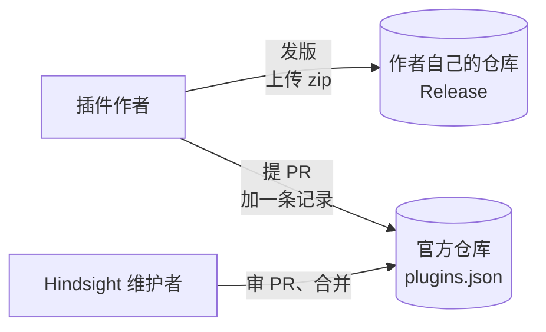
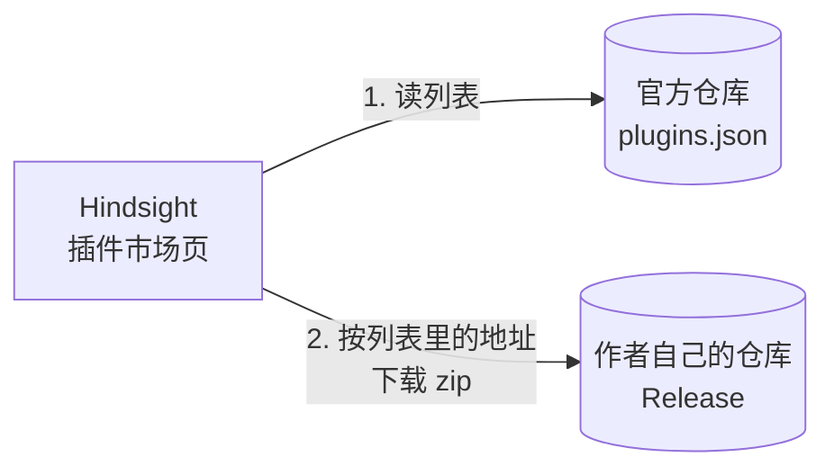

# 插件市场

总体见 [插件后端架构](plugins-architecture.md)。

**本文旨在设计**：插件从哪里来。包括三件事：

- 插件作者怎么上架；
- Hindsight 去哪找插件、从哪下载；
- 怎么保证下载到的文件没被改过、插件 id 不重复。

**上架**



**安装**



- 官方仓库只放列表文件 `plugins.json` 和插件图标 `icons/<id>.png`，不放插件的代码。zip 放在作者自己仓库的 Release 里。
- 市场页的图标从官方仓库读，不从作者的服务器读：否则一打开市场页，就会请求每个作者的服务器。装好以后用包里的 `icon.png`，审 PR 时确认两张是同一张图。
- 官方仓库单独建一个，不放进 Hindsight 主仓库：上架的 PR 不和应用代码混在一起，也不用跑主仓库的 CI。
- 插件 id 不重复，由审 PR 保证。
- 市场页只在用户打开时读一次列表，不在后台定时去拉。
- 读不到列表（断网、10 秒超时、格式不认识）时，「可下载」那一栏显示原因，「已安装」和本地 zip 两栏照常显示。

### 列表文件的格式

外面一层是格式版本；`plugins` 里每个插件一条记录，`versions` 里每个版本一条：

```json
{
  "format_version": 1,
  "plugins": [
    {
      "id": "hindsight-focus",
      "name": "专注",
      "author": "someone",
      "description": "离今天的目标还差多少，切到娱乐时提醒",
      "repo": "someone/hindsight-focus",
      "versions": [
        {
          "version": "0.2.0",
          "url": "https://github.com/someone/hindsight-focus/releases/download/0.2.0/hindsight-focus-0.2.0.zip",
          "sha256": "…",
          "permissions": ["stats.read", "stats.today", "focus.changed", "focus.category", "notifications"],
          "storage_mb": 10
        },
        {
          "version": "0.1.0",
          "url": "https://github.com/someone/hindsight-focus/releases/download/0.1.0/hindsight-focus-0.1.0.zip",
          "sha256": "…",
          "permissions": ["stats.read", "stats.today", "focus.changed", "focus.category"]
        }
      ]
    }
  ]
}
```

- `format_version` 是这个文件结构的版本。
- 同一个 `id` 的插件有新版本时，提 PR 在 `versions` 里加一条，旧版本可以选择保留。
- 每个版本自带 `permissions` 和 `storage_mb`，因为不同版本申请的可能不一样。`storage_mb` 是给插件自己的库申请的磁盘容量（MB），不用库的插件不写，上面的 0.1.0 就没写。市场页在下载前就把这个版本的权限和磁盘容量给用户看，用户同意的传给安装，存进 plugins 表（见 [① 插件安装](install.md)）。

## 市场页的三栏

| 栏 | 内容 | 数据从哪来 |
|---|---|---|
| 已安装 | 装了的插件。有新版本时显示「更新到 x」，旁边的下拉可以选线上的任一版本 | plugins 表，加上线上同 id 的版本 |
| 可下载 | 线上有、还没装的插件 | plugins.json |
| 本地 zip | `plugin-zips/` 里的包（见 [① 插件安装](install.md)） | 文件夹 |

- 「可下载」按 id 分：装了的插件不管线上有没有新版本，都不在「可下载」栏中。
- 「已安装」软件如果可更新，则显示在「已安装」里。
