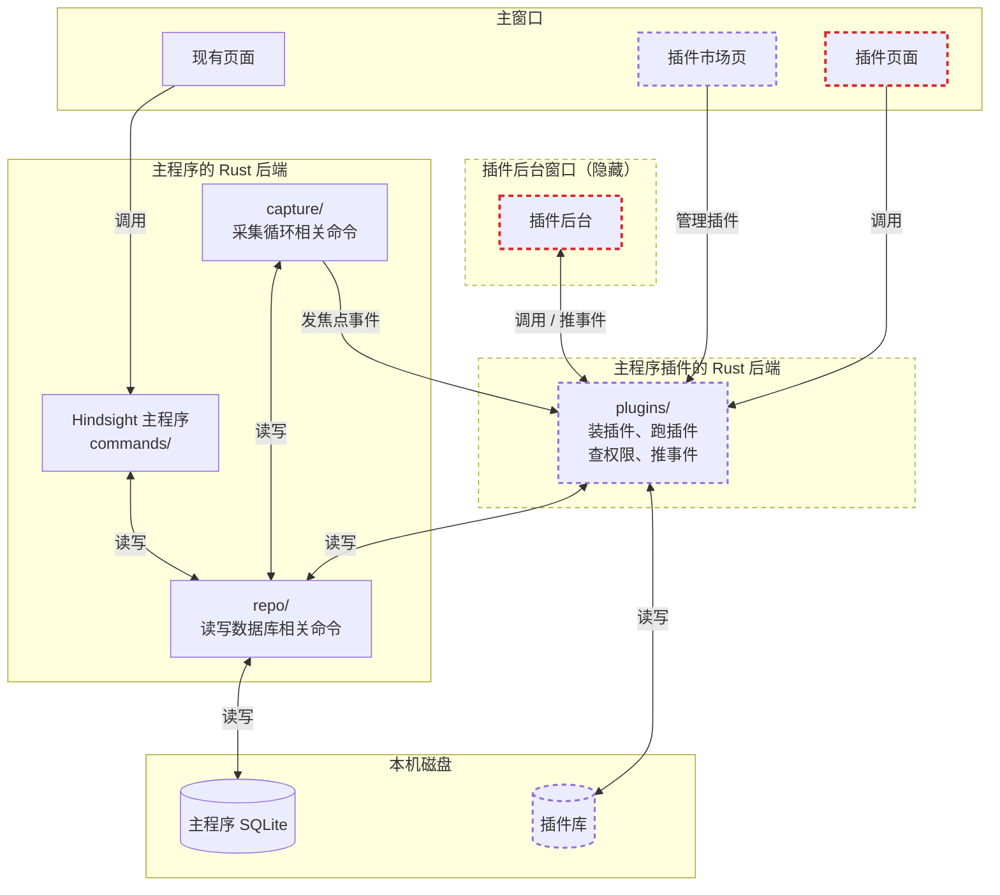
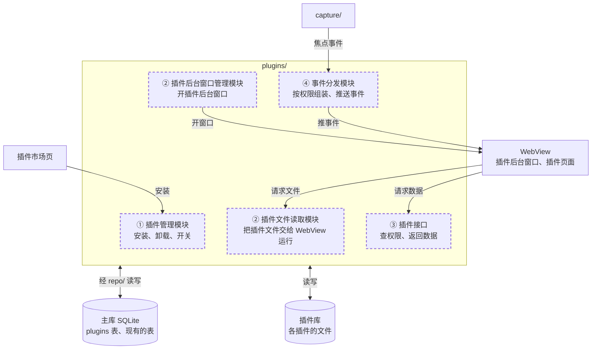
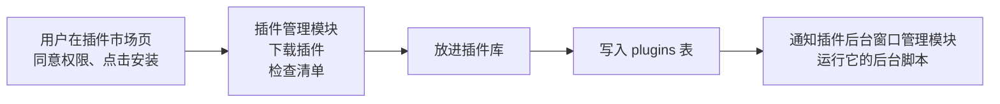
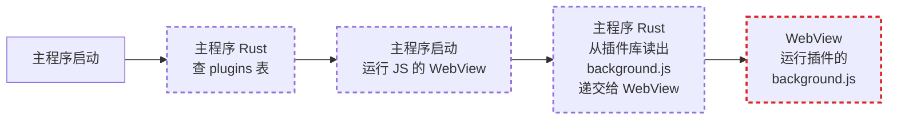
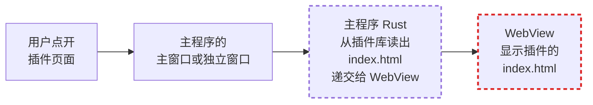
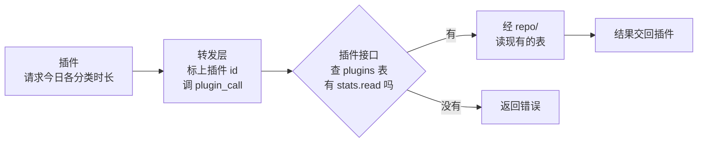
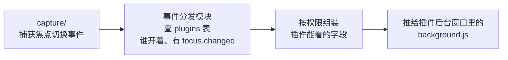

# 插件后端架构

本文档将以专注插件 `hindsight-focus` 为例。它有两个功能：

1. **显示进度**：在「专注」页显示离今天的目标还差多少。比如目标是工作 6 小时，页面显示还差几小时几分。
2. **切换提醒**：发现用户切到了别的窗口，比如娱乐类应用，就弹出通知。

---

## 1. 整体



- 虚线框：Hindsight 插件相关代码（未实现）
- 红色虚线框：用户设计的插件的代码
- 插件的后端代码放在一个新模块 `plugins/`。
- 插件代码只能调用 `plugins/`，调不到现有的 100 多个命令。
- `plugins/` 和现有代码只有两个接触点：
  - 通过 `repo/` 读写数据库；
  - 接收 `capture/` 发来的焦点事件。
- 现在 `chat/`、`memory/`、`sync/engine/pull.rs` 和两个命令文件也直接写 SQL。插件这边定一条规矩：`plugins/` 自己不写 SQL，都放进 `repo/plugins.rs`。

---

## 2. plugins/ 要干的四件事

**要解决的问题**：图 1 里的 `plugins/` 只是一个框。要定下两件事：后端拿到的插件长什么样；`plugins/` 里面分几块代码，每块管什么。每件事的细节见：[插件市场](market.md)、[① 插件安装](install.md)、[② 运行插件程序](runtime.md)、[③ 插件请求数据](api.md)、[④ 插件接收事件](events.md)、[插件的数据](data.md)、[插件权限](permissions.md)。

### 插件包的格式

一个插件对应一个文件夹，文件夹名就是插件 id（比如 `hindsight-focus`，插件作者起的名字，在插件市场里不能重复）：

```
<插件 id>/
├── manifest.json   清单：id、版本、要哪些权限、页面显示在哪、要不要在后台运行
├── ui/index.html   插件页面（图 1 的「插件页面」），显示在主窗口里或独立窗口里
└── background.js   后台脚本（图 1 的「插件后台」），在插件后台窗口里一直跑
```

- 页面和后台脚本都是第三方写的网页代码（HTML、JavaScript），后端只对其开放授权的 `plugins/` 中的 API 接口。
- 插件的权限由用户决定：`manifest.json` 只写插件申请什么，用户同意的记在主数据库的 plugins 表里（见 [插件的数据](data.md)）。

### plugins/ 的组成



### ① 插件安装以及权限申请

细节见 [① 插件安装](install.md)；插件从哪下载见 [插件市场](market.md)。



### ② 运行插件程序

细节见 [② 运行插件程序](runtime.md)。

插件装好以后，插件库里只有它的文件，还没有任何代码在运行。插件的代码有两段：

- 后台脚本 `background.js`：要一直跑，主窗口关了也不能停。
- 插件页面 `index.html`：用户点开时才显示。

这两段都是 JavaScript，要在 WebView（系统自带的网页内核）里运行，WebView 装在主程序开的窗口里。所以主程序要做两件事：开窗口，把插件库里的文件交给 WebView。负责的是主程序的两块 Rust 代码：插件后台窗口管理模块、插件文件读取模块。

**线 A：主程序启动时，运行后台脚本**

主窗口会被用户关掉，所以主程序另开一个不显示的窗口，专门运行各插件的后台脚本，叫插件后台窗口。窗口里每个插件一个 iframe，里面是 Hindsight 自带的启动器，由它把 `background.js` 放进一个单独的 Worker 线程运行：一个插件卡死，不会拖住别的插件（见 [② 运行插件程序](runtime.md)）。



**线 B：用户点开插件页面时，显示页面**

插件页面显示在主程序的主窗口或独立窗口里。



两条线里，WebView 都用 `hindsight-plugin://<插件 id>.localhost/<版本>/<文件>` 这种网址要文件。插件 id 和版本来自插件列表，插件列表由 plugins 表查出。插件文件读取模块不查表，只从插件库里这个版本的文件夹读出文件，交给 WebView；唯一的例外是启动器，它写在 Rust 里。

插件的代码运行以后，请求数据走 ③，接收事件走 ④。

### ③ 插件请求数据

细节见 [③ 插件请求数据](api.md)。



> 转发层：主程序自己的 JS，插件后台窗口和显示插件页面的窗口里各有一份。插件 id 由主程序决定。避免插件冒充别的其他插件而获取非法权限。
>
> stats.read: 读统计数据（各分类、各应用的使用时长），不含窗口标题和网址

### ④ 插件接收事件

细节见 [④ 插件接收事件](events.md)。



> focus.changed: 前台应用或浏览器网址变了、用户离开时收到事件，只带时间。收不收事件只看这一个权限
>
> focus.app: 事件里加上应用名
>
> focus.category: 事件里加上分类
>
> focus.title: 事件里加上窗口标题和网站域名

