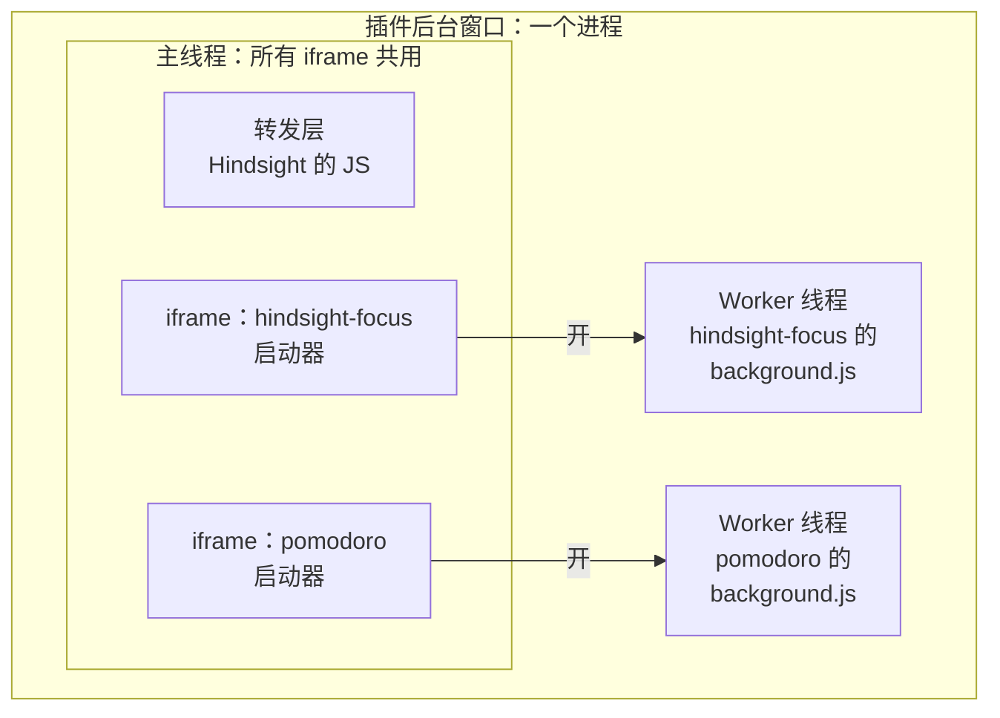
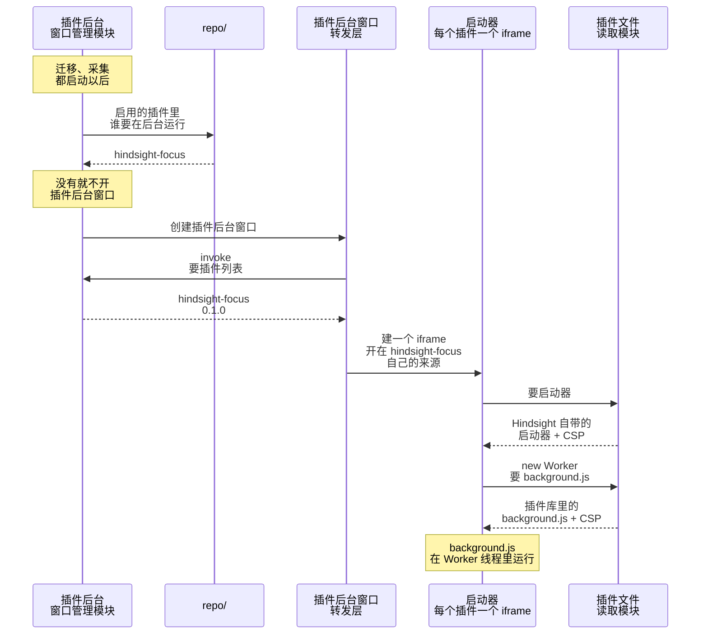
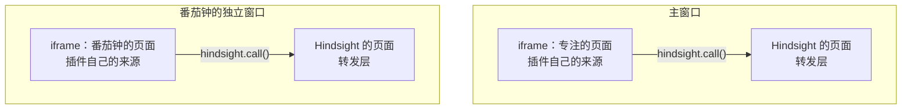

# ② 运行插件程序

总体见 [插件后端架构](plugins-architecture.md)。

**本文旨在设计**：装好的插件怎么运行起来。包括四件事：

- 主程序启动时，怎么开插件后台窗口，把要在后台运行的插件放进去；
- 一个插件卡死，怎么不拖住别的插件和主程序；
- 插件页面怎么显示在主窗口和独立窗口里；
- WebView 来要插件的文件时，插件文件读取模块怎么交出去。

## 插件后台窗口里有什么

- **每个插件一个 Worker**：所有 iframe 共用一条主线程，一个插件卡死，全部停。Worker 是单独的线程，卡死的那个可以单独结束。
- **每个插件一个 iframe**（页面里嵌的另一个页面）：Worker 只能用同来源的脚本开。iframe 开在插件自己的来源下，插件之间、插件和 Hindsight 的存储就是分开的，CSP 也用插件文件读取模块交出的那份。
- **插件的启动器由 Hindsight 提供**：它在共用的主线程上，所以不能放作者的代码。它只开 Worker、转发消息、结束 Worker。
- **心跳**：启动器每 10 秒 ping 一次 Worker，连续两次没回就结束它。插件后台是隐藏的，死循环时用户看不出是哪个插件在占 CPU。
- **不用一个插件一个窗口**：一个窗口一个进程，内存多好几倍；窗口的主页面还会被 Tauri 注入调用接口和密钥。

## 启动时

> 内容安全策略（CSP）：交出网页时附带的一条规则，告诉 WebView 这个页面能做什么、不能做什么，比如不许联网。插件的 JS 想把数据发到外面的网站，WebView 自己就会拦下来，请求发不出去。

## 插件页面

- **插件页面放在 Hindsight 页面里的 iframe 里**：iframe 开在插件自己的来源下，碰不到 Tauri 注入在 Hindsight 页面上的调用接口，存储也和 Hindsight 分开。请求交给外层的转发层，转发层按消息来自哪个 iframe 认出是哪个插件。
- **嵌进主窗口和放进独立窗口，是同一个插件页面**：只有外层不一样，作者不用写两套。

## 实现细节

- 一个后台插件都没有，就不开插件后台窗口，不用插件的用户不多占内存。
- 建窗口时把 `background_throttling` 设成 `Disabled`，否则窗口看不见时插件的定时器会停（Windows 上不支持，要另测）。
- 插件 id 放在主机名里，不同插件的网页来源不同。末尾加 `.localhost`：Windows 上网址会被改写成 `http://hindsight-plugin.hindsight-focus.localhost/…`，以 `.localhost` 结尾的才算安全上下文。
- 文件路径要限制在网址里那个版本文件夹（`<id>/<版本>/`）里，挡掉 `../` 这类往上跳的路径。
- 插件后台用到四个文件，网址都在 `hindsight-plugin://<插件 id>.localhost/<版本>/` 下：
  - Hindsight 写的三个写在 Rust 里，插件文件读取模块看到这三个名字直接返回，不读插件库：
    1. `_launcher.html`、`_launcher.js`：启动器，（CSP 不许内联脚本，所以分成两个文件）。
    2. `_worker.js`：定义 `hindsight.call()`，再加载 `background.js`。
  - `background.js`：插件作者写的脚本。
- 插件文件读取模块用 Tauri 的自定义协议实现，在应用启动时注册一次，和 `lib.rs` 里现有的 `.plugin(...)` 注册放在一起。
