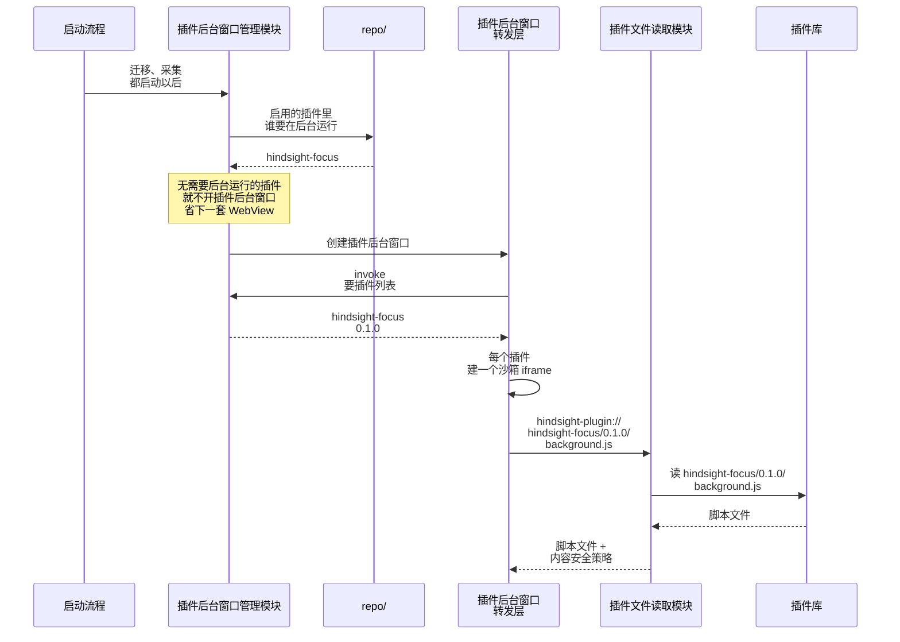

# ② 运行插件程序

总体见 [插件后端架构](plugins-architecture.md)。

**本文旨在设计**：装好的插件怎么运行起来。包括三件事：

- 主程序启动时，怎么开插件后台窗口，把要在后台运行的插件放进去；
- WebView 来要插件的文件时，插件文件读取模块怎么交出去；
- 启动时怎么清理安装中途留下的残留。

> 内容安全策略（CSP）：交出网页时附带的一条规则，告诉 WebView 这个页面能做什么、不能做什么，比如不许联网。插件的 JS 想把数据发到外面的网站，WebView 自己就会拦下来，请求发不出去。

## 实现细节

- 启动时顺便清理 [① 插件安装](install.md) 中途崩溃留下的残留，删掉：
  - 解压时崩了留下的临时目录 `.tmp-xxxx/`；
  - 插件库里有、表里没有的插件文件夹；
  - 表里有这个插件，但不是表里那个版本的文件夹（更新时留下的旧版本或没切过去的新版本）。
- 一个后台插件都没有，就不开插件后台窗口，不用插件的用户不多占内存。
- 建窗口时把 `background_throttling` 设成 `Disabled`，否则窗口看不见时插件的定时器会停（Windows 上不支持，要另测）。
- 文件路径要限制在网址里那个版本文件夹（`<id>/<版本>/`）里，挡掉 `../` 这类往上跳的路径。
- 插件文件读取模块用 Tauri 的自定义协议实现，在应用启动时注册一次，和 `lib.rs` 里现有的 `.plugin(...)` 注册放在一起。
