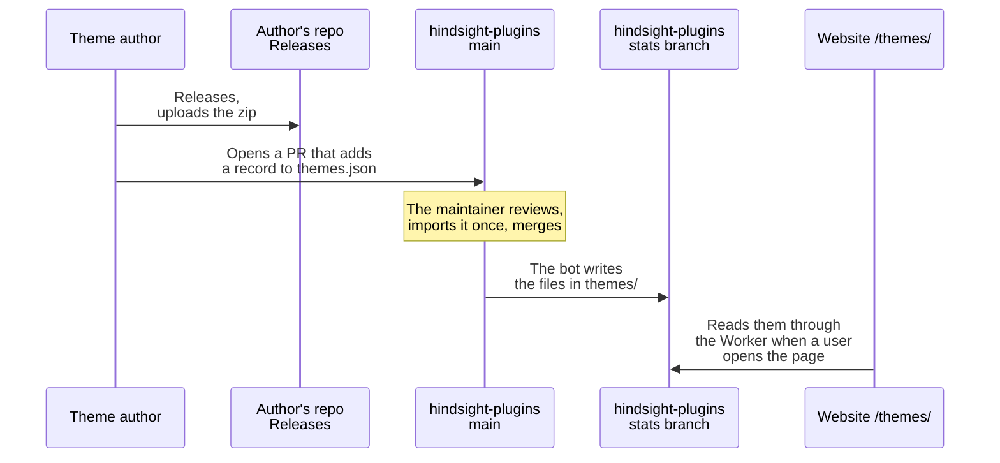

# Theme market

The format of theme files: [Hindsight themes](../README.md).

**This doc designs**: where the themes on `/themes/` of the website come from, and the fields of each file.



- The zip that is reviewed, the one that is shown and the one that is downloaded are the same zip. sha256 makes sure of this: if the author replaces the zip in the release, its sha256 no longer matches, and the website stops showing the theme.
- Each theme has three buttons:
  - "Preview" opens the demo on the website with this theme. You can click in it and change pages.
  - "Homepage" opens the author's own website.
  - "Download" opens the release page of the reviewed version.

  We do not control the author's website, so a file you download there may not be the reviewed zip. This is why Download is a separate button.

## themes.json

It is in the main branch of hindsight-plugins. Authors change it with a PR.

```json
{
  "format_version": 1,
  "themes": [
    {
      "id": "harbor",
      "repo": "someone/hindsight-harbor",
      "homepage": "https://someone.github.io/harbor/",
      "versions": [
        {
          "version": "1.1.0",
          "url": "https://github.com/someone/hindsight-harbor/releases/download/1.1.0/harbor-1.1.0.zip",
          "sha256": "…"
        },
        {
          "version": "1.0.0",
          "url": "https://github.com/someone/hindsight-harbor/releases/download/1.0.0/harbor-1.0.0.zip",
          "sha256": "…"
        }
      ]
    }
  ]
}
```

| Field | What it is |
|---|---|
| `format_version` | The version of this file's structure. It is `1` |
| `id` | The same as `id` in theme.json in the zip. It cannot be `index`, because the file would have the same name as `index.json` |
| `repo` | The author's repository, `owner/repo` |
| `homepage` | Optional. The author's own website. It must be an https address. Without it, it is `https://github.com/<repo>` |
| `versions` | One record per version, the newest first. The website shows only the first. Keep the old versions: their downloads are counted too |
| `version` | The same as `version` in theme.json |
| `url` | The download address of the zip. It must be a release file of the repository in `repo` on GitHub |
| `sha256` | The sha256 of the zip |

The name, author and description are not in this file. They come from theme.json in the zip, so they are written in one place only.

## Files in the zip

```
harbor-1.0.0.zip
└── harbor/
    ├── theme.json
    └── theme.css      optional
```

The folder name is the id. After unzipping, the user can choose `harbor/theme.json` in "Import theme", or copy the whole `harbor/` folder into the themes folder. The zip can have other files, and the website does not read them. The zip can be at most 5 MB.

## themes/ in the stats branch

The bot writes these files. Do not edit them by hand. The website reads the two kinds of files here through `/themes/data/` of the Worker.

### themes/index.json

For the list page.

```json
{
  "format_version": 1,
  "themes": [
    {
      "id": "harbor",
      "name": "Harbor",
      "author": "someone",
      "description": { "en": "Slate blue on cool grey.", "zh-CN": "冷灰底色，石板蓝点缀。" },
      "version": "1.1.0",
      "layout": "card",
      "mode": "light",
      "tokens": { "--color-accent": "#3b6e8f" },
      "repo": "someone/hindsight-harbor",
      "homepage": "https://someone.github.io/harbor/",
      "release_url": "https://github.com/someone/hindsight-harbor/releases/tag/1.1.0",
      "sha256": "…",
      "downloads": 7
    }
  ]
}
```

| Field | Where it comes from |
|---|---|
| `id`, `repo` | themes.json |
| `homepage` | `homepage` in themes.json. Without it, `https://github.com/<repo>`. Homepage opens this address |
| `name`, `author`, `description`, `version`, `layout`, `mode` | theme.json in the zip of the first version. Without `author` it is an empty string, and without `description` it is `{}`. `layout` is `card` and `mode` is `light` by default |
| `tokens` | `tokens` in theme.json. Only the public variables are kept, as when the app uses the theme |
| `release_url` | The release page of the first version. Download opens this address |
| `sha256` | The sha256 of the first version |
| `downloads` | The downloads of the zips of all versions, added up |

Themes with more `downloads` come first. Themes with the same count keep the order of themes.json.

### themes/\<id\>.json

For the preview. The format is `CustomTheme`, which the app uses to apply a custom theme. The demo applies it as it is:

```json
{
  "id": "harbor",
  "layout": "card",
  "mode": "light",
  "tokens": { "--color-accent": "#3b6e8f" },
  "css": "[data-part=\"card\"] { border: 1px solid var(--border-default); }"
}
```

`css` is the whole theme.css. Without theme.css it is `null`.

## When the files change

- The bot runs once a day. It also runs when a change to themes.json is pushed to main. A merged PR shows on the website within 10 minutes.
- In these cases, a theme is not in index.json. The reason is a warning in Actions:
  - The sha256 of the zip in the release is not the one in themes.json.
  - `url` is not a release file of `repo` on GitHub.
  - `homepage` is not an https address.
  - The zip has no `<id>/theme.json`, or `id` or `version` in theme.json is not the same as in themes.json.
  - theme.json is larger than 64 KB, or theme.css is larger than 512 KB.
- If the bot cannot read any repository (most likely the network is down), it writes nothing. The website keeps showing the last files.
- The bot checks only the fields the website needs. The full check is at PR review: import the zip into Hindsight once.
