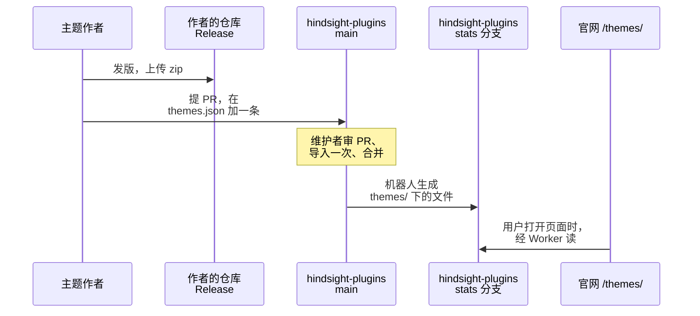

# 主题市场

主题文件的格式见 [Hindsight themes](../README.md)。

**本文旨在设计**：官网 `/themes/` 上的主题从哪里来，每个文件有哪些字段。



- 审、显示、下载的是同一个 zip，靠 sha256 保证：作者换了 Release 里的 zip，sha256 就对不上，网站不再显示这个主题。
- 每个主题有三个按钮：「预览」在官网上打开套着这个主题的 demo，可以点、可以换页；「主页」跳到作者自己的网站；「下载」跳到审过的那个版本的 Release 页面。作者的主页不归我们管，上面下载的不一定是审过的 zip，所以下载要另留一个入口。

## themes.json

放在 hindsight-plugins 的 main 分支，作者提 PR 修改。

```json
{
  "format_version": 1,
  "themes": [
    {
      "id": "harbor",
      "repo": "someone/hindsight-harbor",
      "homepage": "https://someone.github.io/harbor/",
      "versions": [
        {
          "version": "1.1.0",
          "url": "https://github.com/someone/hindsight-harbor/releases/download/1.1.0/harbor-1.1.0.zip",
          "sha256": "…"
        },
        {
          "version": "1.0.0",
          "url": "https://github.com/someone/hindsight-harbor/releases/download/1.0.0/harbor-1.0.0.zip",
          "sha256": "…"
        }
      ]
    }
  ]
}
```

| 字段 | 说明 |
|---|---|
| `format_version` | 这个文件结构的版本，现在是 `1` |
| `id` | 和 zip 里 theme.json 的 `id` 一样。不能叫 `index`，会和 `index.json` 撞名 |
| `repo` | 作者的仓库，`owner/repo` |
| `homepage` | 可以不写。作者自己的网站，必须是 https 地址；不写时用 `https://github.com/<repo>` |
| `versions` | 每个版本一条，新版本在前。网站只显示第一个；旧版本留着，它们的下载次数也算进去 |
| `version` | 和 theme.json 的 `version` 一样 |
| `url` | zip 的下载地址，必须是 `repo` 这个仓库的 GitHub Release 文件 |
| `sha256` | zip 的 sha256 |

名称、作者、简介不写在这里，从 zip 里的 theme.json 读，免得两处写的不一样。

## zip 里的文件

```
harbor-1.0.0.zip
└── harbor/
    ├── theme.json
    └── theme.css      可以没有
```

文件夹名就是 id。用户解压后，可以「导入主题」选 `harbor/theme.json`，也可以把 `harbor/` 整个拷进主题文件夹。zip 里可以有别的文件，网站不读；整个 zip 最大 5 MB。

## stats 分支的 themes/

机器人生成，不要手改。官网经 Worker 的 `/themes/data/` 读这里的两种文件。

### themes/index.json

列表页用。

```json
{
  "format_version": 1,
  "themes": [
    {
      "id": "harbor",
      "name": "Harbor",
      "author": "someone",
      "description": { "en": "Slate blue on cool grey.", "zh-CN": "冷灰底色，石板蓝点缀。" },
      "version": "1.1.0",
      "layout": "card",
      "mode": "light",
      "tokens": { "--color-accent": "#3b6e8f" },
      "repo": "someone/hindsight-harbor",
      "homepage": "https://someone.github.io/harbor/",
      "release_url": "https://github.com/someone/hindsight-harbor/releases/tag/1.1.0",
      "sha256": "…",
      "downloads": 7
    }
  ]
}
```

| 字段 | 从哪来 |
|---|---|
| `id`、`repo` | themes.json |
| `homepage` | themes.json 的 `homepage`；没写时是 `https://github.com/<repo>`。「主页」跳到这里 |
| `name`、`author`、`description`、`version`、`layout`、`mode` | 第一个版本 zip 里的 theme.json。没写 `author` 时是空串，没写 `description` 时是 `{}`，`layout` 默认 `card`，`mode` 默认 `light` |
| `tokens` | theme.json 的 `tokens`，只留公开变量，和应用套用时一样 |
| `release_url` | 第一个版本的 Release 页面。「下载」跳到这里 |
| `sha256` | 第一个版本的 sha256 |
| `downloads` | 所有版本的 zip 的下载次数加起来 |

按 `downloads` 从多到少排，一样多的保持 themes.json 的顺序。

### themes/\<id\>.json

预览用。格式就是应用里套用自定义主题用的 `CustomTheme`，demo 直接拿去套用：

```json
{
  "id": "harbor",
  "layout": "card",
  "mode": "light",
  "tokens": { "--color-accent": "#3b6e8f" },
  "css": "[data-part=\"card\"] { border: 1px solid var(--border-default); }"
}
```

`css` 是 theme.css 的全文，没有 theme.css 时是 `null`。

## 什么时候更新

- 机器人每天跑一次；themes.json 有改动推到 main 时也跑。合并 PR 后 10 分钟内，网站能看到。
- 下面几种情况，主题不出现在 index.json 里，原因写在 Actions 的警告里：
  - Release 里 zip 的 sha256 和 themes.json 的不一样；
  - `url` 不是 `repo` 的 GitHub Release 文件；
  - `homepage` 不是 https 地址；
  - zip 里没有 `<id>/theme.json`，或者 theme.json 的 `id`、`version` 和 themes.json 的不一样；
  - theme.json 超过 64 KB，或者 theme.css 超过 512 KB。
- 一个仓库都读不到时（多半是网络断了），机器人什么都不写，网站继续显示上一次的。
- 机器人只查网站显示要用的字段。完整的检查在审 PR 时做：用 Hindsight 导入一次这个 zip。
