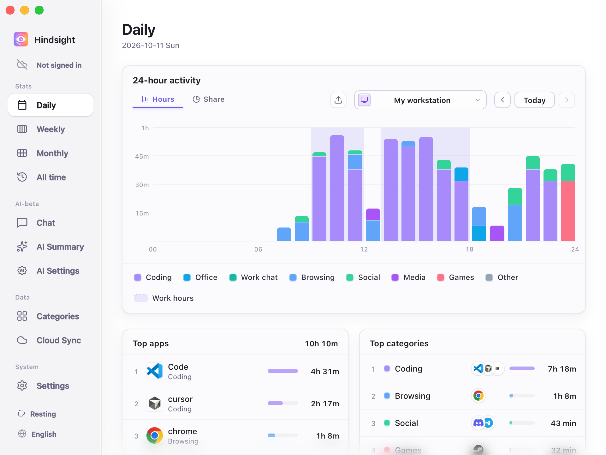
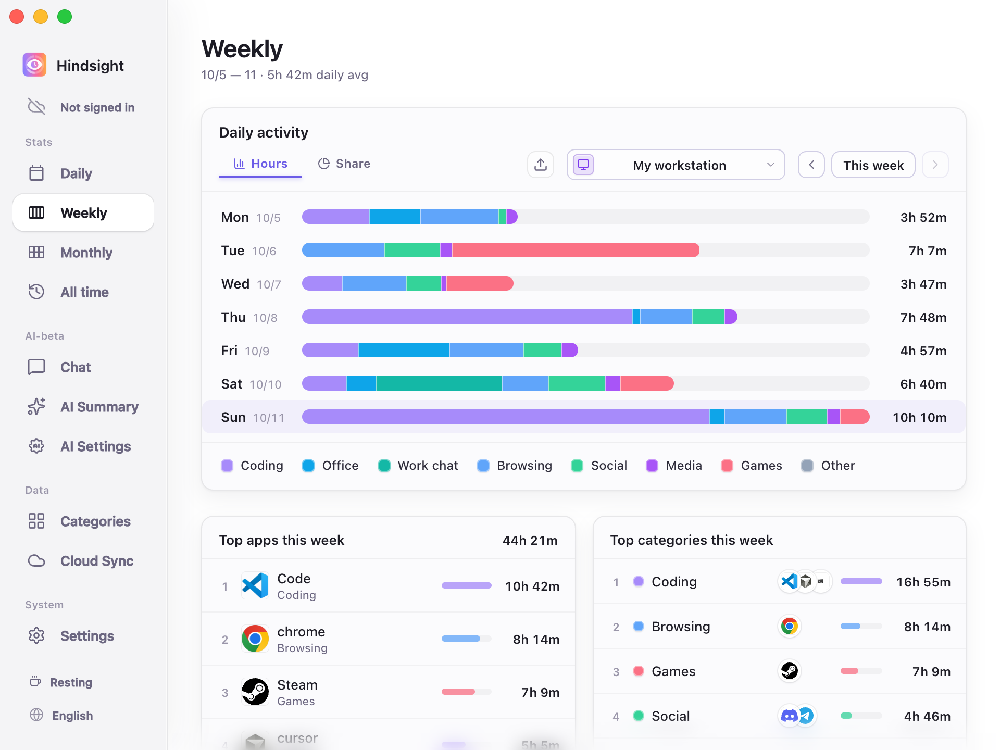
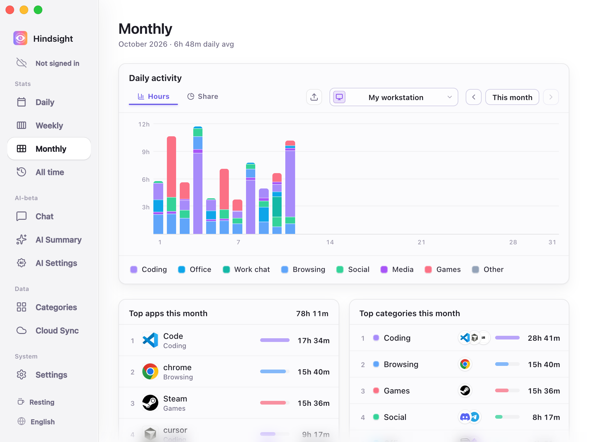
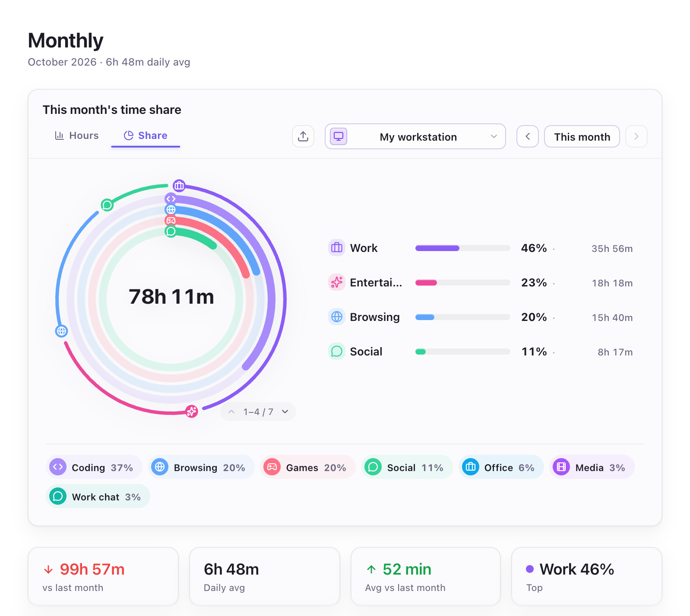
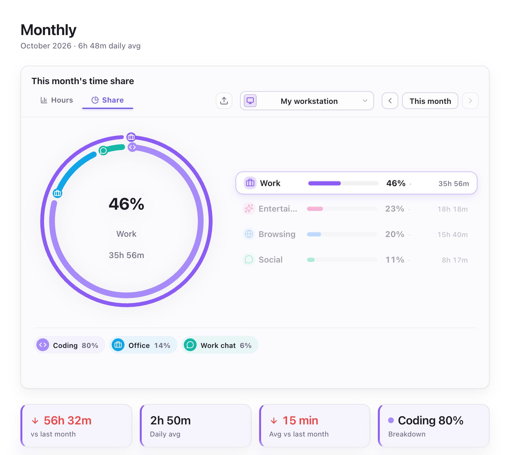
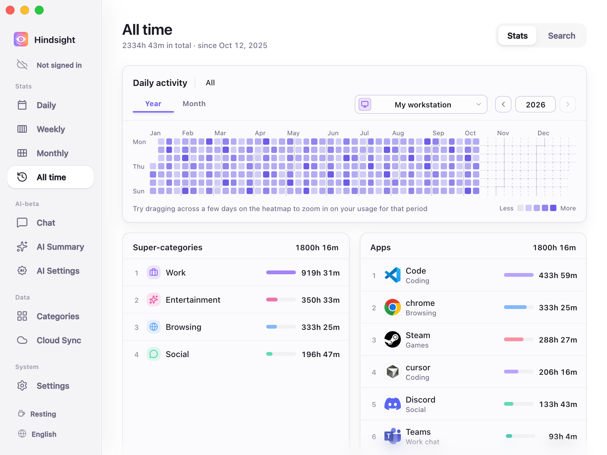
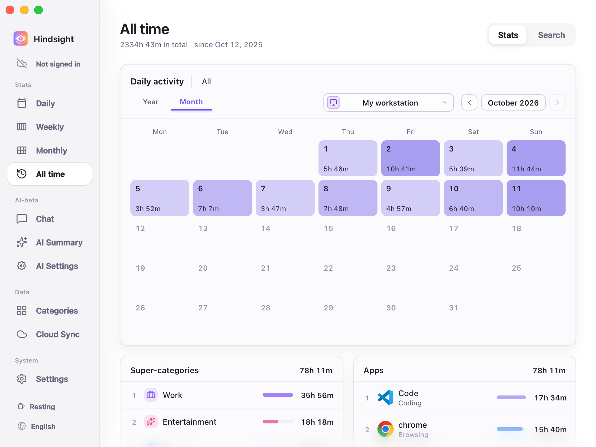

# Activity Recording and Statistics

- [Overview](#overview)
- [Statistics](#statistics)
  - [Daily](#daily)
  - [Weekly](#weekly)
  - [Monthly](#monthly)
  - [All time](#all-time)
- [Activity Capture](#activity-capture)
- [Defaults](#defaults)

## Overview

Hindsight automatically records foreground activity and time spent, with daily, weekly, monthly, and historical statistics. Basic time tracking works without screenshots; screenshots and OCR are optional.

## Statistics

### Daily

    
     
    Daily (Hours view)

### Weekly

    
     
    Weekly (Hours view)

### Monthly

    
     
    Monthly (Hours view)

    
     
    Monthly (category shares and statistics)

> The outer ring shows super-category shares (such as “Work”, “Entertainment”, “Browsing”, and “Social”). The inner ring shows category shares (such as “Coding”, “Office”, and “Work chat” under “Work”).

    
     
    Monthly (Share view — Selected super-category)

> Selecting a super-category narrows the ring and the labels below to its breakdown. Here, “Work” is selected: Coding accounts for 82%, Office for 11%, and Work chat for 7%.
> The four cards below show, from left to right: the change in work time from last month (-60h 42m), average daily work time this month (2h 48m), the change in that daily average from last month (-19m), and the largest category within Work (Coding, at 82%).

### All time

The yearly heatmap shows long-term activity patterns, while the monthly calendar shows time spent each day. You can also view statistics for a specific date range or review an individual app's history.

    
     
    All time (Year view)

> Darker cells indicate more time spent that day. Drag across the heatmap to zoom into a date range. Selecting a day updates the super-category and app rankings below to show only that day.

    
     
    All time (Month view)

## Activity Capture

- **Activity recording:** Records the focused foreground app and time spent in it.
- **Idle timeout:** Stops counting time after 3 minutes of keyboard and mouse inactivity by default.
- **Work hours:** When enabled, captures activity only during the configured hours. Outside those hours, the sidebar shows “Resting” and activity capture stops.
- **Capture control:** Click “Stop capture” in the sidebar to stop activity capture; click again to resume.
- **Website domains:** Enabled by default to record and categorize visited websites. For example, YouTube visits can be assigned to a “Video” category.
- **Multiple devices:** Each device records its own activity. After syncing, you can view all devices together or a single device.

## Defaults

| Setting | Default | Description |
| --- | --- | --- |
| Enable capture | On | - |
| Capture interval | 30 seconds | - |
| Idle timeout | 3 minutes | - |
| Enable work hours | Off | When enabled, records activity only during the configured hours |
| Record website domains | On (subject to browser support, permissions, and privacy settings) | - |
| Enable screenshots | Off | - |
| Screenshot retention | 7 days | Screenshots are automatically deleted after this period to save storage space |
