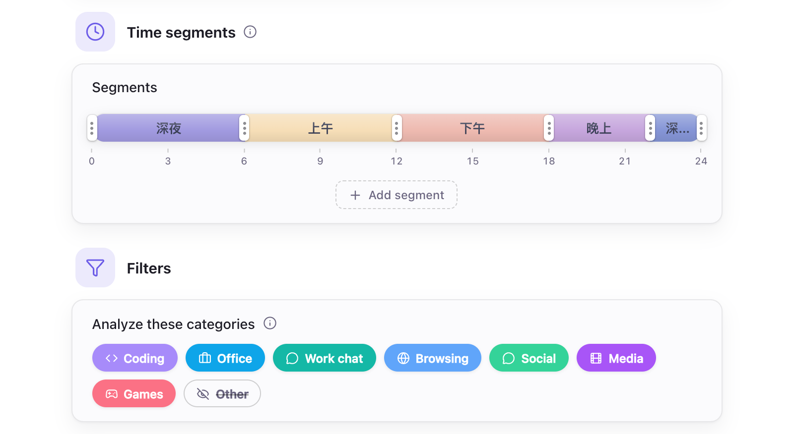

# AI Configuration

- [Overview](#overview)
- [Local Models](#local-models)
- [Cloud API](#cloud-api)
- [Summary Report Settings](#summary-report-settings)
- [Defaults](#defaults)

## Overview

Configure local models or a cloud API to use generative large language models for summaries and Chat.

## Local Models

Local models run on your computer. Hindsight helps configure them for your hardware:

1. **Automatically matched engine**: Download the engine in “AI Settings → Engine”. Hindsight detects your hardware, such as Mac Metal or NVIDIA CUDA, and downloads the best-matched accelerated engine without manual driver installation.
2. **Download recommended models**: In “AI Settings → Models”, download a recommended model that suits your needs.
3. **Apply optimal parameters**: Hindsight uses your available video memory to calculate stable settings automatically.

Choose from the preset model list, import your own GGUF files, or enter a Hugging Face repository URL to download a model. Engines and models use official download sources by default; you can switch to a mirror if access is difficult.

## Cloud API

Switch to a cloud service if your device cannot run a local model, or if you need a more capable model.

- **Provider**: Supports OpenAI-compatible APIs, with presets for OpenAI, DeepSeek, Kimi (Moonshot), OpenRouter, Together, and Groq. You can also enter another compatible service's URL.

Cloud services receive text only; screenshot images are not uploaded.

> **Protect your personal information**: Sent text includes app names, window titles, your activity timeline, and the information in “About you”. Chat also sends your questions and screen text recognized by OCR. This may contain sensitive personal information. We recommend configuring [Privacy Settings](./privacy-setting.md) first and using only API providers you trust.

## Summary Report Settings

Hindsight uses these settings to generate summary reports.

    
     
    AI Settings → General

- **Time segments**: Divide the day into segments for AI to summarize separately.
- **Analyze these categories**: Choose which app categories to include in reports.
- **About you**: Optional information about your work to help tailor summaries.
- **System prompt**: Guides the style and content of AI reports; customize it as needed.

## Defaults

| Setting | Default | Description |
| --- | --- | --- |
| Local AI engine | Not installed | Download in “AI Settings → Engine”; about 16–605 MB depending on your system and graphics hardware |
| Download source | Official sources | Downloads from Hugging Face and GitHub; switch to a mirror in “AI Settings → Engine” if access is difficult |
| AI memory usage | Released after 2 minutes idle | Stops automatically about 2 minutes after tasks finish and the engine becomes idle, freeing RAM and video memory |
| Time segments | 5 segments | 00:00–06:00, 06:00–09:00, 09:00–12:00, 12:00–18:00, 18:00–24:00; editable |
| Analyze these categories | All except “Other” | Reports use only apps in these categories. Apps in “Other”, including unassigned apps, are omitted; adjust this in “AI Settings → General → Filters” |
