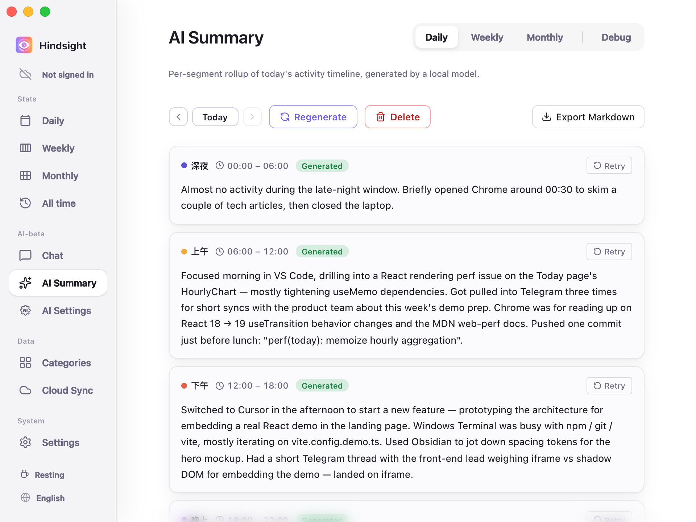
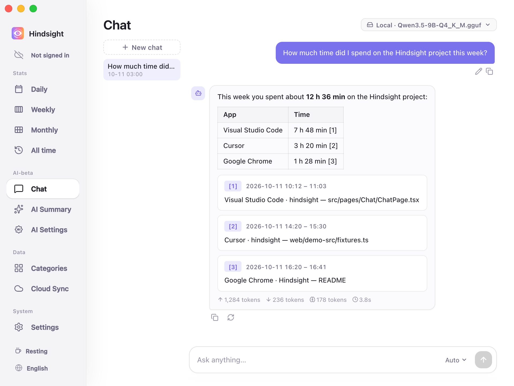

# AI Summaries and Chat

- [Overview](#overview)
- [Summary Reports](#summary-reports)
- [Chat](#chat)
- [Models](#models)
- [Defaults](#defaults)

## Overview

AI can summarize your activity over a period into a text report, or answer questions based on your activity records.

## Summary Reports

“AI Summary” turns activity records into text reports.

    
     
    AI Summary → Daily

Currently supported:

- **Daily**: Organizes a day's activity into configured time segments. Reports can be exported as Markdown.
- **Weekly**: Generates a report summarizing a week's activity.

> “Monthly” is still in development and cannot generate reports yet.

## Chat

Use natural language on the “Chat” page to query your records, such as “How much time did I spend on the Hindsight project this week?” or “How much time did I spend browsing YouTube this week?”.

    
     
    AI Chat

AI answers based on your activity records and provides links so you can check its sources.

## Models

Summaries and Chat each have their own model selection, either local or cloud:

- **Local models**: Run on your computer; all content stays on your device.
- **Cloud API**: Supports OpenAI-compatible APIs, with presets for OpenAI, DeepSeek, Kimi (Moonshot), OpenRouter, Together, and Groq. You can also enter another compatible service's URL.

See [AI Configuration](./ai-configuration.md) for setup details.

## Defaults

| Setting | Default | Description |
| --- | --- | --- |
| Auto summary | Off | When enabled, generates the current day's Daily report at 23:00 by default, and fills in missing daily reports and the previous week's weekly report |
| Enable cloud API | Off | Uses local models by default; cloud services require configuration |
