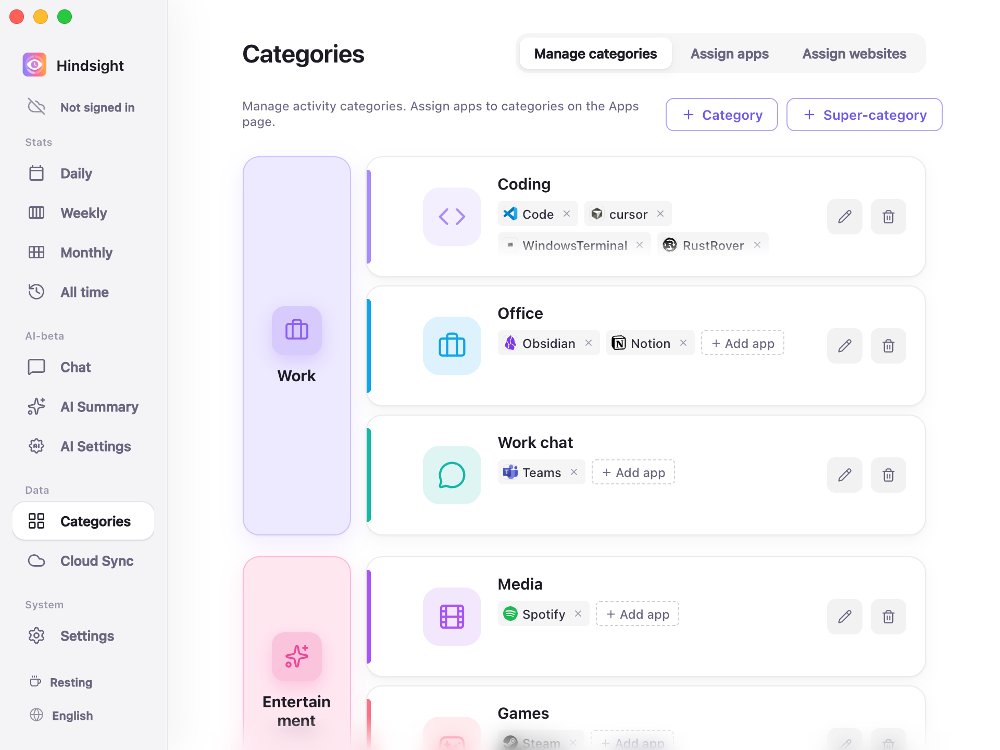
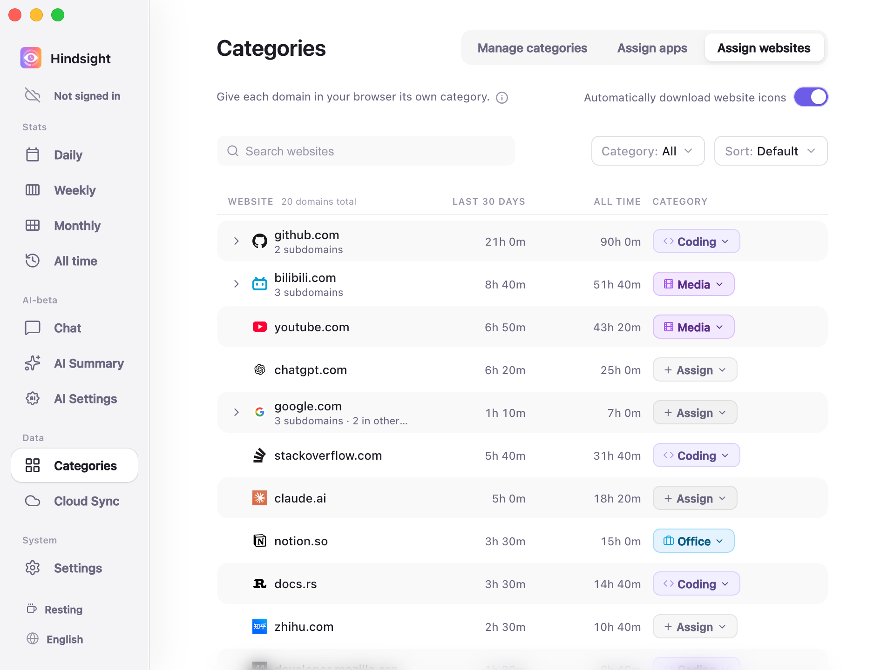
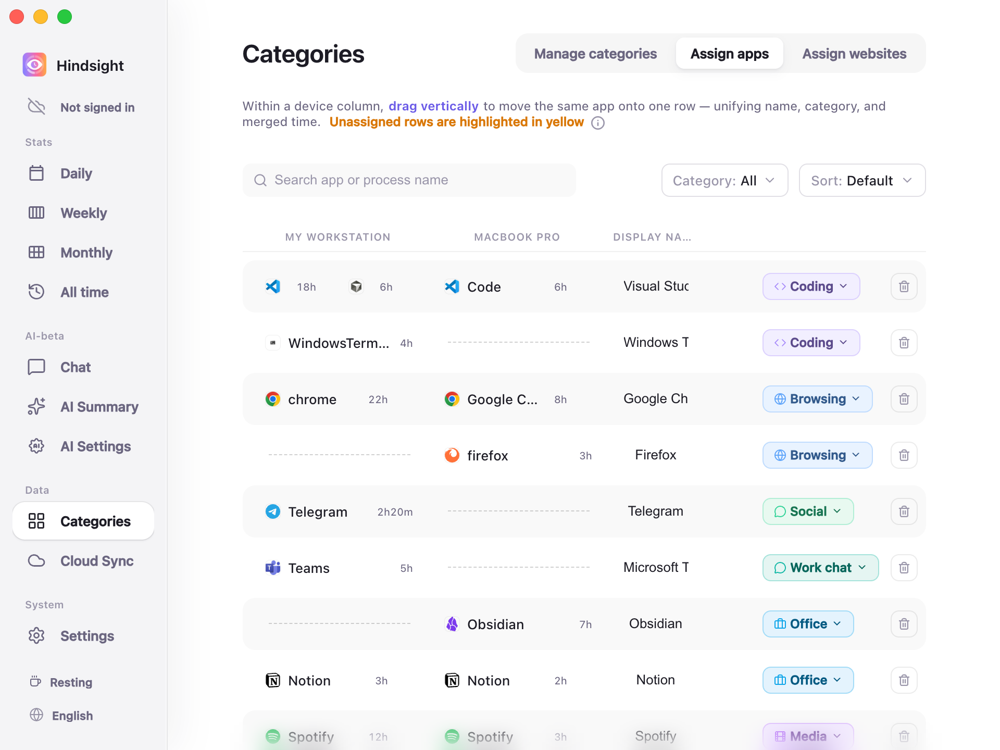

# Categories and App Management

- [Overview](#overview)
- [Super-categories, Categories, and Apps](#super-categories-categories-and-apps)
- [Assign websites](#assign-websites)
- [Assign apps and Merge Across Devices](#assign-apps-and-merge-across-devices)
- [Defaults](#defaults)

## Overview

Hindsight organizes your computer usage into three levels: super-categories, categories, and apps. Assign categories to websites and apps to group their usage time.

## Super-categories, Categories, and Apps

Hindsight organizes and summarizes your time at three levels:

- **Super-category**: A broad area of life or work, such as “Work” or “Entertainment”.
- **Category**: A specific activity type, such as Coding, Office, Social, or Games. Each category belongs to a super-category and groups app usage in statistics.
- **App**: A program you use on your computer, such as WeChat, Chrome, or PowerPoint. Each app belongs to a category.

> **Example**: App ➡️ Category ➡️ Super-category. PowerPoint belongs to “Office”, which contributes to the “Work” super-category.

    
     
    Categories → Manage categories

> The left column lists super-categories, such as “Work” and “Entertainment”. Each row on the right is a category within the selected super-category, such as “Coding”, “Office”, or “Work chat”. The chips in each row are its apps, such as Code and Cursor under Coding.

A set of super-categories and categories is ready to use. You can add, delete, rename, or drag them to change their grouping. Some common apps are also assigned categories in advance to help you get started.

## Assign websites

Browsers serve many different purposes. Assigning the entire browser to “Browsing” mixes time spent researching on GitHub with time spent watching videos on Bilibili.

“Assign websites” lets you assign a category to each domain within a browser.

    
     
    Assign websites

## Assign apps and Merge Across Devices

All recorded apps appear here automatically. Assign a category to each app, or combine usage of the same app across devices.

    
     
    Assign apps

- **Assign categories**: Click the category chip on the right to assign a category. Unassigned apps have a yellow background.
- **Merge across devices by dragging**: The same app may have different names on different systems, such as `chrome.exe` on Windows and `Google Chrome` on macOS. **Drag vertically** in the list to pair them on the same row, with a shared name and combined usage time.
- **Hide and clean up**: Assign background apps you do not want included in statistics to “Hidden” to exclude them from reports.

## Defaults

| Setting | Default | Description |
| --- | --- | --- |
| Preset super-categories | Work, Entertainment, Social, Browsing | - |
| Preset categories | Coding, Office, Work chat (under Work); Games, Media (under Entertainment); Social (under Social); Browsing (under Browsing); Design, Other (not in any super-category) | Apps in the special “Hidden” category are excluded from statistics |
| Automatic categorization of common apps | On | Includes mappings for about 370 common process names, such as Chrome → Browsing, VS Code → Coding, Steam → Games, Spotify → Media, Word → Office |
| Unassigned apps | Counted as “Other” | Highlighted in yellow on “Assign apps”; this page shows only unassigned apps by default |
| Merging across devices | Common apps merge automatically | Includes name mappings across systems for 32 common apps. For example, Windows's `chrome.exe` and macOS's `Google Chrome` appear on the same row automatically; other apps can be paired by dragging |
| Automatically download website icons | Off | Shows a default globe icon when off; downloads each website's actual icon, such as GitHub's or YouTube's logo, only when enabled |

