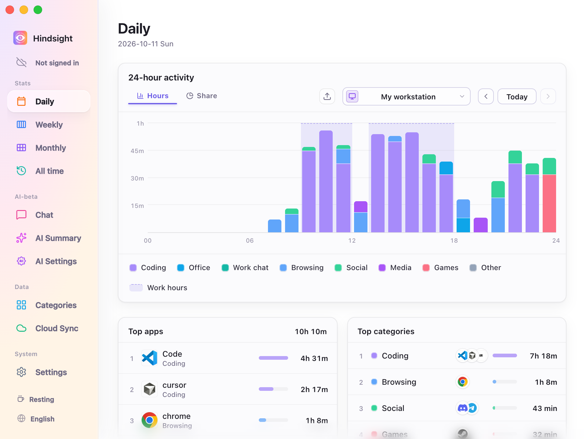
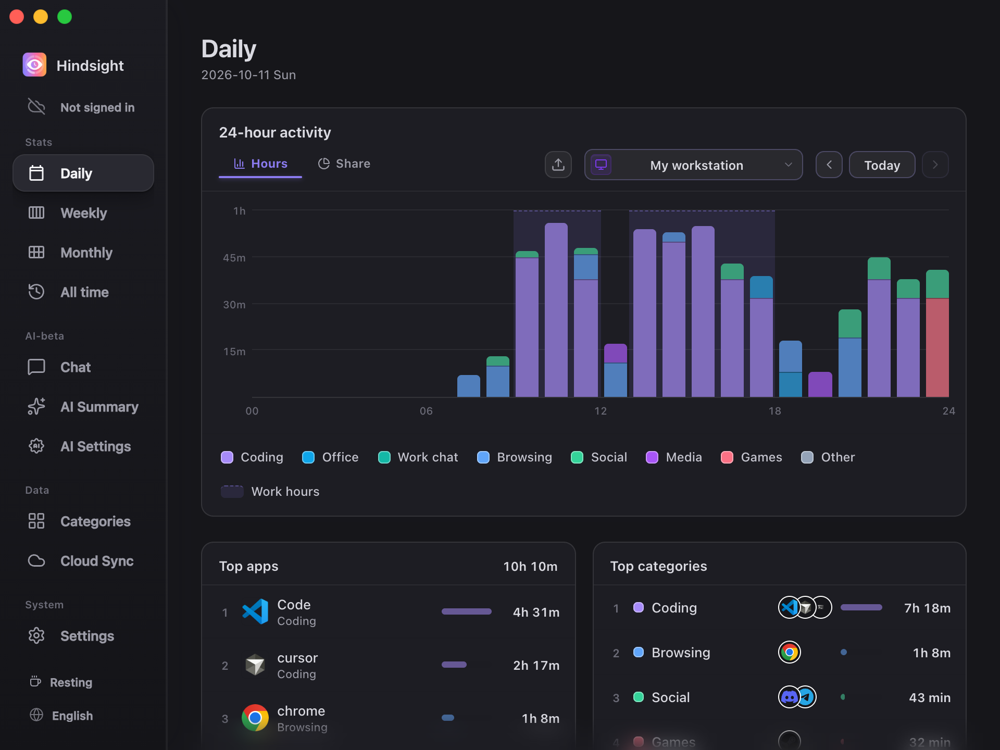

# Interface and Appearance

- [Overview](#overview)
- [Interface Language](#interface-language)
- [Themes](#themes)
- [Startup and Closing](#startup-and-closing)
- [Defaults](#defaults)

## Overview

Change the interface language and theme, choose whether Hindsight launches on system startup, and decide whether it keeps running in the background when you close the window.

## Interface Language

Supports 简体中文, 繁體中文, English, 日本語, Português, and Español. Change the language in “Settings → General”, or cycle through languages with the button at the bottom of the sidebar. Changes take effect immediately.

Changing the interface language also changes the prompt language used for AI summaries.

## Themes

Hindsight offers three themes: Default, Minimal, and Dark.

<table align="center">
  <tr>
    <td align="center"> Default</td>
    <td align="center"> Minimal</td>
    <td align="center"> Dark</td>
  </tr>
</table>

## Startup and Closing

- **Launch on system startup**: Runs Hindsight automatically after you log in and starts recording.
- **Silent startup**: When enabled, Hindsight runs in the background on system startup without showing the main window.
- **Minimize to tray on close**: When enabled, the close button hides the window while Hindsight keeps recording in the background. Use the tray icon to reopen or quit it.

## Defaults

| Setting | Default | Description |
| --- | --- | --- |
| Interface language | Follows the system | Uses Chinese, Japanese, Portuguese, or Spanish for the corresponding system language; English for other system languages |
| Theme | Minimal | - |
| Launch on system startup | Off | - |
| Closing the window | Minimizes to tray | Keeps recording in the background |
| Check for updates automatically | On | Checks weekly; change this in “Settings → About” |
