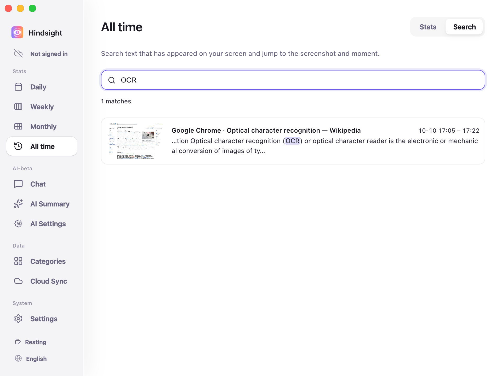
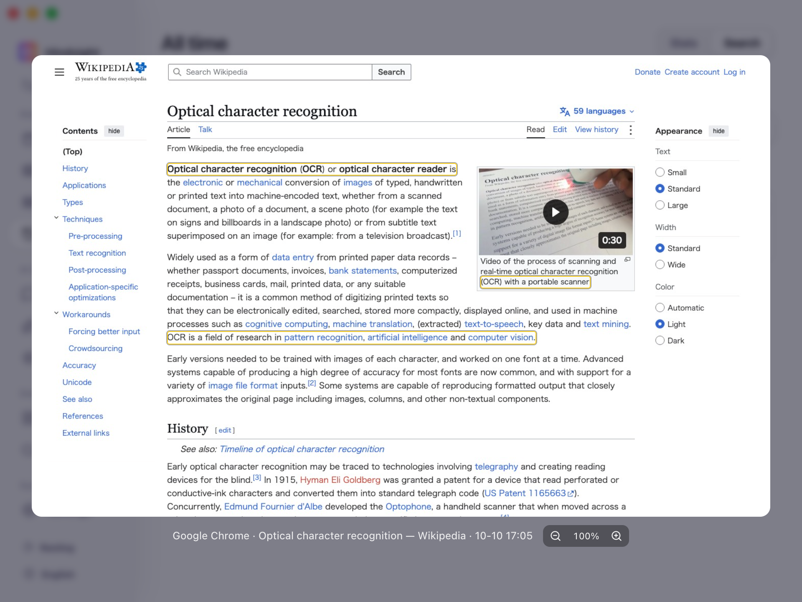

# Screen Memory and Search

- [Overview](#overview)
- [Search and Review](#search-and-review)
- [Defaults](#defaults)

## Overview

Use keywords to find web text, document snippets, or a sentence whose source you have forgotten.

## Search and Review

Matching text is highlighted, and results show the app and time it appeared.

    
     
    All time → Search

    
     
    Search results (Screenshot preview)

> Boxes mark matching text in the screenshot. Zoom and pan to view details.

## Defaults

| Setting | Default | Description |
| --- | --- | --- |
| Enable screenshots | Off | Required for screen memory; enable it in Settings |
| Keep OCR resident | Off | When enabled, continuously recognizes text in new screenshots in the background |
| Screenshot retention | 7 days | Older screenshots are cleaned up, but recognized text remains searchable |
