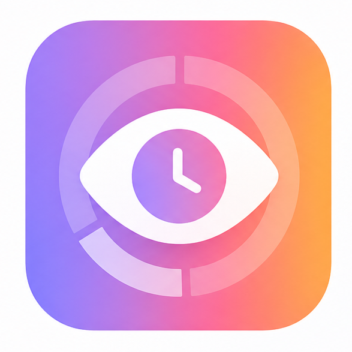

  

<h1 align="center">Guía completa de funciones de Hindsight</h1>

  <a href="https://hindsight.kyosweb.com">Sitio web</a> ·
  <a href="https://github.com/Tomotsugu-dev/Hindsight/releases/latest">Descargar</a> ·
  <a href="https://github.com/Tomotsugu-dev/Hindsight">GitHub</a>

Hindsight registra el uso del ordenador: guarda en segundo plano las aplicaciones y ventanas que utilizas y genera estadísticas diarias, semanales y mensuales. También ofrece funciones opcionales de búsqueda de texto en capturas de pantalla, resúmenes de IA, consultas de actividad con IA y sincronización entre dispositivos.

## Índice

| Documento | Contenido |
| --- | --- |
| [Registro de actividad y estadísticas](./activity-record.md) | Estadísticas y visualización de la actividad del ordenador |
| [Categorías y gestión de aplicaciones](./classification-app-management.md) | Clasificar aplicaciones para obtener estadísticas más precisas |
| [Memoria de pantalla y búsqueda](./screen-memory-search.md) | Encontrar con palabras clave el texto que apareció en pantalla |
| [Resúmenes de IA y chat](./ai-summary-and-chat.md) | Generar informes diarios y semanales, o preguntar «¿Cuánto tiempo he dedicado a este proyecto esta semana?» |
| [Configuración de IA](./ai-configuration.md) | Configurar modelos locales o una API en la nube |
| [Sincronización en la nube y gestión de dispositivos](./cloud-sync-and-device-management.md) | Reunir los registros de varios dispositivos para consultarlos juntos |
| [Gestión de datos](./data-management.md) | Exportar datos y borrar los registros que no quieras conservar |
| [Interfaz y apariencia](./interface-and-appearance.md) | Ajustes de inicio, idioma y tema |
| [Ajustes de privacidad](./privacy-setting.md) | Ajustes de los filtros de privacidad |
| [Uso de recursos](./resource-usage.md) | Uso de memoria y CPU durante la ejecución |
