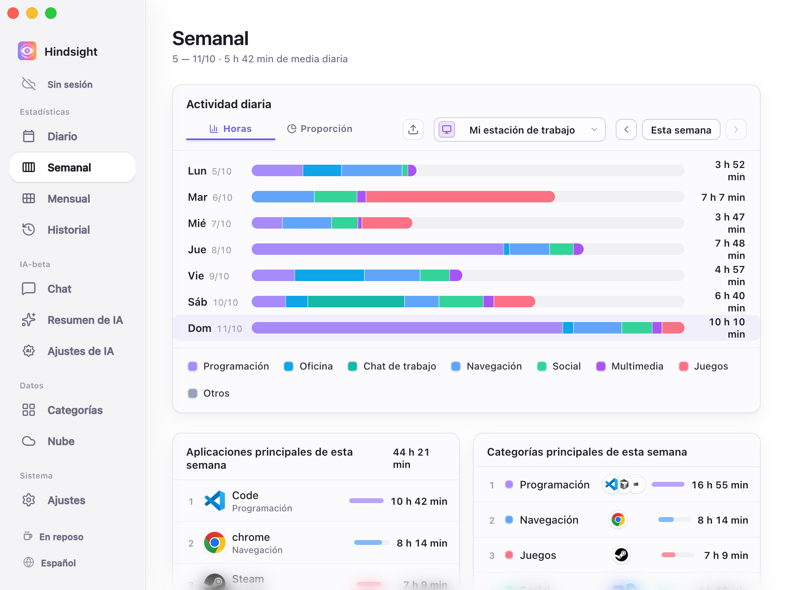
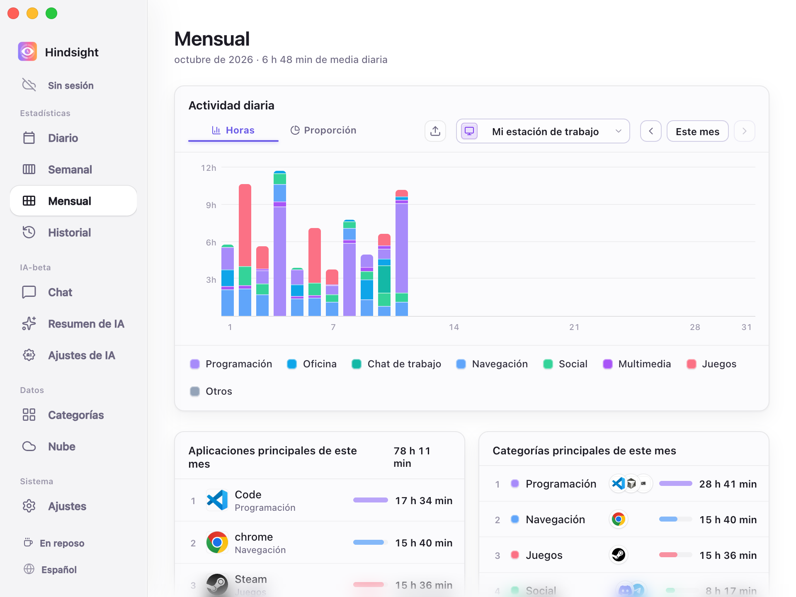
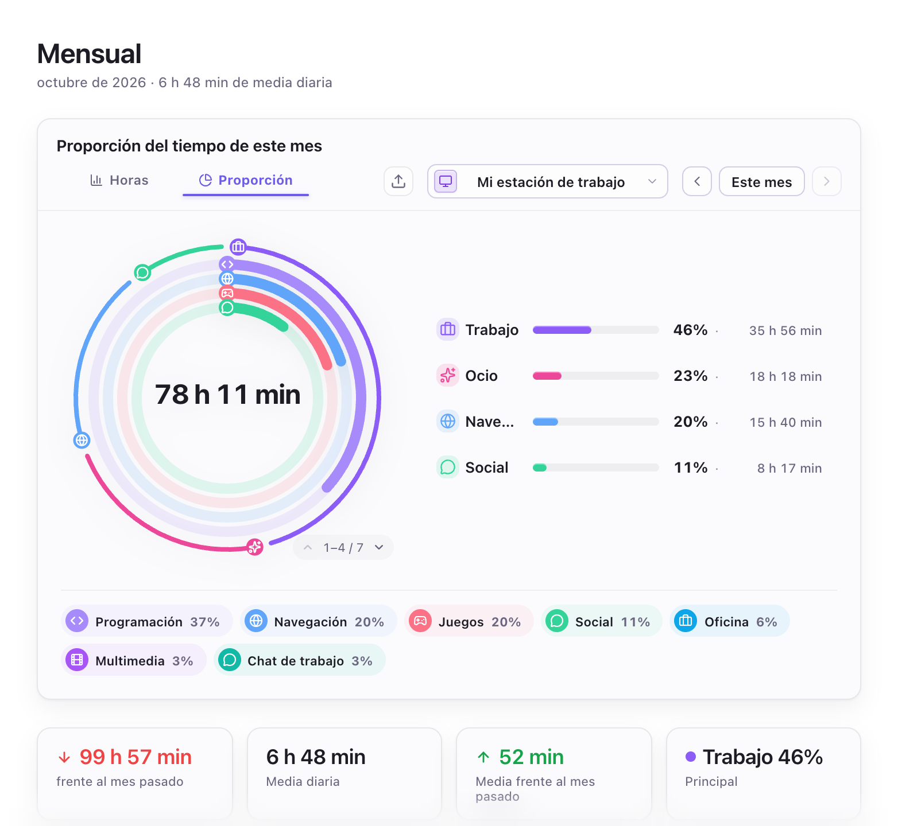
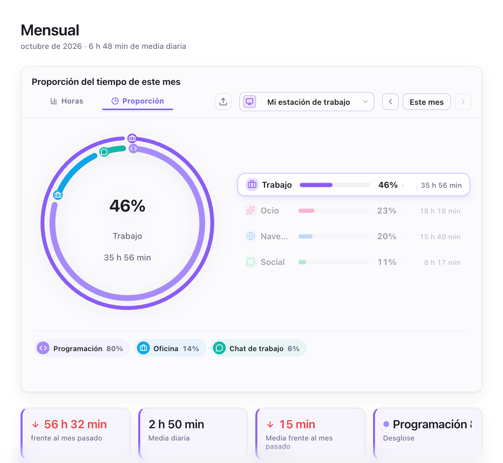
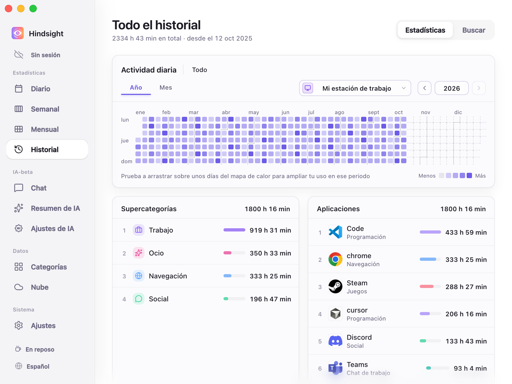
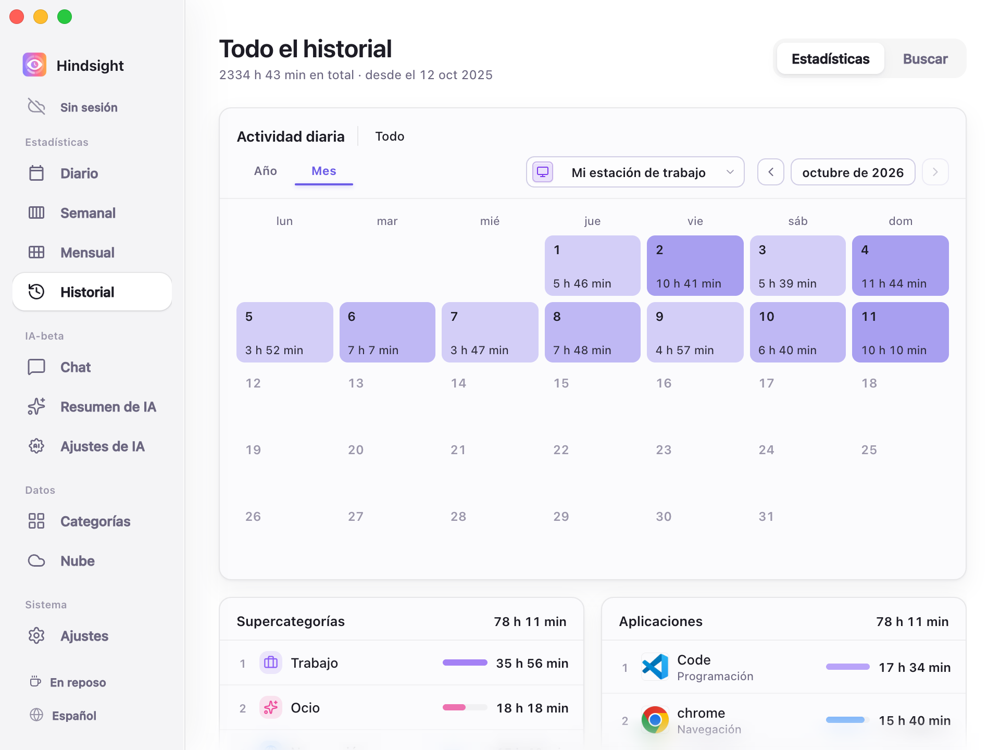

# Registro de actividad y estadísticas

- [Descripción general](#descripción-general)
- [Estadísticas](#estadísticas)
  - [Diario](#diario)
  - [Semanal](#semanal)
  - [Mensual](#mensual)
  - [Historial](#historial)
- [Captura de actividad](#captura-de-actividad)
- [Comportamiento predeterminado](#comportamiento-predeterminado)

## Descripción general

Hindsight registra automáticamente la actividad en primer plano y su duración, y ofrece estadísticas diarias, semanales, mensuales e históricas. Las estadísticas de tiempo básicas no requieren capturas de pantalla; las capturas y el OCR son opcionales.

## Estadísticas

### Diario

    
     
    Diario (vista Horas)

### Semanal

    
     
    Semanal (vista Horas)

### Mensual

    
     
    Mensual (vista Horas)

    
     
    Mensual (proporciones y estadísticas de las categorías de actividad)

> El anillo exterior muestra las proporciones de las supercategorías (como «Trabajo», «Ocio», «Navegación» y «Social»); el interior, las de sus categorías (como «Programación», «Oficina» y «Chat de trabajo», dentro de «Trabajo»).

    
     
    Mensual (vista Proporción: categoría seleccionada)

> Al seleccionar una supercategoría, el anillo y las etiquetas inferiores muestran solo su composición. Aquí está seleccionado «Trabajo»: Programación representa el 82 %, Oficina el 11 % y Chat de trabajo el 7 %.
> Las cuatro tarjetas inferiores muestran, de izquierda a derecha: la variación del tiempo de trabajo de este mes respecto al anterior (-60h 42m), el promedio diario de trabajo de este mes (2h 48m), su variación respecto al mes anterior (-19m) y la categoría con mayor proporción dentro de Trabajo (aquí, Programación, con el 82 %).

### Historial

El mapa de calor anual muestra la distribución de la actividad a largo plazo, y el calendario mensual, el tiempo de cada día. También permite consultar un intervalo de fechas o revisar el historial de una aplicación.

    
     
    Historial (Año)

> Cuanto más oscuro es el color, más tiempo se registró ese día. Arrastra para seleccionar un intervalo y ampliarlo; al seleccionar un día, las clasificaciones de supercategorías y aplicaciones de abajo muestran solo sus datos.

    
     
    Historial (Mes)

## Captura de actividad

- **Registro de actividad:** Registra la aplicación en primer plano y el tiempo de uso.
- **Inactividad:** Deja de contar el tiempo tras 3 minutos sin actividad de ratón o teclado, de forma predeterminada.
- **Horario de trabajo:** Al activarlo, solo captura dentro del horario indicado. Fuera de él, la barra lateral muestra «En reposo» y la captura de actividad se detiene.
- **Estado de captura:** El botón `Detener` de la barra lateral detiene la captura de actividad; al pulsarlo de nuevo, se reanuda.
- **Dominios de sitios:** El registro está activado de forma predeterminada y permite registrar y clasificar los sitios visitados; por ejemplo, asignar las visitas a YouTube a una categoría «Vídeo».
- **Varios dispositivos:** Cada dispositivo registra su propia actividad. Tras sincronizar, puedes consultar los datos conjuntos o los de un solo dispositivo.

## Comportamiento predeterminado

| Elemento | Estado predeterminado | Descripción |
| --- | --- | --- |
| Captura de actividad | Activada | - |
| Intervalo de captura | 30 segundos | - |
| Tiempo de inactividad | 3 minutos | - |
| Horario de trabajo | Desactivado | Al activarlo, solo registra actividad durante el horario indicado |
| Registrar los dominios de los sitios | Activado (sujeto a la compatibilidad del navegador, los permisos y los ajustes de privacidad) | - |
| Capturas de pantalla | Desactivadas | - |
| Retención de las capturas de pantalla | 7 días | Las capturas se eliminan automáticamente después de este plazo para ahorrar espacio |
