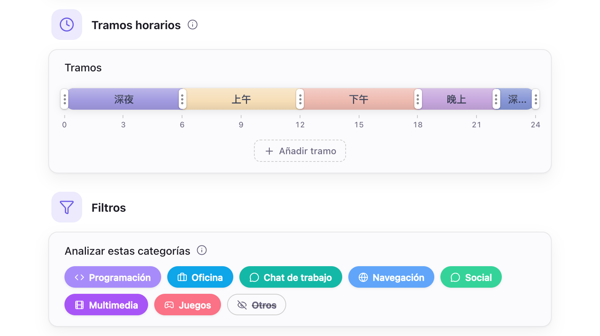

# Configuración de IA

- [Descripción general](#descripción-general)
- [Modelos locales](#modelos-locales)
- [API en la nube](#api-en-la-nube)
- [Ajustes de los informes](#ajustes-de-los-informes)
- [Comportamiento predeterminado](#comportamiento-predeterminado)

## Descripción general

Hindsight permite configurar modelos locales y una API en la nube para usar modelos de lenguaje generativos en los resúmenes y el chat.

## Modelos locales

Los modelos locales se ejecutan en tu ordenador. Hindsight adapta la configuración a tu equipo:

1. **Selección automática del motor:** Ve a «Ajustes de IA → Motor» y pulsa el botón de descarga. El sistema detecta tu hardware (como Mac Metal o NVIDIA CUDA) y descarga el motor de aceleración más adecuado, sin necesidad de instalar controladores manualmente.
2. **Descarga de modelos recomendados:** En «Ajustes de IA → Modelos», descarga el modelo recomendado que se ajuste a tus necesidades.
3. **Aplicación de los parámetros óptimos:** El sistema calcula automáticamente los parámetros más estables según la memoria de vídeo de tu ordenador.

Puedes elegir un modelo de la lista, importar un archivo GGUF propio o introducir la dirección de un repositorio de Hugging Face para descargarlo. Los motores y modelos se descargan de las fuentes oficiales de forma predeterminada; si hay problemas de acceso, puedes usar un espejo.

## API en la nube

Si tu dispositivo no tiene suficiente potencia para ejecutar un modelo local, o necesitas un modelo más potente, puedes usar un servicio en la nube.

- **Proveedor:** Admite API compatibles con OpenAI. Incluye perfiles de OpenAI, DeepSeek, Kimi (Moonshot), OpenRouter, Together y Groq, y permite introducir la dirección de otros servicios compatibles.

Los servicios en la nube solo reciben texto; las imágenes de las capturas no se envían.

> **Ten en cuenta la exposición de datos personales:** El texto enviado incluye nombres de aplicaciones, títulos de ventanas, la línea de tiempo de actividad y la información de «Sobre ti». En el chat, también incluye tus preguntas y el texto de pantalla reconocido mediante OCR. Puede contener datos personales sensibles. Recomendamos configurar los [ajustes de privacidad](./privacy-setting.md) antes de usarlo y elegir solo proveedores de API en los que confíes.

## Ajustes de los informes

Hindsight usa estos ajustes para generar los informes.

    
     
    Ajustes de IA → General

- **Tramos horarios:** Divide el día en intervalos para que la IA resuma cada uno.
- **Analizar estas categorías:** Elige las categorías de aplicaciones que se incluirán en los informes.
- **Sobre ti:** Opcional; indica a qué te dedicas para adaptar los resúmenes.
- **Prompt del sistema:** Orienta el estilo y contenido de los informes; puedes personalizarlo.

## Comportamiento predeterminado

| Elemento | Predeterminado | Descripción |
| --- | --- | --- |
| Motor de IA local | Sin instalar | Se descarga en «Ajustes de IA → Motor»; ocupa unos 16–605 MB, según el sistema y la tarjeta gráfica |
| Fuentes de descarga | Oficiales | Descarga desde Hugging Face y GitHub; si hay problemas de acceso, puedes cambiar a un espejo en «Ajustes de IA → Motor» |
| Memoria de la IA | Se libera tras 2 minutos de inactividad | Tras finalizar una tarea y unos 2 minutos sin uso, se detiene automáticamente y libera la RAM y la memoria de vídeo |
| Tramos para los resúmenes | 5 tramos | 0–6, 6–9, 9–12, 12–18 y 18–24 h; se pueden modificar |
| Categorías de aplicaciones analizadas | Todas excepto «Otros» | Solo se incluyen las aplicaciones de estas categorías. Las de «Otros» (incluidas las que aún no tienen categoría) quedan fuera; se ajusta en «Ajustes de IA → General → Filtros» |
