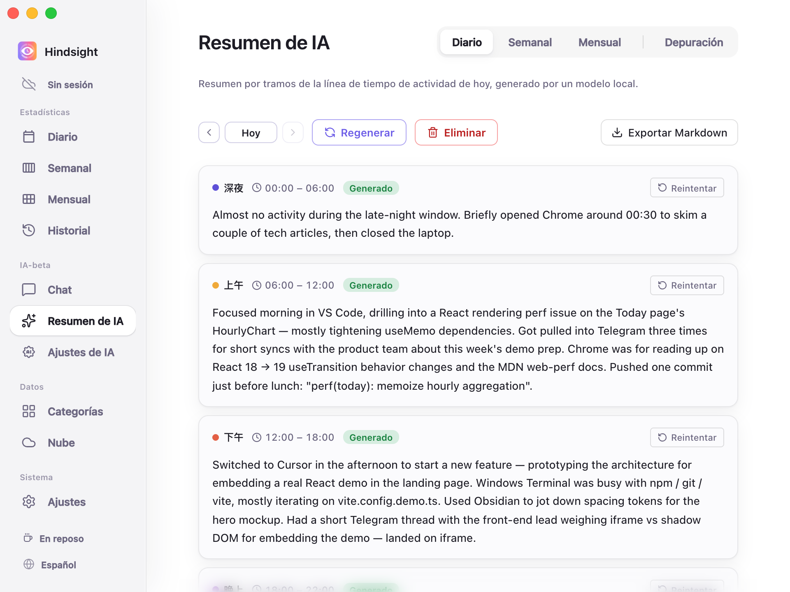
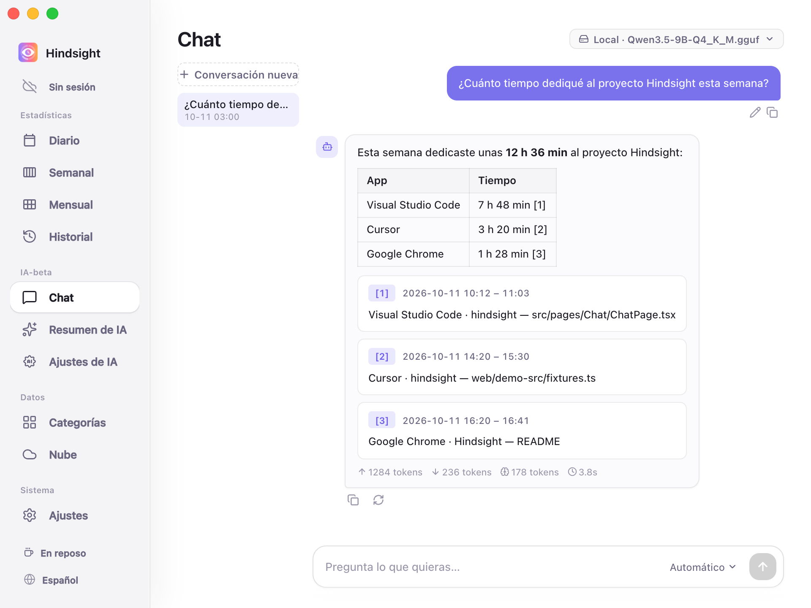

# Resúmenes de IA y chat

- [Descripción general](#descripción-general)
- [Informes](#informes)
- [Chat](#chat)
- [Modelos](#modelos)
- [Comportamiento predeterminado](#comportamiento-predeterminado)

## Descripción general

Hindsight puede usar la IA para resumir la actividad de un periodo, generar informes de texto o responder preguntas sobre tus registros.

## Informes

«Resumen de IA» convierte los registros de actividad en informes de texto.

    
     
    Resumen de IA → Diario

Actualmente ofrece:

- **Diario:** Organiza la actividad del día por los tramos horarios configurados. Se puede exportar a Markdown.
- **Semanal:** Genera un resumen de la actividad de la semana.

> «Mensual» sigue en desarrollo y aún no genera informes.

## Chat

En «Chat» puedes consultar tus registros con lenguaje natural, por ejemplo: «¿Cuánto tiempo he dedicado al proyecto Hindsight esta semana?» o «¿Cuánto tiempo he pasado en YouTube esta semana?».

    
     
    Chat con IA

La IA responde basándose en tus registros y proporciona enlaces para que puedas comprobar las fuentes.

## Modelos

Puedes elegir un modelo distinto para los resúmenes y el chat, tanto local como en la nube:

- **Modelos locales:** Se ejecutan en tu ordenador; el contenido no sale del dispositivo.
- **API en la nube:** Admite API compatibles con OpenAI. Incluye perfiles de OpenAI, DeepSeek, Kimi (Moonshot), OpenRouter, Together y Groq, y permite introducir la dirección de otros servicios compatibles.

Consulta los detalles en [Configuración de IA](./ai-configuration.md).

## Comportamiento predeterminado

| Elemento | Predeterminado | Descripción |
| --- | --- | --- |
| Resumen automático | Desactivado | Al activarlo, genera el informe diario a las 23:00 de forma predeterminada y completa los informes diarios que falten y el informe de la semana anterior |
| API en la nube | Desactivada | Usa modelos locales de forma predeterminada; el servicio en la nube requiere configuración explícita |
