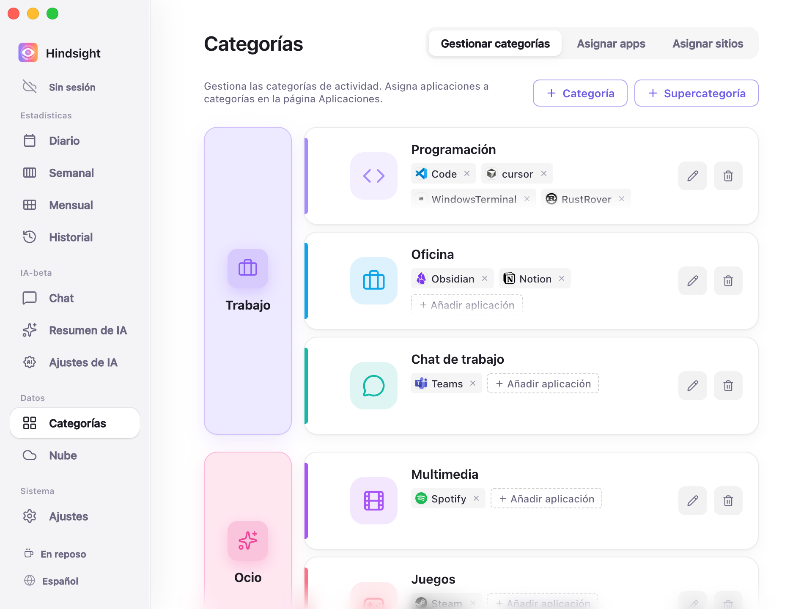
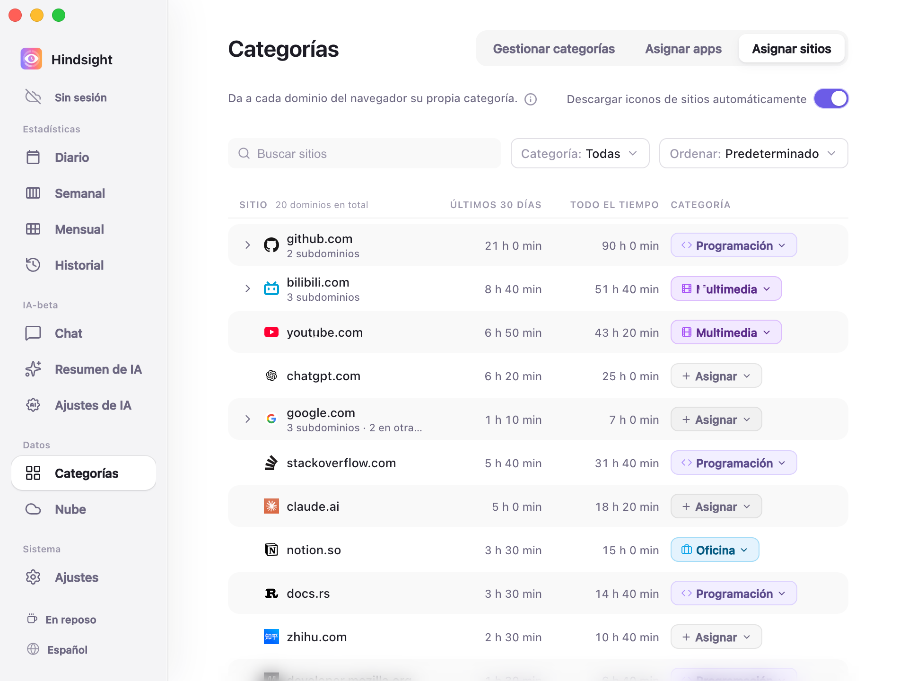
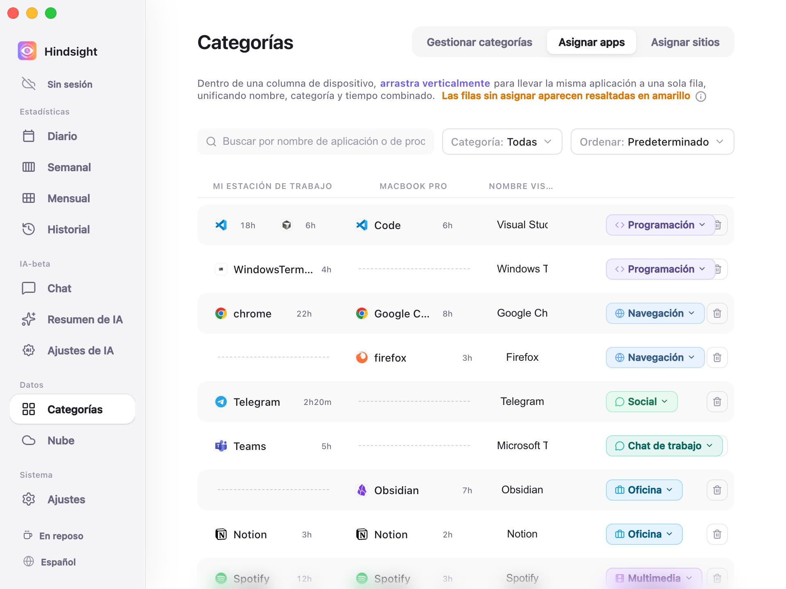

# Categorías y gestión de aplicaciones

- [Descripción general](#descripción-general)
- [Supercategorías, categorías y aplicaciones](#supercategorías-categorías-y-aplicaciones)
- [Asignar sitios](#asignar-sitios)
- [Asignar apps y combinar dispositivos](#asignar-apps-y-combinar-dispositivos)
- [Comportamiento predeterminado](#comportamiento-predeterminado)

## Descripción general

Hindsight organiza y analiza el uso del ordenador en tres niveles: supercategorías, categorías y aplicaciones. Puedes asignar categorías a sitios y aplicaciones para agrupar su tiempo de uso.

## Supercategorías, categorías y aplicaciones

Hindsight organiza y calcula tu tiempo en tres niveles:

- **Supercategoría:** Un ámbito general de tu vida o trabajo, como «Trabajo» u «Ocio».
- **Categoría:** Un tipo de actividad concreto, como Programación, Oficina, Social o Juegos. Cada categoría pertenece a una supercategoría y agrupa el uso de sus aplicaciones en las estadísticas.
- **Aplicación:** Un programa que utilizas en el ordenador, como WeChat, Chrome o PowerPoint, asignado a su categoría.

> **Relación:** Aplicación ➡️ Categoría ➡️ Supercategoría. Por ejemplo, PowerPoint pertenece a «Oficina», que se incluye en «Trabajo».

    
     
    Categorías → Gestionar categorías

> La columna izquierda muestra las supercategorías (como «Trabajo» y «Ocio»). Cada fila de la derecha es una de sus categorías (como «Programación», «Oficina» o «Chat de trabajo»). Las etiquetas de la fila son sus aplicaciones (como Code y Cursor en Programación).

El sistema incluye supercategorías y categorías listas para usar. Puedes añadirlas, eliminarlas, renombrarlas o arrastrarlas para cambiar su agrupación. Algunas aplicaciones habituales también vienen clasificadas para ayudarte a empezar.

## Asignar sitios

El navegador sirve para actividades muy distintas. Si lo asignas por completo a «Navegación», el tiempo dedicado a consultar GitHub y a ver vídeos en Bilibili queda mezclado.

«Asignar sitios» permite asignar una categoría a cada dominio, por separado del navegador.

    
     
    Asignar sitios

## Asignar apps y combinar dispositivos

Todas las aplicaciones registradas aparecen aquí automáticamente. Puedes asignarles categorías o combinar el tiempo de una misma aplicación en varios dispositivos.

    
     
    Asignar apps

- **Asignar categorías:** Pulsa la etiqueta de categoría de la derecha para asignarla. Las aplicaciones sin categoría aparecen con fondo amarillo.
- **Combinar dispositivos arrastrando:** Una misma aplicación puede tener distintos nombres en distintos sistemas (por ejemplo, `chrome.exe` en Windows y `Google Chrome` en macOS). **Arrástralas verticalmente** hasta la misma fila para emparejarlas, unificar su nombre y sumar sus tiempos.
- **Ocultar y limpiar:** Puedes asignar a «Oculto» las aplicaciones en segundo plano que no quieras incluir en las estadísticas.

## Comportamiento predeterminado

| Elemento | Predeterminado | Descripción |
| --- | --- | --- |
| Supercategorías incluidas | Trabajo, Ocio, Social, Navegación | - |
| Categorías incluidas | Programación, Oficina, Chat de trabajo (en Trabajo); Juegos, Multimedia (en Ocio); Social (en Social); Navegación (en Navegación); Diseño, Otros (sin supercategoría) | También existe «Oculto»: sus aplicaciones no se incluyen en las estadísticas |
| Clasificación automática de aplicaciones habituales | Activada | Incluye una tabla con unos 370 nombres de proceso; por ejemplo, Chrome → Navegación, VS Code → Programación, Steam → Juegos, Spotify → Multimedia y Word → Oficina |
| Aplicaciones sin categoría | Se incluyen en «Otros» | Se muestran con fondo amarillo en «Asignar apps»; esta página solo muestra las aplicaciones sin categoría de forma predeterminada |
| Combinación entre dispositivos | Automática para aplicaciones habituales | Incluye equivalencias entre sistemas para 32 aplicaciones, como `chrome.exe` en Windows y `Google Chrome` en macOS, que aparecen automáticamente en la misma fila; las demás se emparejan arrastrándolas |
| Descargar iconos de sitios automáticamente | Desactivado | Al desactivarlo, se muestra un icono de globo genérico; al activarlo, se descargan los iconos de cada sitio, como GitHub o YouTube |
