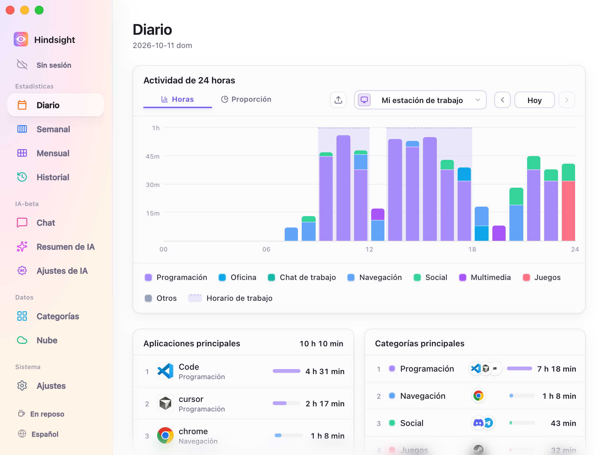
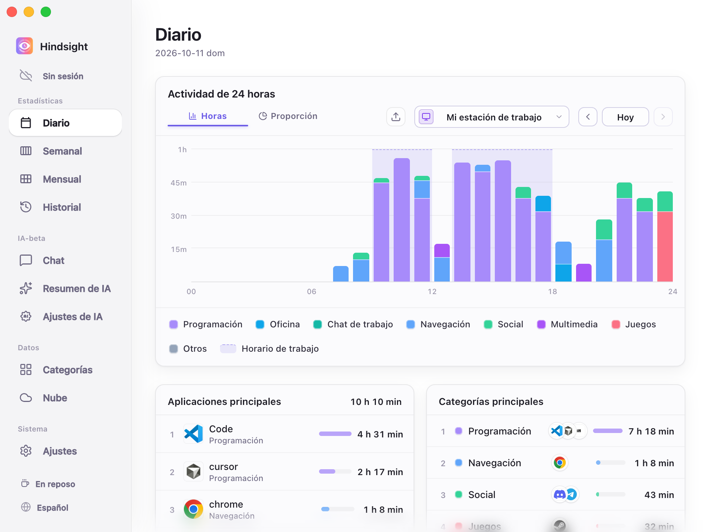
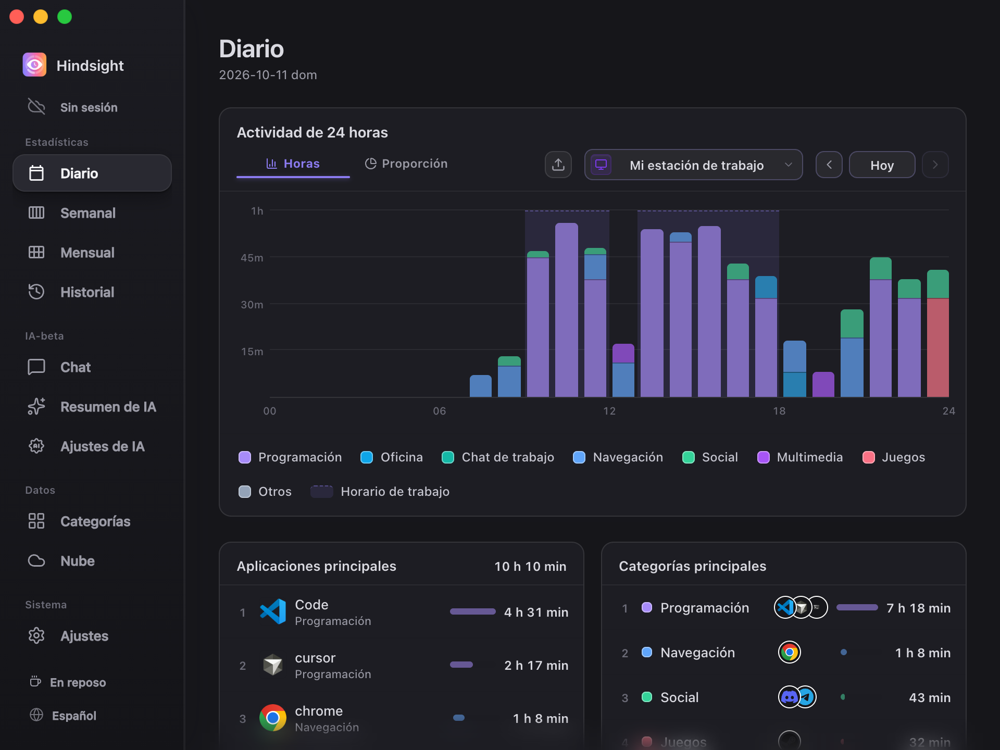

# Interfaz y apariencia

- [Descripción general](#descripción-general)
- [Idioma de la interfaz](#idioma-de-la-interfaz)
- [Temas](#temas)
- [Inicio y cierre](#inicio-y-cierre)
- [Comportamiento predeterminado](#comportamiento-predeterminado)

## Descripción general

Hindsight permite cambiar el idioma y el tema de la interfaz, elegir si se inicia con el sistema y si sigue funcionando en segundo plano al cerrar la ventana.

## Idioma de la interfaz

Admite 简体中文, 繁體中文, English, 日本語, Português y Español. Cambia el idioma en «Ajustes → General» o usa el botón de idioma de la parte inferior de la barra lateral para alternarlos. El cambio es inmediato.

Al cambiar el idioma de la interfaz, también cambia el idioma de los prompts de los resúmenes de IA.

## Temas

Hindsight ofrece tres temas: Predeterminado, Minimalista y Oscuro.

<table align="center">
  <tr>
    <td align="center"> Predeterminado</td>
    <td align="center"> Minimalista</td>
    <td align="center"> Oscuro</td>
  </tr>
</table>

## Inicio y cierre

- **Iniciar con el sistema:** Hindsight se ejecuta automáticamente al iniciar sesión y comienza a registrar la actividad.
- **Inicio silencioso:** Hindsight puede iniciarse en segundo plano con el sistema, sin mostrar la ventana principal.
- **Minimizar a la bandeja del sistema al cerrar:** Al activarlo, el botón de cierre solo oculta la ventana y Hindsight sigue registrando en segundo plano. El icono de la bandeja permite volver a abrirlo o salir.

## Comportamiento predeterminado

| Elemento | Predeterminado | Descripción |
| --- | --- | --- |
| Idioma de la interfaz | El del sistema | Usa el idioma correspondiente para chino, japonés, portugués y español; para otros idiomas del sistema, muestra inglés |
| Apariencia | Minimalista | - |
| Iniciar con el sistema | Desactivado | - |
| Cerrar la ventana | Minimiza a la bandeja del sistema | Sigue registrando en segundo plano |
| Buscar actualizaciones automáticamente | Activado | Comprueba una vez por semana; se puede cambiar en «Ajustes → Acerca de» |
