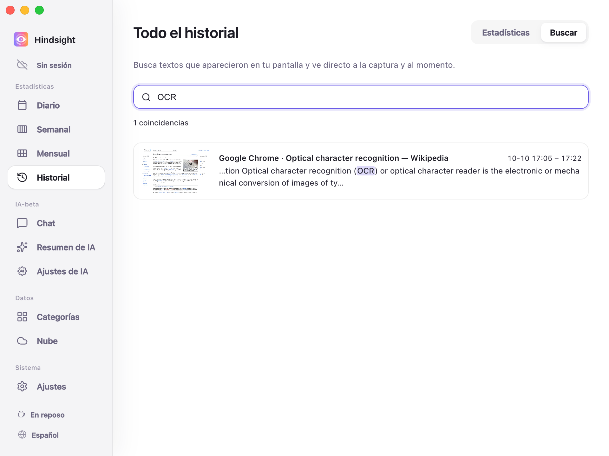
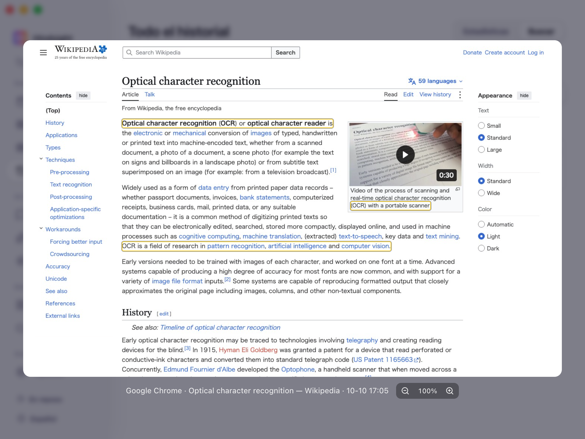

# Memoria de pantalla y búsqueda

- [Descripción general](#descripción-general)
- [Buscar y revisar](#buscar-y-revisar)
- [Comportamiento predeterminado](#comportamiento-predeterminado)

## Descripción general

Hindsight permite encontrar con palabras clave textos de páginas web, fragmentos de documentos o una frase cuyo origen hayas olvidado.

## Buscar y revisar

El texto que coincide se resalta, y cada resultado indica la aplicación y la hora en que apareció.

    
     
    Historial → Buscar

    
     
    Resultados de búsqueda (vista previa de la captura)

> La captura marca la ubicación del texto coincidente y permite ampliar, reducir y arrastrar la imagen para revisarla.

## Comportamiento predeterminado

| Elemento | Predeterminado | Descripción |
| --- | --- | --- |
| Capturas de pantalla | Desactivadas | Son necesarias para la memoria de pantalla; debes activarlas en los ajustes |
| Mantener el OCR residente | Desactivado | Al activarlo, reconoce en segundo plano el texto de las nuevas capturas |
| Retención de las capturas de pantalla | 7 días | Las capturas se borran al superar este plazo, pero el texto ya reconocido sigue siendo consultable |
