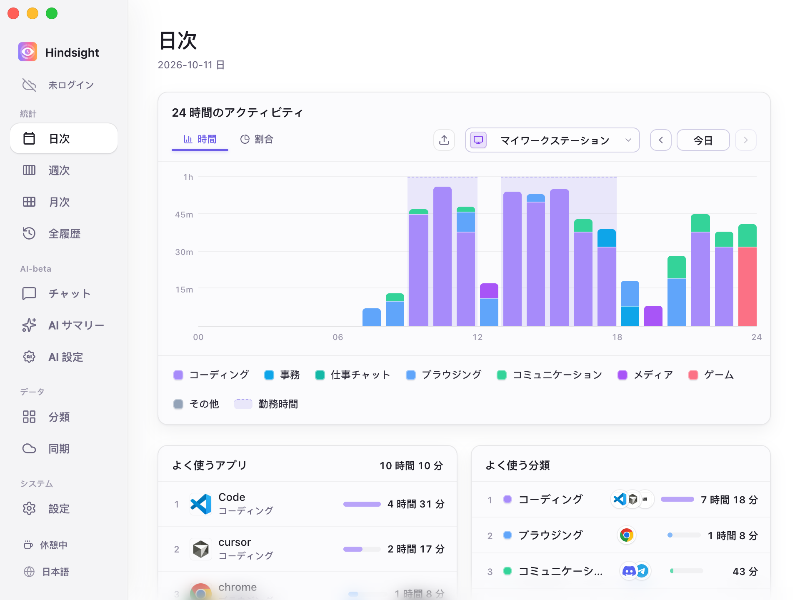
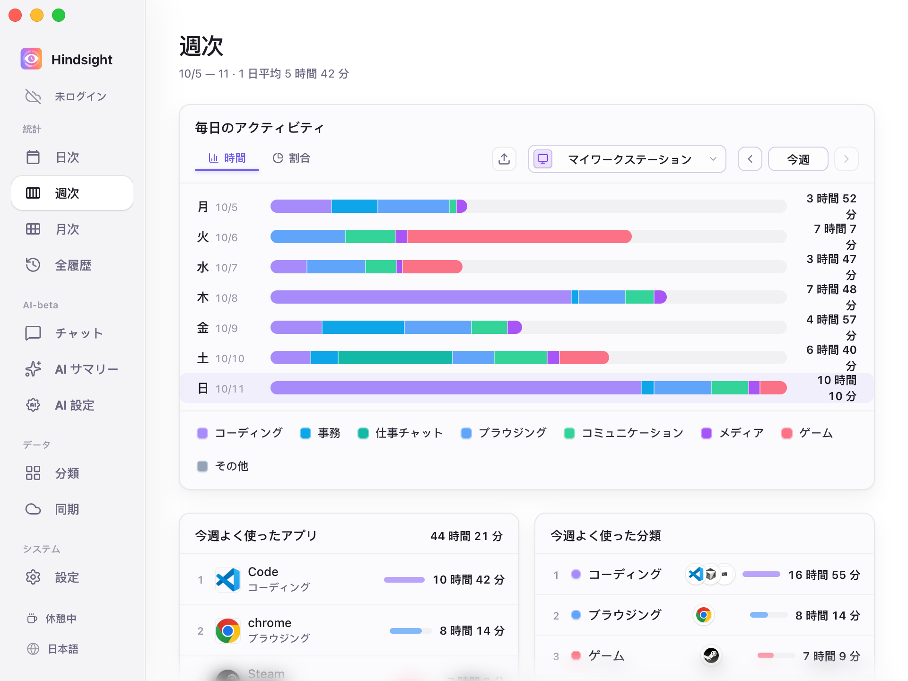
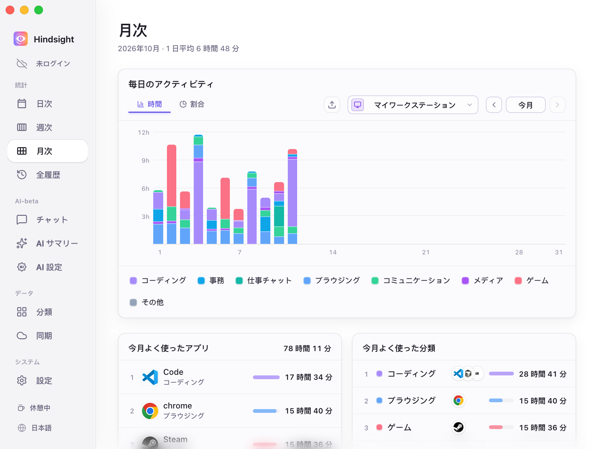
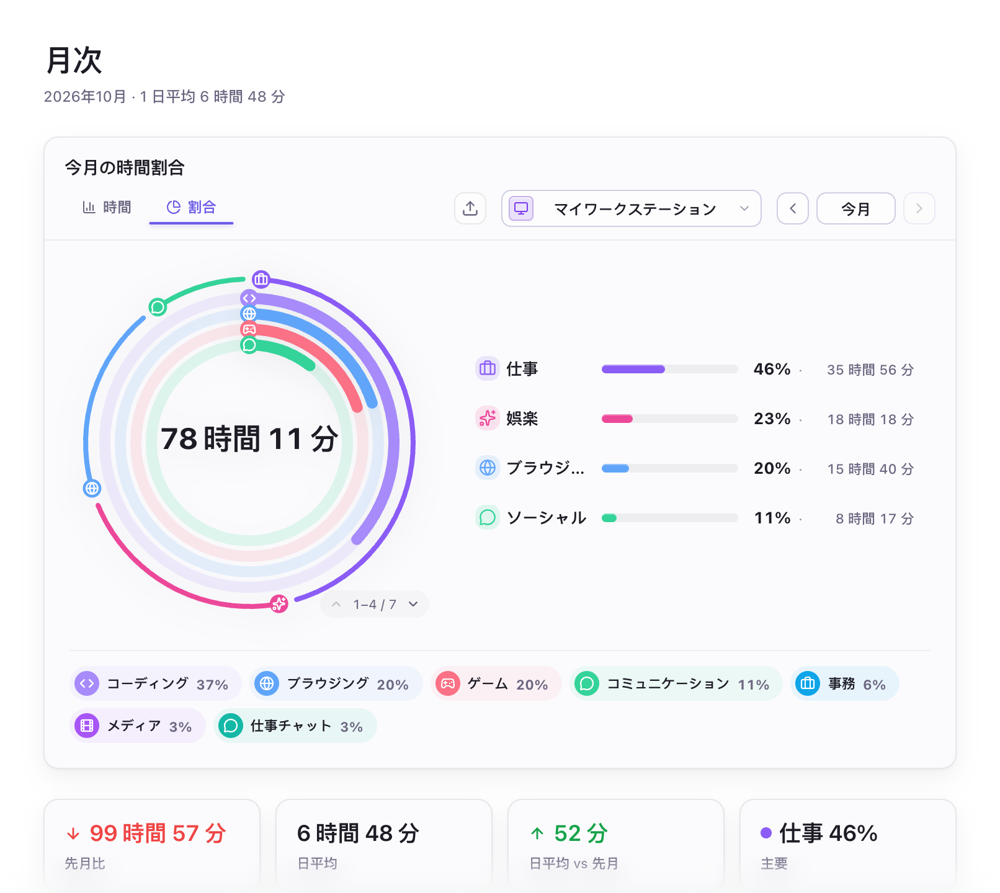
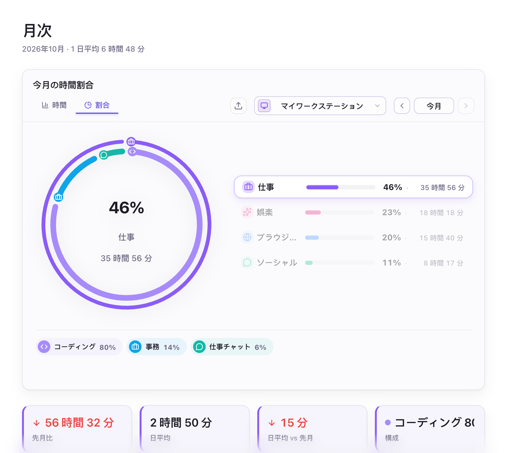
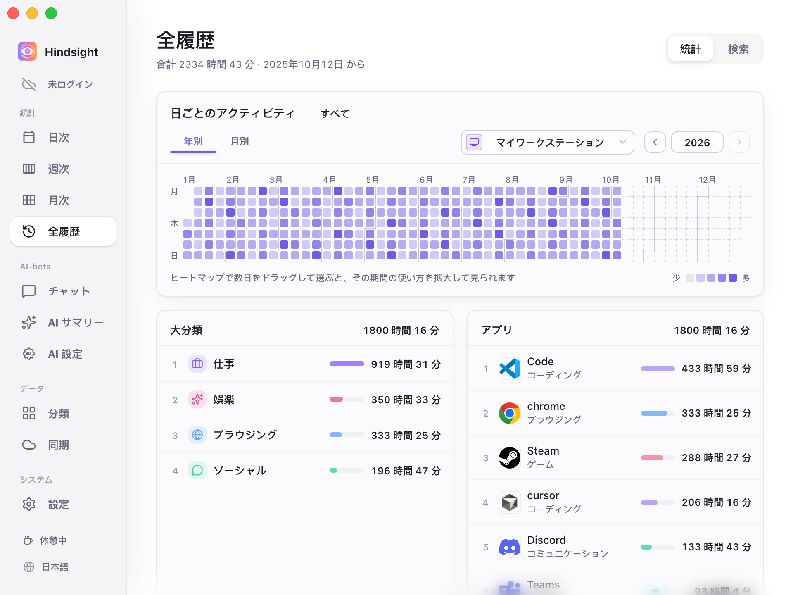
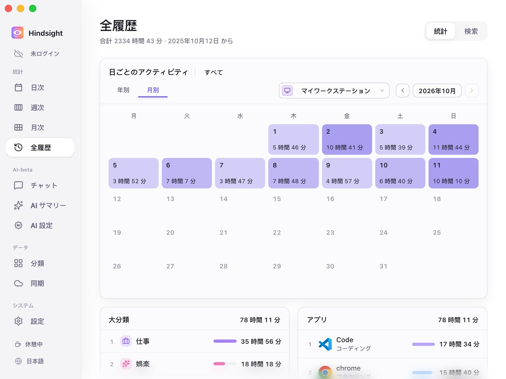

# アクティビティ記録と統計

- [機能概要](#機能概要)
- [統計](#統計)
  - [日次](#日次)
  - [週次](#週次)
  - [月次](#月次)
  - [全履歴](#全履歴)
- [アクティビティの記録](#アクティビティの記録)
- [初期設定](#初期設定)

## 機能概要

Hindsight はアクティブなアプリと使用時間を自動記録し、日次・週次・月次・全履歴の統計を表示します。基本的な時間の集計にスクリーンショットは不要です。スクリーンショットと OCR は必要に応じて利用できます。

## 統計

### 日次

    
     
    日次（時間表示）

### 週次

    
     
    週次（時間表示）

### 月次

    
     
    月次（時間表示）

    
     
    月次（分類別の割合と統計）

> 外側のリングは大分類の割合（「仕事」「娯楽」「ブラウジング」「ソーシャル」など）、内側は小分類の割合（「仕事」に属する「コーディング」「事務」「仕事チャット」など）を示します。

    
     
    月次（割合表示・分類を選択）

> 大分類を選ぶと、リングと下のラベルにその内訳だけが表示されます。ここでは「仕事」を選択し、コーディング 82%、事務 11%、仕事チャット 7% を表示しています。
> 下の 4 枚のカードは左から、今月の仕事時間の先月比（-60h 42m）、今月の日平均（2h 48m）、日平均の先月比（-19m）、仕事の中で最も割合の大きい小分類（ここではコーディング、82%）です。

### 全履歴

年別のヒートマップで長期的な使用状況を、月別のカレンダーで日ごとの使用時間を確認できます。期間を指定した集計や、特定のアプリの長期的な振り返りにも対応しています。

    
     
    全履歴（年別）

> 色が濃い日ほど使用時間が長くなります。ヒートマップで期間をドラッグ選択すると、その期間を拡大できます。日付を選ぶと、下の大分類とアプリのランキングもその日だけの集計に切り替わります。

    
     
    全履歴（月別）

## アクティビティの記録

- **アクティビティ記録：** アクティブなアプリと、その使用時間を記録します。
- **離席時の処理：** マウスやキーボードの操作が 3 分間（初期設定）ないと、計測を停止します。
- **勤務時間：** 有効にすると指定した時間帯のみ記録します。それ以外の時間はサイドバーに「休憩中」と表示され、記録が停止します。
- **記録状態：** サイドバーの `記録を停止` ボタンで記録を停止し、もう一度押すと再開できます。
- **ウェブサイトのドメイン：** 初期設定で有効です。閲覧したサイトを記録・分類できます。例えば YouTube の閲覧記録を「動画」に分類できます。
- **複数デバイス：** デバイスごとに記録します。同期後は全デバイスの合計も、特定の 1 台の記録も確認できます。

## 初期設定

| 項目 | 初期状態 | 説明 |
| --- | --- | --- |
| 記録を有効化 | オン | - |
| 記録の間隔 | 30 秒 | - |
| アイドル時間 | 3 分 | - |
| 勤務時間 | オフ | 有効にすると指定した時間帯のみ記録 |
| ウェブサイトのドメインを記録 | オン（ブラウザの対応状況・権限・プライバシー設定による） | - |
| スクリーンショットを有効化 | オフ | - |
| スクリーンショット保持 | 7 日 | 期限を過ぎた画像は自動削除し、ストレージを節約 |
