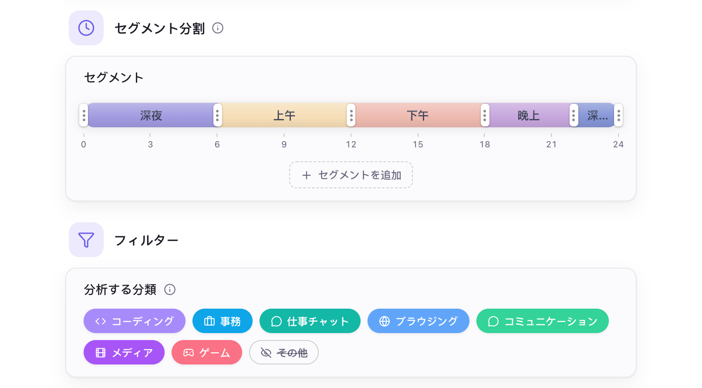

# AI 設定

- [機能概要](#機能概要)
- [ローカルモデル](#ローカルモデル)
- [クラウド API](#クラウド-api)
- [レポートの設定](#レポートの設定)
- [初期設定](#初期設定)

## 機能概要

Hindsight ではローカルモデルとクラウド API を設定し、サマリーやチャットに大規模言語モデルを利用できます。

## ローカルモデル

ローカルモデルは自分のパソコンで動作します。Hindsight がパソコンに合った設定を行います。

1. **エンジンの自動選択**：「AI 設定 → エンジン」からダウンロードできます。Mac の Metal や NVIDIA CUDA などのハードウェアを自動検出し、最適なエンジンをダウンロードします。ドライバーの手動インストールは不要です。
2. **推奨モデルをワンクリックでダウンロード**：「AI 設定 → モデル」で、用途に合った推奨モデルを選べます。
3. **最適なパラメータをワンクリックで適用**：パソコンの VRAM に応じて、安定して動作するパラメータを自動計算します。

用意されたモデルを選ぶほか、自分の GGUF ファイルを取り込んだり、Hugging Face リポジトリを指定してダウンロードしたりできます。エンジンとモデルのダウンロード元は初期設定で公式です。接続しにくい場合はミラーに切り替えられます。

## クラウド API

ローカルモデルを動かす性能が足りない場合や、より高性能なモデルが必要な場合は、クラウドサービスに切り替えられます。

- **プロバイダー**：OpenAI 互換 API に対応。OpenAI、DeepSeek、Kimi（Moonshot）、OpenRouter、Together、Groq のプリセットがあり、他の互換サービスのアドレスも指定できます。

クラウドサービスにはテキストだけを送信し、スクリーンショット画像はアップロードしません。

> **個人情報の送信にご注意ください**：送信するテキストにはアプリ名、ウィンドウタイトル、アクティビティのタイムライン、あなたについての情報が含まれます。チャットでは質問や OCR で認識された画面テキストも含まれます。機微な個人情報が含まれる可能性があるため、事前に[プライバシー設定](./privacy-setting.md)を行い、信頼できる API プロバイダーのみ利用してください。

## レポートの設定

次の設定をもとにレポートを生成します。

    
     
    AI 設定 → 一般

- **セグメント分割**：1 日をいくつかの時間帯に分け、時間帯ごとに AI が要約します。
- **分析する分類**：レポートに含めるアプリの分類を選びます。
- **あなたについて**：任意。仕事内容を伝えることで、状況に合った要約になります。
- **システムプロンプト**：レポートの文体や内容を AI に指示します。必要に応じて変更できます。

## 初期設定

| 項目 | 初期設定 | 説明 |
| --- | --- | --- |
| ローカル AI エンジン | 未インストール | 「AI 設定 → エンジン」からダウンロード。OS と GPU により約 16–605 MB |
| ダウンロード元 | 公式 | Hugging Face と GitHub からダウンロード。接続しにくい場合は「AI 設定 → エンジン」でミラーに切り替え可能 |
| AI のメモリ使用 | 2 分間の待機後に解放 | タスク終了後、約 2 分間使われないと自動停止し、メモリと VRAM を解放 |
| 要約の時間帯 | 5 区分 | 0–6、6–9、9–12、12–18、18–24 時。変更可能 |
| 分析する分類 | 「その他」以外のすべて | 対象の分類に属するアプリだけをレポートに使用。「その他」（未分類を含む）は対象外。「AI 設定 → 一般 → フィルター」で変更可能 |
