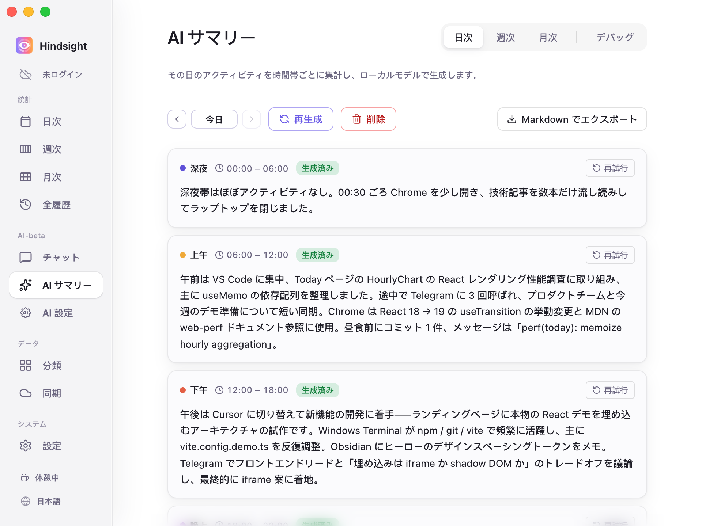
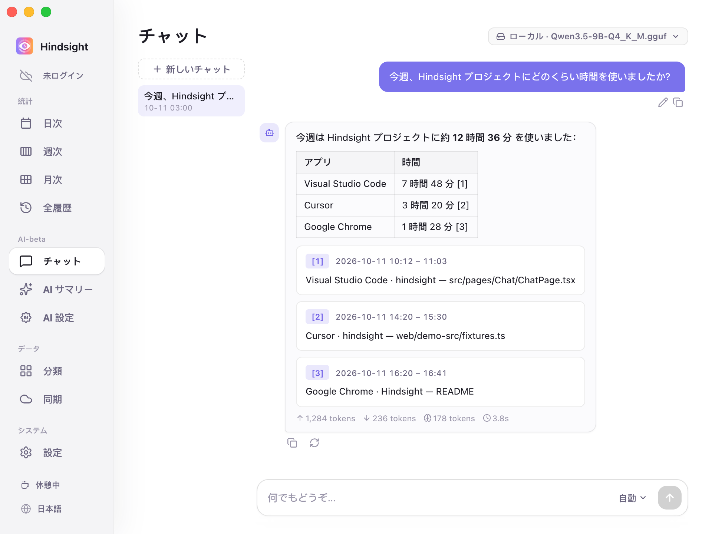

# AI サマリーとチャット

- [機能概要](#機能概要)
- [レポート](#レポート)
- [チャット](#チャット)
- [モデル](#モデル)
- [初期設定](#初期設定)

## 機能概要

AI が一定期間のアクティビティ記録をまとめてレポートを生成し、記録にもとづいて質問に回答します。

## レポート

「AI サマリー」はアクティビティ記録を文章のレポートにまとめます。

    
     
    AI サマリー → 日次

現在対応しているレポート：

- **日報**：設定した時間帯ごとに 1 日の活動をまとめます。Markdown にエクスポートできます。
- **週報**：1 週間のアクティビティをまとめたレポートを生成します。

> 月報は開発中のため、まだ生成できません。

## チャット

「チャット」で自分の記録について自然な言葉で質問できます。例えば「今週 Hindsight プロジェクトに何時間使った？」「今週 YouTube を見た時間は？」などです。

    
     
    AI チャット

AI はアクティビティ記録にもとづいて回答し、根拠を確認できるリンクを示します。

## モデル

サマリーとチャットでは、それぞれローカルまたはクラウドのモデルを選べます。

- **ローカルモデル**：パソコン上で動作し、内容が外部に送られることはありません。
- **クラウド API**：OpenAI 互換 API に対応。OpenAI、DeepSeek、Kimi（Moonshot）、OpenRouter、Together、Groq のプリセットがあり、他の互換サービスのアドレスも指定できます。

詳しい設定は [AI 設定](./ai-configuration.md)をご覧ください。

## 初期設定

| 項目 | 初期設定 | 説明 |
| --- | --- | --- |
| 自動サマリー | オフ | 有効にすると毎日 23:00 に当日の日報を生成し、未生成の日報と先週の週報も補完 |
| クラウド API | オフ | 初期設定ではローカルモデルのみ使用。クラウドの利用には設定が必要 |
