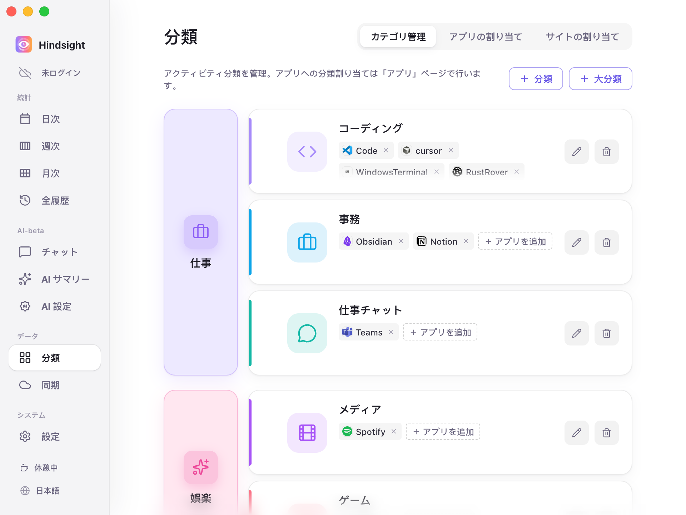
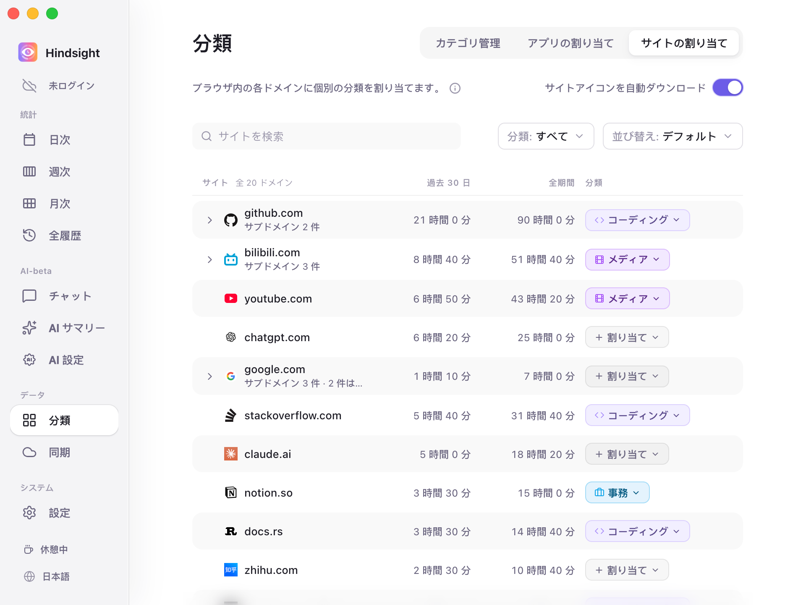
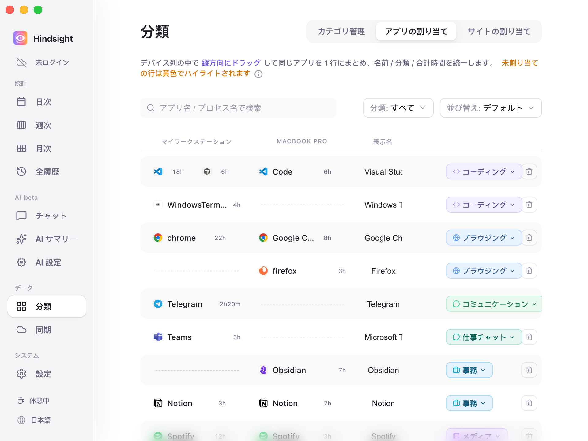

# 分類とアプリ管理

- [機能概要](#機能概要)
- [大分類・小分類・アプリ](#大分類小分類アプリ)
- [サイトの割り当て](#サイトの割り当て)
- [アプリの割り当てとデバイス間の統合](#アプリの割り当てとデバイス間の統合)
- [初期設定](#初期設定)

## 機能概要

Hindsight は大分類・小分類・アプリの 3 階層で、パソコンの使用状況を管理・集計します。サイトやアプリに分類を割り当てると、その分類ごとに使用時間が集計されます。

## 大分類・小分類・アプリ

時間を次の 3 階層で整理・集計します。

- **大分類**：生活や仕事の大まかな領域（「仕事」「娯楽」など）。
- **小分類**：具体的な活動の種類（コーディング、事務、コミュニケーション、ゲームなど）。それぞれ大分類に属し、統計で同じ種類のアプリをまとめます。
- **アプリ**：WeChat、Chrome、PowerPoint など、パソコンで使うプログラム。それぞれ対応する分類に割り当てます。

> **階層の例**：アプリ ➡️ 分類 ➡️ 大分類（PowerPoint は「事務」に属し、「仕事」の使用時間に含まれます）。

    
     
    分類 → カテゴリ管理

> 左の列が大分類（「仕事」「娯楽」など）、右の各行がその配下の小分類（「コーディング」「事務」「仕事チャット」など）です。行内のラベルは、その小分類に属するアプリ（コーディングの Code、Cursor など）です。

すぐに使える大分類と小分類が用意されています。追加・削除・名前の変更や、ドラッグで所属を変更できます。よく使われるアプリにも分類が設定されています。

## サイトの割り当て

ブラウザではさまざまな作業をします。ブラウザ全体を「ブラウジング」に分類すると、GitHub で調べ物をする時間と Bilibili で動画を見る時間を区別できません。

「サイトの割り当て」では、ブラウザ内のドメインごとに分類を設定できます。

    
     
    サイトの割り当て

## アプリの割り当てとデバイス間の統合

記録されたアプリはすべてここに表示されます。各アプリに分類を割り当てたり、別のデバイスにある同じアプリをまとめて集計したりできます。

    
     
    アプリの割り当て

- **分類の設定**：右側の分類ラベルをクリックして割り当てます。未分類のアプリは黄色の背景で表示されます。
- **デバイス間での統合**：同じアプリでも、OS によって名前が異なることがあります（Windows の `chrome.exe` と macOS の `Google Chrome` など）。一覧で**縦方向にドラッグ**して同じ行に紐付けると、名前が統一され、使用時間も合算されます。
- **非表示と整理**：集計したくないバックグラウンドアプリは「非表示」にすると、レポートから除外されます。

## 初期設定

| 項目 | 初期設定 | 説明 |
| --- | --- | --- |
| 既定の大分類 | 仕事、娯楽、ソーシャル、ブラウジング | - |
| 既定の小分類 | コーディング・事務・仕事チャット（仕事）、ゲーム・メディア（娯楽）、コミュニケーション（ソーシャル）、ブラウジング（ブラウジング）、デザイン・その他（大分類なし） | 特別な分類「非表示」に属するアプリは集計対象外 |
| よく使われるアプリの自動分類 | オン | 約 370 のプロセス名に対応。例：Chrome → ブラウジング、VS Code → コーディング、Steam → ゲーム、Spotify → メディア、Word → 事務 |
| 未分類のアプリ | 「その他」に集計 | 「アプリの割り当て」で黄色の背景で表示。このページは初期設定で未分類のアプリだけを表示 |
| デバイス間の統合 | よく使われるアプリは自動統合 | 32 のアプリについて OS ごとの名前を対応付け。例えば Windows の `chrome.exe` と macOS の `Google Chrome` は自動的に同じ行に配置。それ以外は手動でドラッグして紐付け |
| サイトアイコンを自動ダウンロード | オフ | オフでは地球のアイコンを表示。オンにすると GitHub や YouTube などのサイト固有のアイコンをダウンロード |
