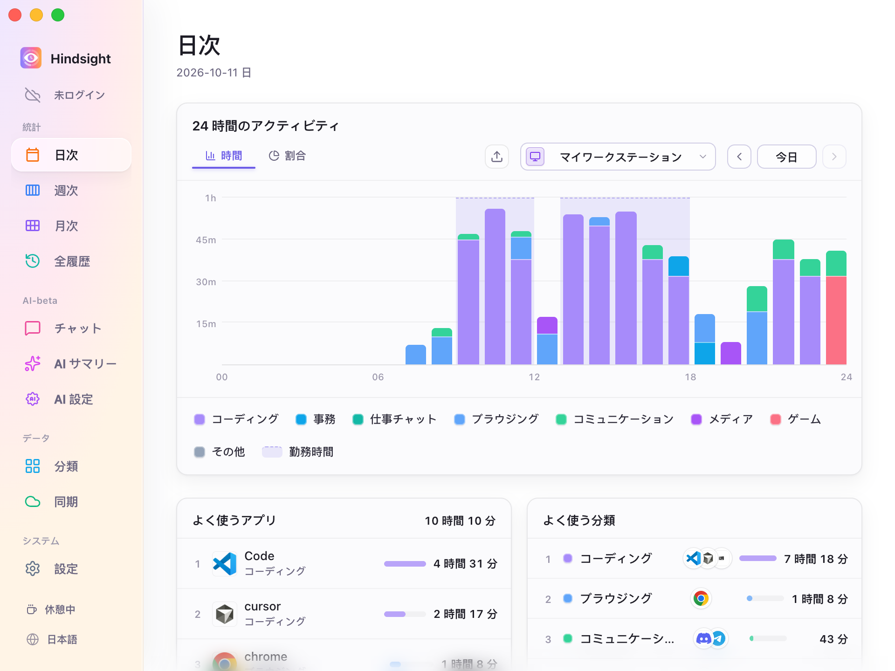
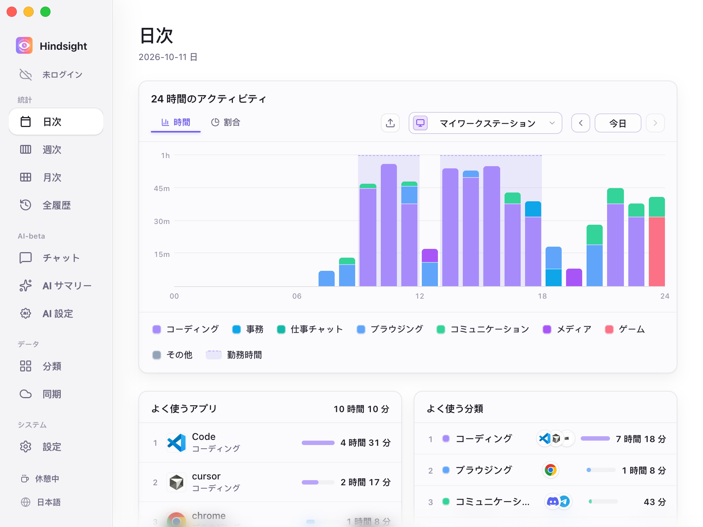
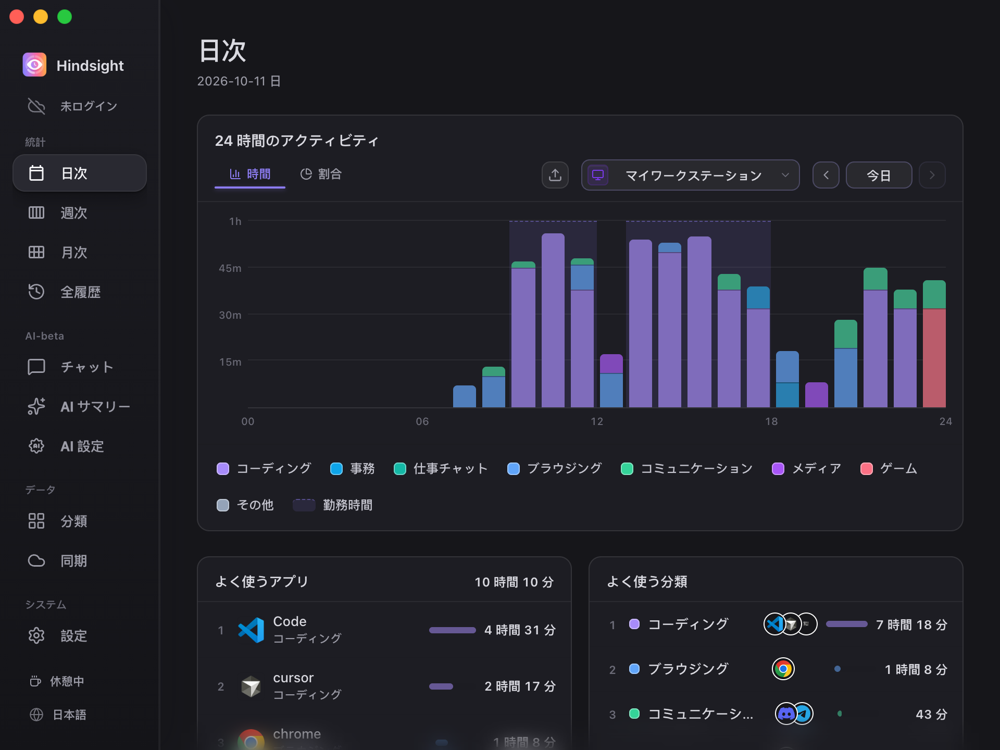

# インターフェースと外観

- [機能概要](#機能概要)
- [表示言語](#表示言語)
- [テーマ](#テーマ)
- [起動と終了](#起動と終了)
- [初期設定](#初期設定)

## 機能概要

表示言語やテーマを切り替えられます。システム起動時の自動起動や、ウィンドウを閉じた後もバックグラウンドで動作させるかを設定できます。

## 表示言語

简体中文、繁體中文、English、日本語、Português、Español に対応しています。「設定 → 一般」で選ぶか、サイドバー下部の言語ボタンで順に切り替えられます。変更はすぐに反映されます。

表示言語を切り替えると、AI サマリーのプロンプトの言語も切り替わります。

## テーマ

デフォルト、シンプル、ダークの 3 つのテーマがあります。

<table align="center">
  <tr>
    <td align="center"> デフォルト</td>
    <td align="center"> シンプル</td>
    <td align="center"> ダーク</td>
  </tr>
</table>

## 起動と終了

- **システム起動時に自動起動**：ログイン後に Hindsight が自動起動し、記録を始めます。
- **静かに起動**：メインウィンドウを表示せず、バックグラウンドで起動できます。
- **閉じるときにトレイへ最小化**：有効にすると、閉じるボタンでウィンドウを隠し、バックグラウンドで記録を続けます。トレイのアイコンから再表示や終了ができます。

## 初期設定

| 項目 | 初期設定 | 説明 |
| --- | --- | --- |
| 表示言語 | システムに合わせる | 中国語・日本語・ポルトガル語・スペイン語には対応する言語を使用。それ以外は英語 |
| テーマ | シンプル | - |
| システム起動時に自動起動 | オフ | - |
| ウィンドウを閉じたとき | トレイへ最小化 | バックグラウンドで記録を継続 |
| アップデートを自動で確認 | オン | 毎週確認。「設定 → 情報」で変更可能 |
