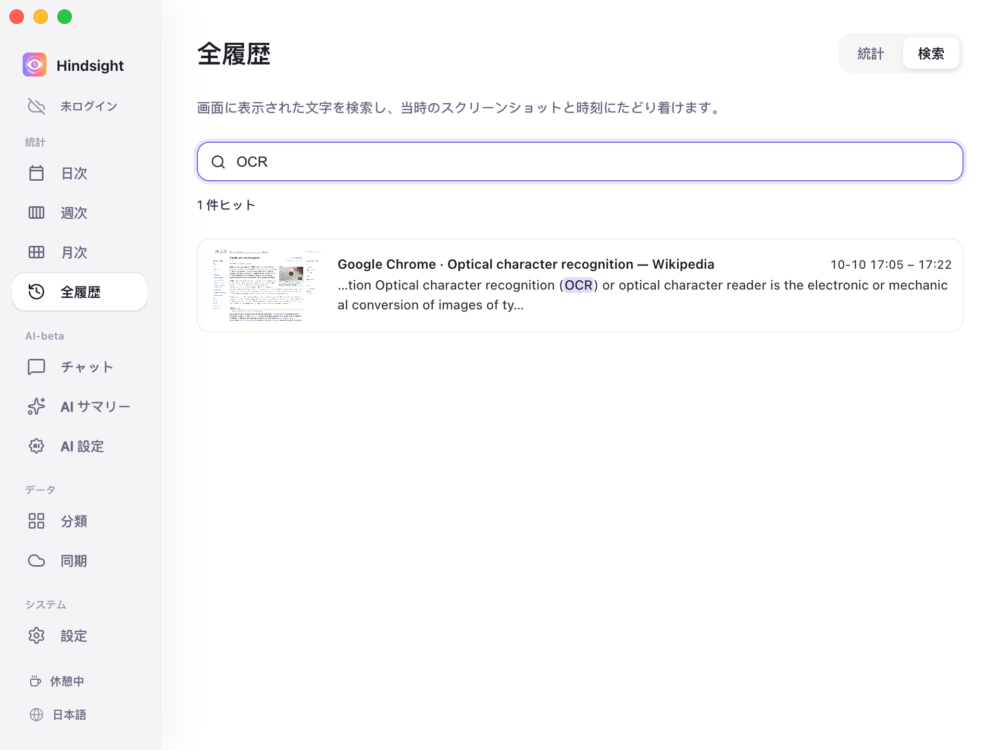
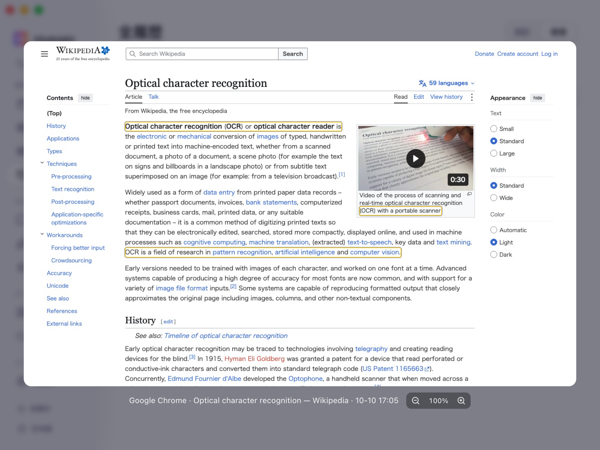

# 画面メモリと検索

- [機能概要](#機能概要)
- [検索と振り返り](#検索と振り返り)
- [初期設定](#初期設定)

## 機能概要

以前見たウェブページの文字や文書の一部、出典を忘れた一文をキーワードで探せます。

## 検索と振り返り

一致する文字が強調表示され、検索結果にはアプリと表示された時刻も示されます。

    
     
    全履歴 → 検索

    
     
    検索結果（スクリーンショットのプレビュー）

> スクリーンショット内の一致箇所を枠で表示します。拡大・縮小やドラッグで内容を確認できます。

## 初期設定

| 項目 | 初期設定 | 説明 |
| --- | --- | --- |
| スクリーンショットを有効化 | オフ | 画面メモリの利用に必要。設定で有効化 |
| OCR を常駐させる | オフ | 有効にすると新しいスクリーンショットの文字をバックグラウンドで継続的に認識 |
| スクリーンショット保持 | 7 日 | 期限を過ぎた画像は削除。認識済みの文字は引き続き検索可能 |
