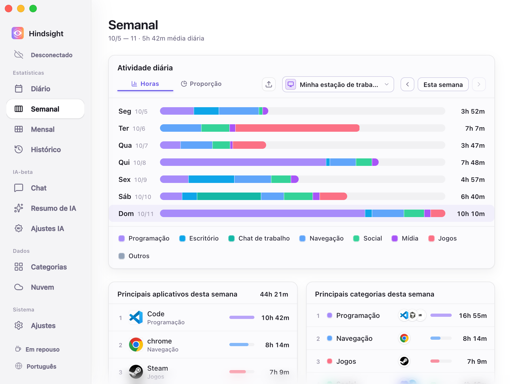
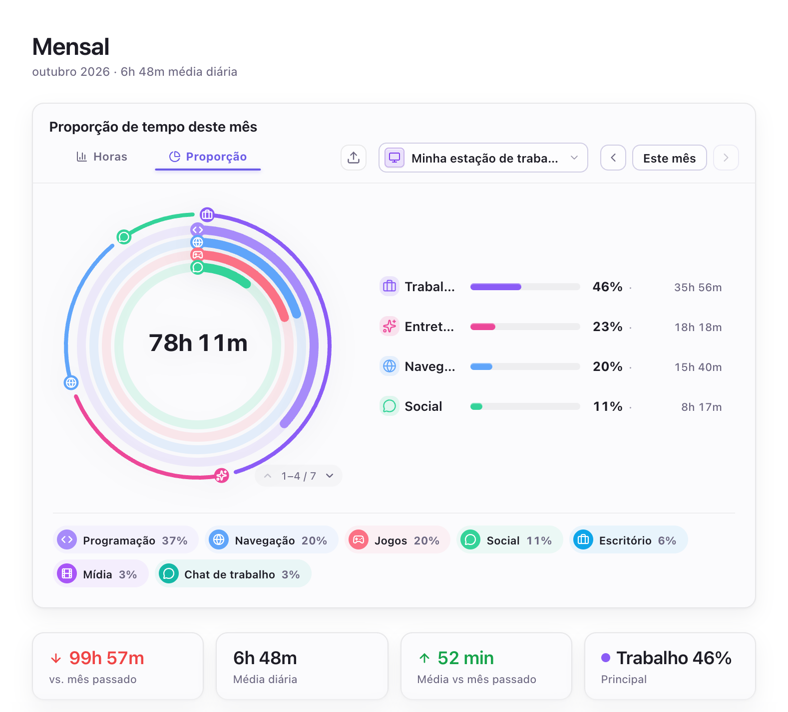
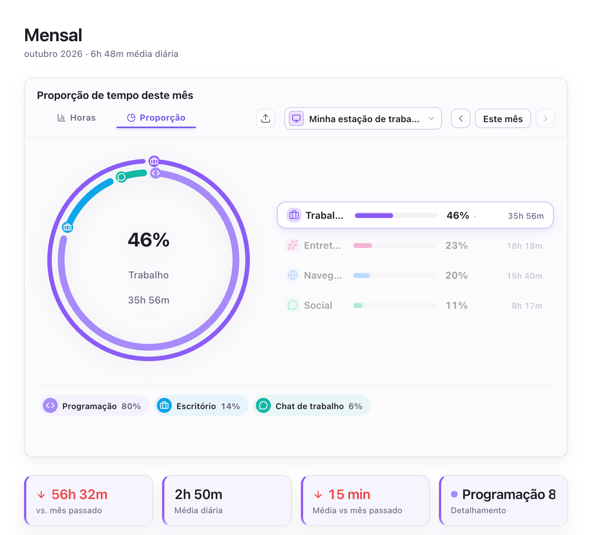
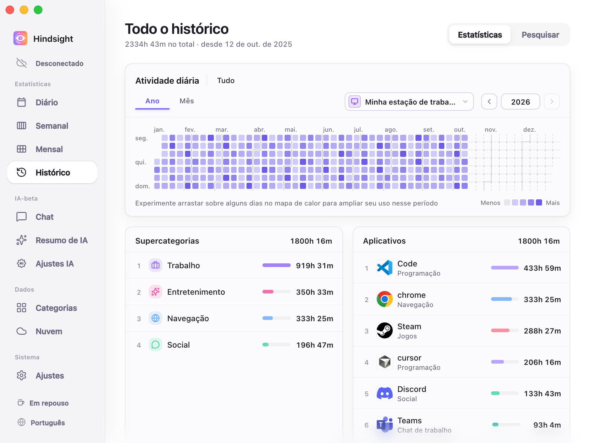
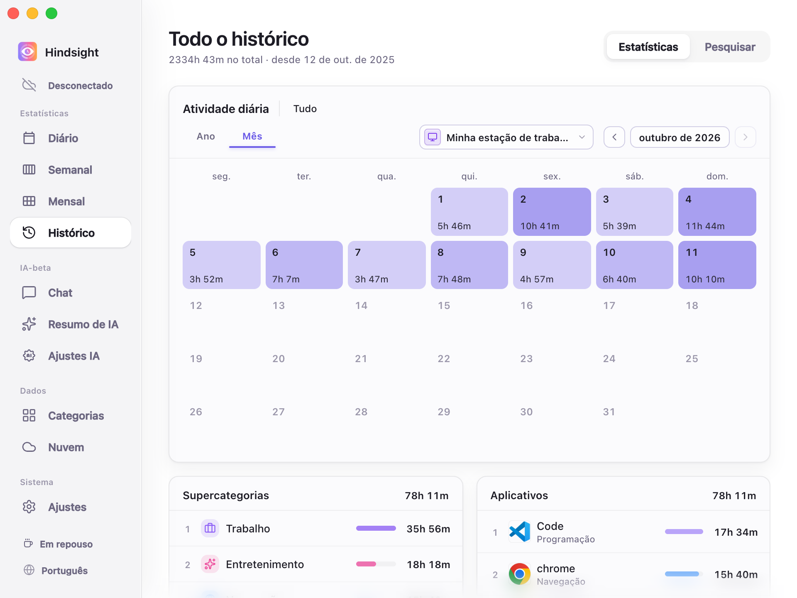

# Registro de atividade e estatísticas

- [Visão geral](#visão-geral)
- [Estatísticas](#estatísticas)
  - [Diário](#diário)
  - [Semanal](#semanal)
  - [Mensal](#mensal)
  - [Histórico](#histórico)
- [Captura de atividade](#captura-de-atividade)
- [Comportamento padrão](#comportamento-padrão)

## Visão geral

O Hindsight registra automaticamente a atividade em primeiro plano e o tempo de uso, com estatísticas diárias, semanais, mensais e históricas. As estatísticas básicas de tempo não exigem capturas de tela; capturas e OCR são opcionais.

## Estatísticas

### Diário

    
     
    Diário (visão Horas)

### Semanal

    
     
    Semanal (visão Horas)

### Mensal

    
     
    Mensal (visão Horas)

    
     
    Mensal (participação e estatísticas das categorias de atividade)

> O anel externo mostra a participação das supercategorias, como “Trabalho”, “Entretenimento”, “Navegação” e “Social”. O anel interno mostra as categorias, como “Programação”, “Escritório” e “Chat de trabalho”, dentro de “Trabalho”.

    
     
    Mensal (visão Proporção — supercategoria selecionada)

> Ao selecionar uma supercategoria, o anel e os rótulos abaixo mostram apenas sua composição. Aqui, “Trabalho” está selecionado: Programação representa 82%, Escritório 11% e Chat de trabalho 7%.
> Os quatro cartões abaixo mostram, da esquerda para a direita: a variação do tempo de trabalho neste mês em relação ao anterior (-60h 42m), a média diária de trabalho neste mês (2h 48m), a variação dessa média em relação ao mês anterior (-19m) e a categoria com maior participação em Trabalho (Programação, com 82%).

### Histórico

O mapa de calor anual mostra a distribuição da atividade ao longo do tempo, e o calendário mensal mostra o uso de cada dia. Também é possível consultar um intervalo de datas ou rever o histórico de um aplicativo.

    
     
    Histórico (Ano)

> Na visão anual, cores mais escuras indicam mais tempo de uso naquele dia. Arraste sobre um intervalo no mapa de calor para ampliá-lo. Ao selecionar um dia, os rankings de supercategorias e aplicativos abaixo passam a mostrar apenas esse dia.

    
     
    Histórico (Mês)

## Captura de atividade

- **Registro de atividade:** registra o aplicativo em foco e seu tempo de uso.
- **Inatividade:** para de contar o tempo após 3 minutos sem uso do mouse ou teclado, por padrão.
- **Horário de trabalho:** quando ativado, captura apenas nos horários definidos. Fora deles, a barra lateral mostra “Em repouso” e a captura de atividade para.
- **Status de captura:** o botão `Parar` na barra lateral interrompe a captura de atividade; outro clique a retoma.
- **Domínios de sites:** ativado por padrão, permite registrar e classificar os sites visitados. Por exemplo, as visitas ao YouTube podem ser atribuídas a uma categoria de vídeos.
- **Vários dispositivos:** cada dispositivo registra sua própria atividade. Após sincronizar, você pode consultar todos juntos ou apenas um.

## Comportamento padrão

| Item | Padrão | Observações |
| --- | --- | --- |
| Captura de atividade | Ativada | - |
| Intervalo de captura | 30 segundos | - |
| Tempo limite de inatividade | 3 minutos | - |
| Horário de trabalho | Desativado | Quando ativado, registra a atividade apenas nos horários definidos |
| Registrar domínios de sites | Ativado (depende do suporte do navegador, das permissões e dos ajustes de privacidade) | - |
| Capturas de tela | Desativadas | - |
| Retenção de capturas de tela | 7 dias | As capturas são excluídas automaticamente após esse prazo para economizar espaço |
