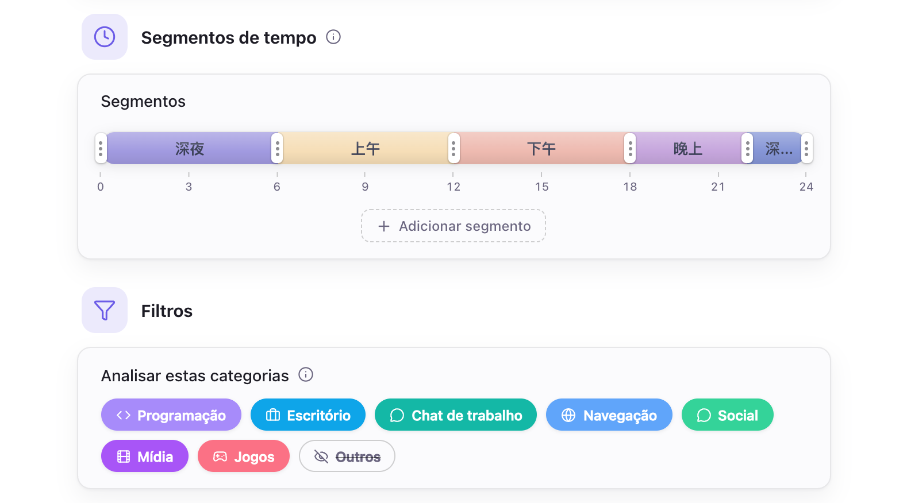

# Configuração de IA

- [Visão geral](#visão-geral)
- [Modelos locais](#modelos-locais)
- [API na nuvem](#api-na-nuvem)
- [Ajustes dos relatórios](#ajustes-dos-relatórios)
- [Comportamento padrão](#comportamento-padrão)

## Visão geral

O Hindsight permite configurar modelos locais e APIs na nuvem para usar modelos de linguagem generativos nos resumos e no Chat.

## Modelos locais

Os modelos locais rodam no seu computador. O Hindsight ajuda a configurá-los de acordo com o hardware:

1. **Mecanismo adequado automaticamente:** em “Ajustes IA → Mecanismo”, clique para baixar. O sistema identifica o hardware, como Mac Metal ou NVIDIA CUDA, e baixa o mecanismo de aceleração mais adequado, sem exigir instalação manual de drivers.
2. **Modelos recomendados com um clique:** em “Ajustes IA → Modelos”, baixe um modelo recomendado conforme suas necessidades.
3. **Melhores parâmetros com um clique:** o sistema calcula os parâmetros mais estáveis com base na memória de vídeo do computador.

Escolha um modelo da lista predefinida, importe seu próprio arquivo GGUF ou informe um repositório do Hugging Face para baixar. O mecanismo e os modelos são baixados de fontes oficiais por padrão; se o acesso for difícil, você pode usar espelhos.

## API na nuvem

Use um serviço na nuvem se o computador não conseguir executar um modelo local ou se você precisar de um modelo mais potente.

- **Provedor:** aceita APIs compatíveis com OpenAI. Há configurações prontas para OpenAI, DeepSeek, Kimi (Moonshot), OpenRouter, Together e Groq; você também pode informar o endereço de outro serviço compatível.

Os serviços na nuvem recebem apenas texto, nunca imagens das capturas de tela.

> **Atenção à exposição de informações pessoais:** o texto enviado inclui nomes de aplicativos, títulos de janelas, a linha do tempo de atividades e as informações em “Sobre você”. No Chat, também inclui suas perguntas e o texto da tela reconhecido por OCR. Esses dados podem conter informações pessoais sensíveis. Recomendamos configurar os [ajustes de privacidade](./privacy-setting.md) antes de usar e escolher apenas provedores de API em que você confia.

## Ajustes dos relatórios

O Hindsight usa estes ajustes para gerar relatórios.

    
     
    Ajustes IA → Geral

- **Segmentos de tempo:** divide o dia em partes, resumidas separadamente pela IA.
- **Analisar estas categorias:** define quais categorias de aplicativos entram nos relatórios.
- **Sobre você:** opcional; diga ao modelo com o que você trabalha para obter resumos mais pertinentes.
- **Prompt do sistema:** orienta o estilo e o conteúdo dos relatórios de IA e pode ser personalizado.

## Comportamento padrão

| Item | Padrão | Observações |
| --- | --- | --- |
| Mecanismo de IA local | Não instalado | Baixe em “Ajustes IA → Mecanismo”; cerca de 16–605 MB, conforme o sistema e a placa de vídeo |
| Fonte de download | Oficial | Baixa do Hugging Face e do GitHub; se o acesso for difícil, escolha um espelho em “Ajustes IA → Mecanismo” |
| Uso de memória pela IA | Liberada após 2 minutos de inatividade | Cerca de 2 minutos após o fim da tarefa, o mecanismo para automaticamente e libera RAM e memória de vídeo |
| Segmentos de tempo dos resumos | 5 segmentos | 0–6, 6–9, 9–12, 12–18 e 18–24 horas; podem ser alterados |
| Categorias de aplicativos analisadas | Todas, exceto “Outros” | Os relatórios usam apenas essas categorias. Aplicativos em “Outros”, incluindo os ainda sem categoria, não entram nos relatórios. Altere em “Ajustes IA → Geral → Filtros” |
