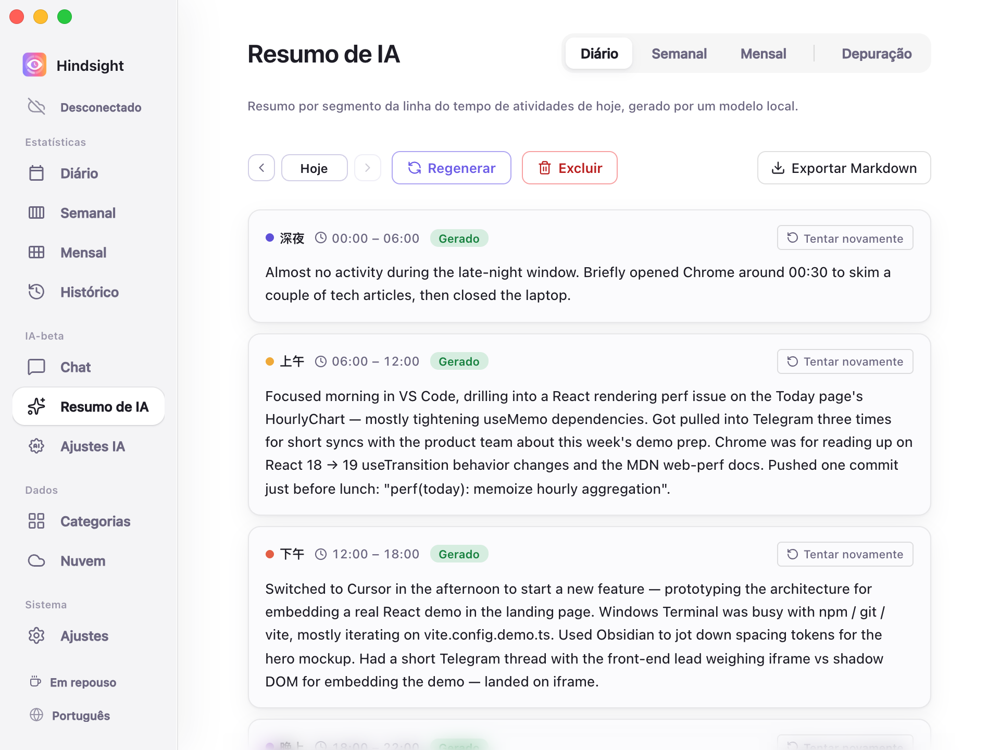
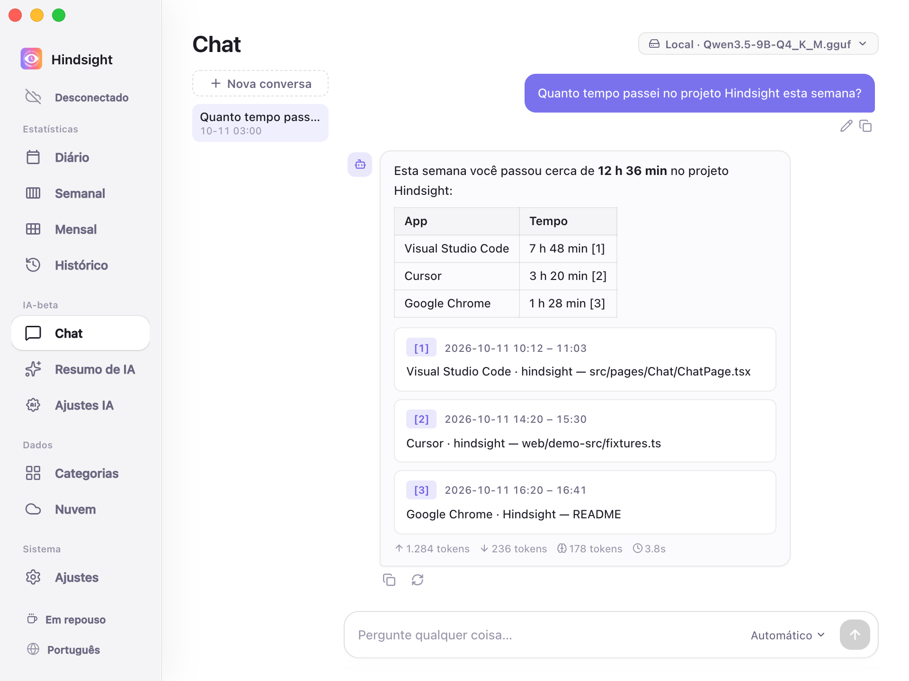

# Resumos de IA e Chat

- [Visão geral](#visão-geral)
- [Relatórios](#relatórios)
- [Chat](#chat)
- [Modelos](#modelos)
- [Comportamento padrão](#comportamento-padrão)

## Visão geral

O Hindsight usa IA para resumir registros de atividade de um período, gerar relatórios em texto e responder às suas perguntas com base nesses registros.

## Relatórios

“Resumo de IA” transforma registros de atividade em relatórios em texto.

    
     
    Resumo de IA → Diário

Atualmente, oferece:

- **Diário:** organiza as atividades do dia nos segmentos de tempo definidos; pode ser exportado como Markdown.
- **Semanal:** gera um relatório das atividades da semana.

> “Mensal” ainda está em desenvolvimento e não pode ser gerado.

## Chat

Na página “Chat”, consulte seus registros em linguagem natural. Por exemplo: “Quanto tempo gastei no projeto Hindsight nesta semana?” ou “Quanto tempo passei no YouTube nesta semana?”.

    
     
    Chat com IA

A IA responde com base nos seus registros de atividade e fornece links para você verificar as fontes.

## Modelos

Resumos e Chat podem usar modelos diferentes, locais ou na nuvem:

- **Modelos locais:** rodam no computador; todo o conteúdo permanece neste dispositivo.
- **API na nuvem:** aceita APIs compatíveis com OpenAI. Há configurações prontas para OpenAI, DeepSeek, Kimi (Moonshot), OpenRouter, Together e Groq; você também pode informar o endereço de outro serviço compatível.

Veja os detalhes em [Configuração de IA](./ai-configuration.md).

## Comportamento padrão

| Item | Padrão | Observações |
| --- | --- | --- |
| Resumo automático | Desativado | Quando ativado, gera o relatório diário às 23:00 por padrão e completa os relatórios diários ausentes e o relatório da semana anterior |
| API na nuvem | Desativada | Usa apenas modelos locais por padrão; o uso da nuvem exige configuração |
