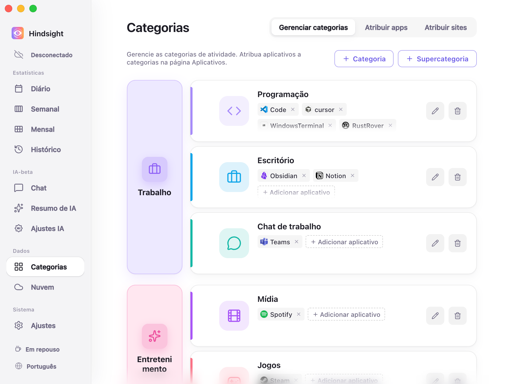
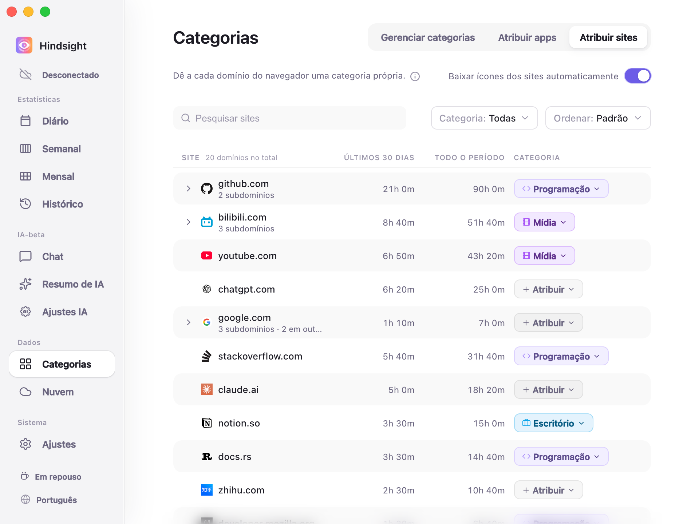
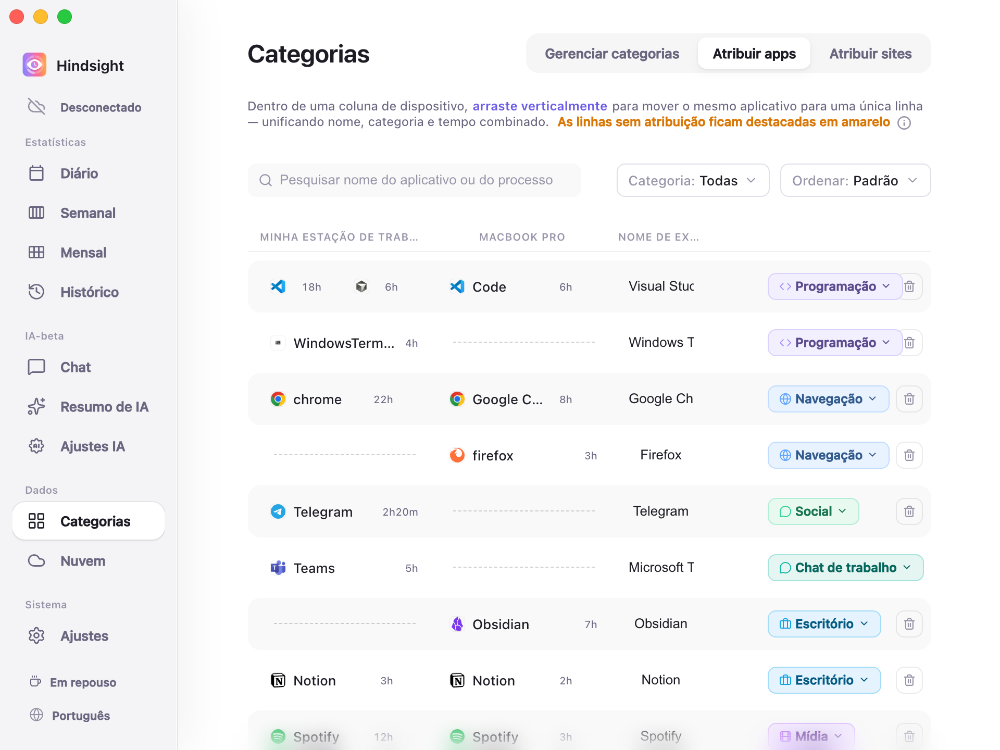

# Categorias e gerenciamento de aplicativos

- [Visão geral](#visão-geral)
- [Supercategorias, categorias e aplicativos](#supercategorias-categorias-e-aplicativos)
- [Atribuir sites](#atribuir-sites)
- [Atribuir apps e unificar entre dispositivos](#atribuir-apps-e-unificar-entre-dispositivos)
- [Comportamento padrão](#comportamento-padrão)

## Visão geral

O Hindsight organiza e contabiliza o uso do computador em três níveis: supercategorias, categorias e aplicativos. Você pode atribuir categorias a sites e aplicativos para agrupar o tempo de uso.

## Supercategorias, categorias e aplicativos

O Hindsight organiza e contabiliza seu tempo em três níveis:

- **Supercategorias:** áreas gerais da vida ou do trabalho, como “Trabalho” e “Entretenimento”.
- **Categorias:** tipos específicos de atividade, como Programação, Escritório, Social e Jogos. Cada categoria pertence a uma supercategoria e reúne o uso de aplicativos nas estatísticas.
- **Aplicativos:** programas usados no computador, como WeChat, Chrome e PowerPoint, cada um atribuído à sua categoria.

> **Relação:** aplicativo ➡️ categoria ➡️ supercategoria. Por exemplo, PowerPoint pertence a “Escritório”, que faz parte de “Trabalho”.

    
     
    Categorias → Gerenciar categorias

> A coluna à esquerda mostra as supercategorias, como “Trabalho” e “Entretenimento”. Cada linha à direita é uma categoria desse grupo, como “Programação”, “Escritório” e “Chat de trabalho”. Os rótulos da linha são os aplicativos da categoria, como Code e Cursor em Programação.

O sistema inclui supercategorias e categorias prontas para usar. Você pode adicionar, excluir, renomear ou arrastar itens para mudar a organização. Alguns aplicativos comuns já vêm classificados para facilitar o início.

## Atribuir sites

Um navegador pode servir a tarefas muito diferentes. Classificá-lo inteiro como “Navegação” mistura o tempo de pesquisa no GitHub com o de vídeos no Bilibili.

“Atribuir sites” permite definir uma categoria para cada domínio, independentemente da categoria do navegador.

    
     
    Atribuir sites

## Atribuir apps e unificar entre dispositivos

Todos os programas registrados no computador aparecem aqui automaticamente. Você pode atribuir uma categoria a cada aplicativo e unificar as estatísticas do mesmo programa em dispositivos diferentes.

    
     
    Atribuir apps

- **Definir categoria:** clique no rótulo de categoria à direita para atribuí-la. Aplicativos sem categoria ficam destacados em amarelo.
- **Unificar entre dispositivos:** um programa pode ter nomes diferentes em cada sistema, como `chrome.exe` no Windows e `Google Chrome` no macOS. **Arraste verticalmente** na lista para emparelhá-los na mesma linha, unificar o nome e somar o tempo de uso.
- **Ocultar e limpar:** atribua “Oculto” a programas em segundo plano que não deseja incluir nas estatísticas. Eles deixam de aparecer nos relatórios.

## Comportamento padrão

| Item | Padrão | Observações |
| --- | --- | --- |
| Supercategorias predefinidas | Trabalho, Entretenimento, Social, Navegação | - |
| Categorias predefinidas | Programação, Escritório, Chat de trabalho (Trabalho); Jogos, Mídia (Entretenimento); Social (Social); Navegação (Navegação); Design e Outros (sem supercategoria) | Há também a categoria especial “Oculto”, cujos aplicativos não entram nas estatísticas |
| Classificação automática de aplicativos comuns | Ativada | Inclui uma tabela com cerca de 370 nomes de processos comuns: Chrome → Navegação, VS Code → Programação, Steam → Jogos, Spotify → Mídia, Word → Escritório |
| Aplicativos ainda sem categoria | Contam como “Outros” | Aparecem em amarelo em “Atribuir apps”; por padrão, essa página mostra apenas os aplicativos ainda sem categoria |
| Unificação entre dispositivos | Automática para programas comuns | Inclui nomes equivalentes de 32 programas em diferentes sistemas. Por exemplo, `chrome.exe` no Windows e `Google Chrome` no macOS aparecem automaticamente na mesma linha; os demais podem ser emparelhados por arraste |
| Baixar ícones dos sites automaticamente | Desativado | Exibe um ícone genérico de globo. Quando ativado, baixa os ícones reais dos sites, como GitHub e YouTube |
