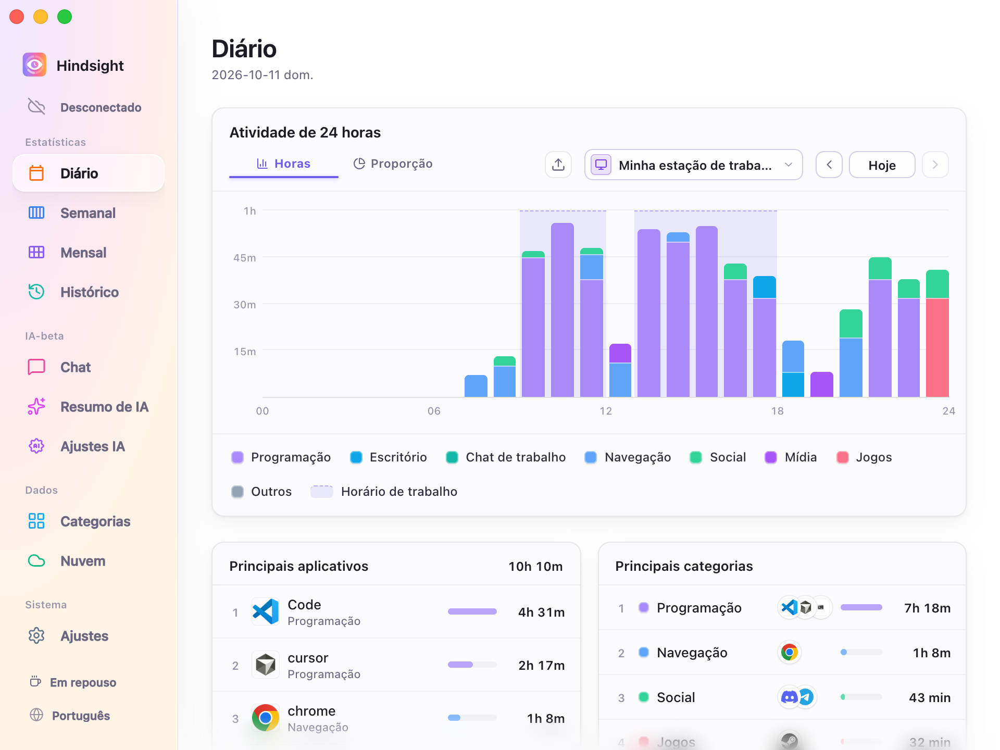
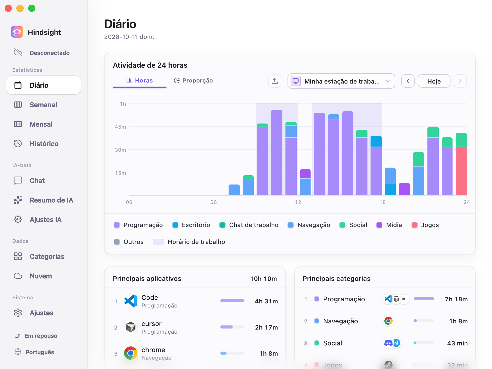
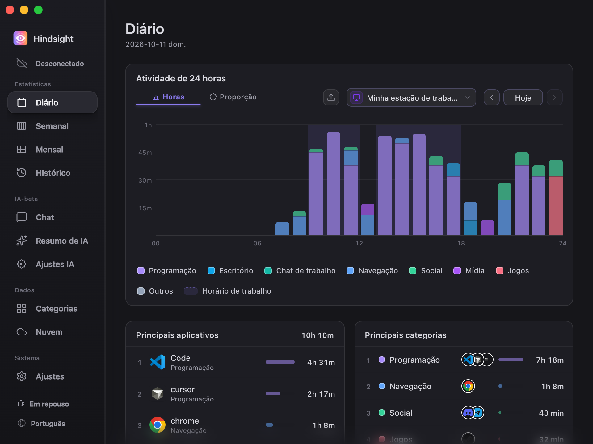

# Interface e aparência

- [Visão geral](#visão-geral)
- [Idioma da interface](#idioma-da-interface)
- [Temas](#temas)
- [Inicialização e fechamento](#inicialização-e-fechamento)
- [Comportamento padrão](#comportamento-padrão)

## Visão geral

O Hindsight permite mudar o idioma e o tema da interface, iniciar com o sistema e continuar em segundo plano após fechar a janela.

## Idioma da interface

Há suporte a 简体中文, 繁體中文, English, 日本語, Português e Español. Mude o idioma em “Ajustes → Geral” ou use o botão de idioma na parte inferior da barra lateral para alternar entre eles. A mudança é imediata.

Ao mudar o idioma da interface, o idioma dos prompts usados nos resumos de IA também muda.

## Temas

O Hindsight oferece três temas: Padrão, Minimalista e Escuro.

<table align="center">
  <tr>
    <td align="center"> Padrão</td>
    <td align="center"> Minimalista</td>
    <td align="center"> Escuro</td>
  </tr>
</table>

## Inicialização e fechamento

- **Iniciar com o sistema:** executa o Hindsight automaticamente após o login e começa a registrar.
- **Inicialização silenciosa:** com “Mostrar janela principal na inicialização” desativado, o Hindsight inicia em segundo plano com o sistema, sem abrir a janela principal.
- **Minimizar para a bandeja do sistema ao fechar:** quando ativado, o botão de fechar apenas recolhe a janela. O Hindsight continua registrando em segundo plano e pode ser reaberto ou encerrado pelo ícone da bandeja.

## Comportamento padrão

| Item | Padrão | Observações |
| --- | --- | --- |
| Idioma da interface | Segue o sistema | Usa o idioma correspondente para chinês, japonês, português e espanhol; para os demais idiomas do sistema, usa inglês |
| Aparência | Minimalista | - |
| Iniciar com o sistema | Desativado | - |
| Fechar a janela | Minimiza para a bandeja do sistema | Continua registrando em segundo plano |
| Verificar atualizações automaticamente | Ativado | Verifica semanalmente; pode ser alterado em “Ajustes → Sobre” |
