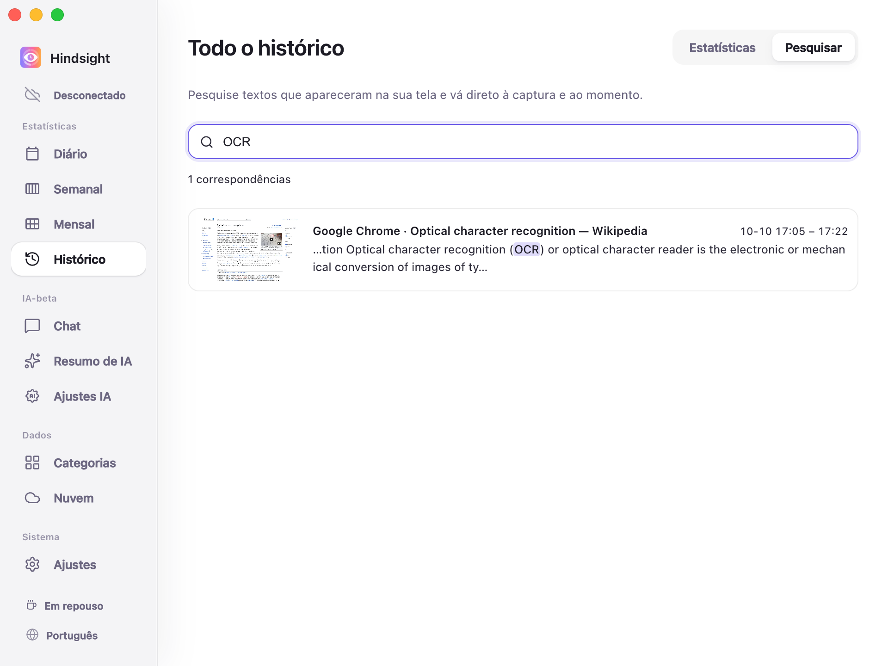
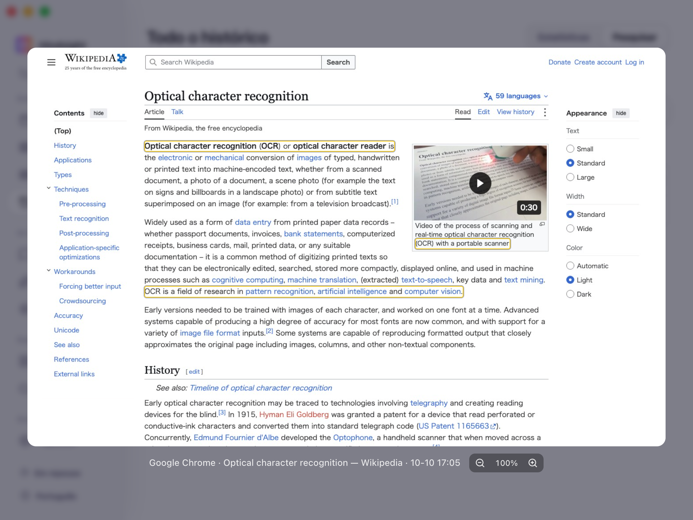

# Memória de tela e pesquisa

- [Visão geral](#visão-geral)
- [Pesquisar e rever](#pesquisar-e-rever)
- [Comportamento padrão](#comportamento-padrão)

## Visão geral

O Hindsight permite encontrar, por palavras-chave, textos de páginas e documentos que você viu, ou uma frase cuja origem esqueceu.

## Pesquisar e rever

O texto correspondente aparece destacado, junto com o aplicativo e o horário em que foi visto.

    
     
    Histórico → Pesquisar

    
     
    Resultados da pesquisa (prévia da captura de tela)

> A captura destaca a localização do texto correspondente. Você pode ampliar, reduzir e arrastar para ver os detalhes.

## Comportamento padrão

| Item | Padrão | Observações |
| --- | --- | --- |
| Capturas de tela | Desativadas | São necessárias para a memória de tela; ative-as nos ajustes |
| Manter OCR residente | Desativado | Quando ativado, reconhece continuamente o texto das novas capturas em segundo plano |
| Retenção de capturas de tela | 7 dias | Capturas mais antigas são removidas, mas o texto já reconhecido continua disponível para pesquisa |
