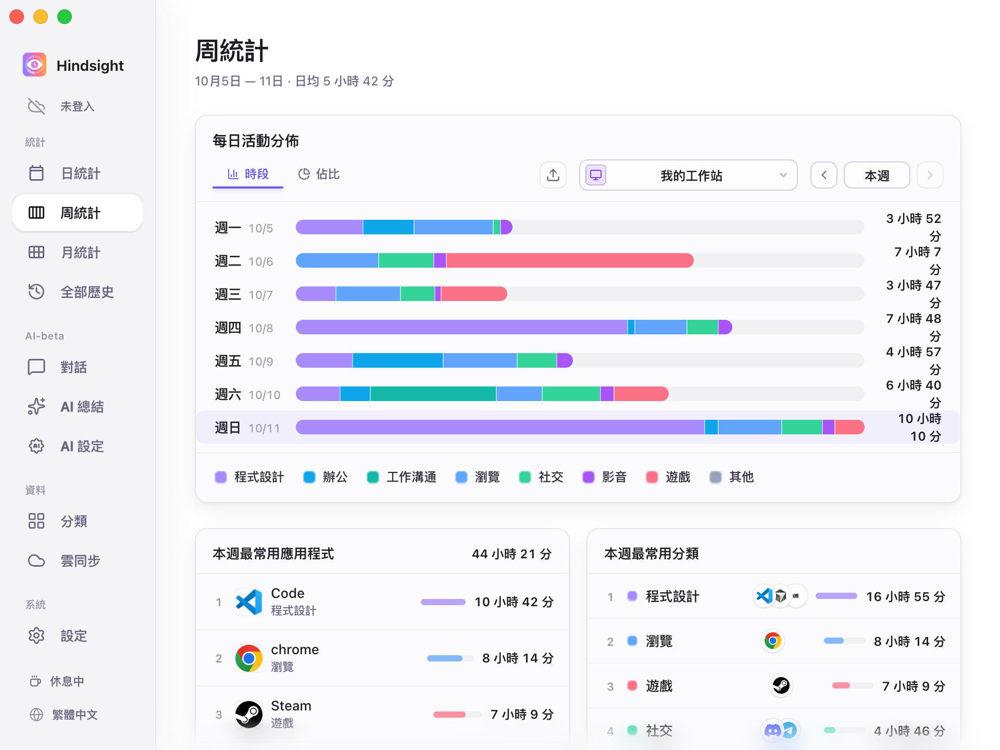
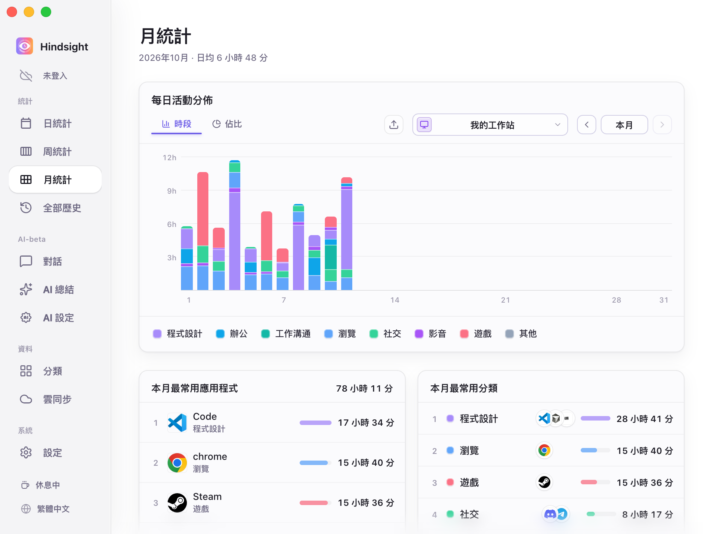
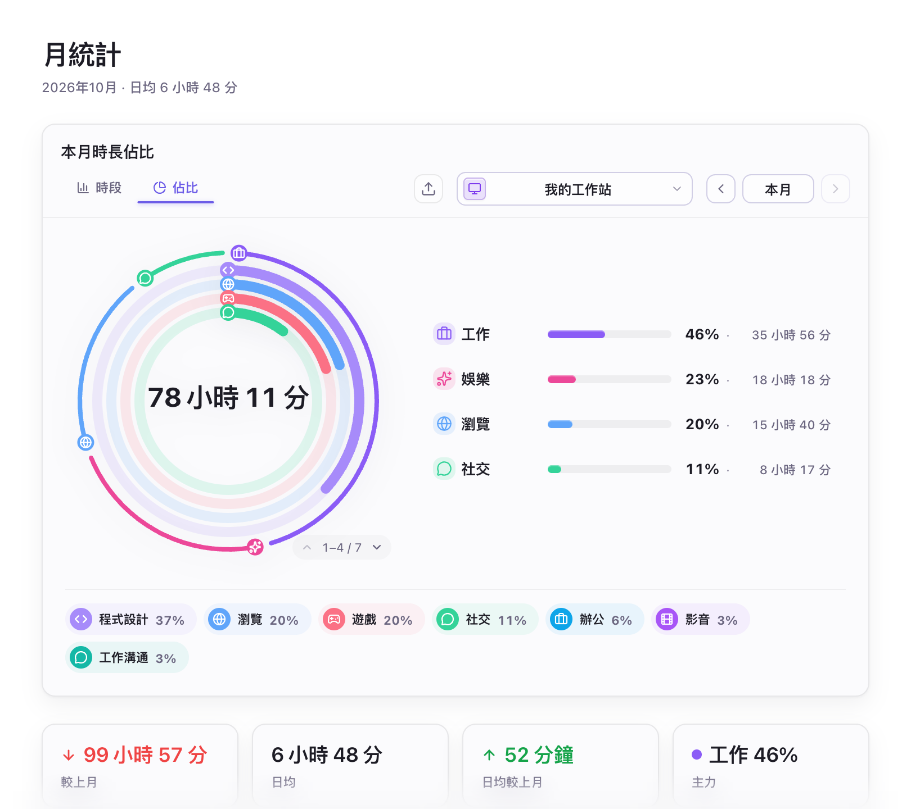
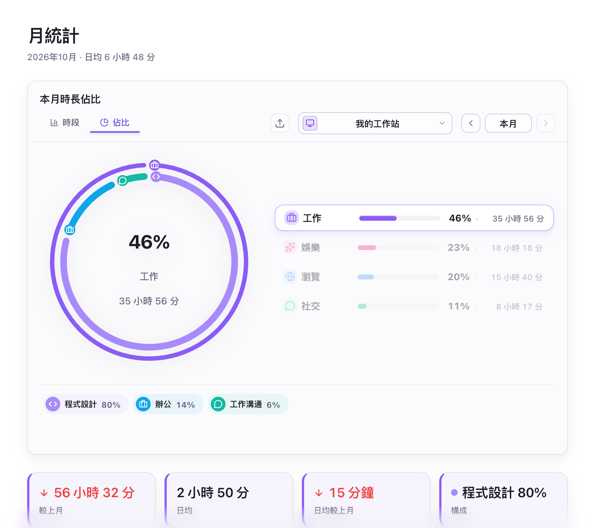
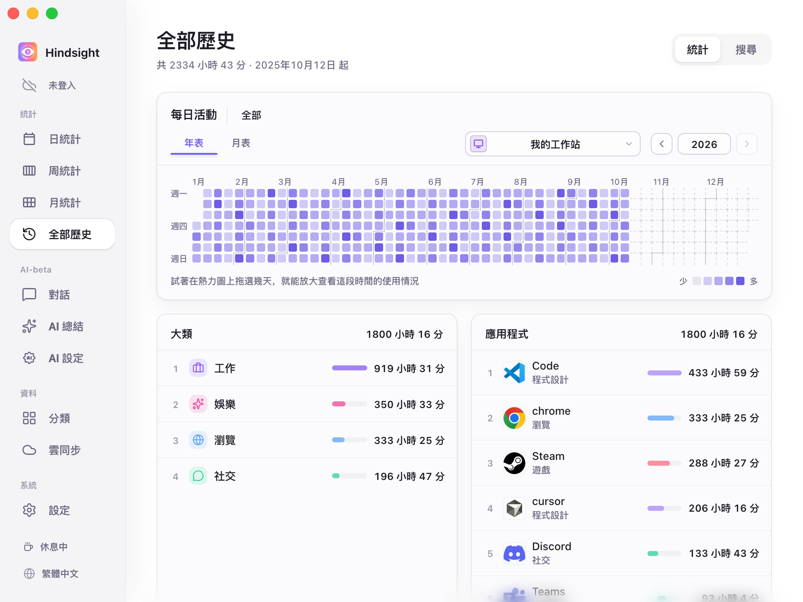
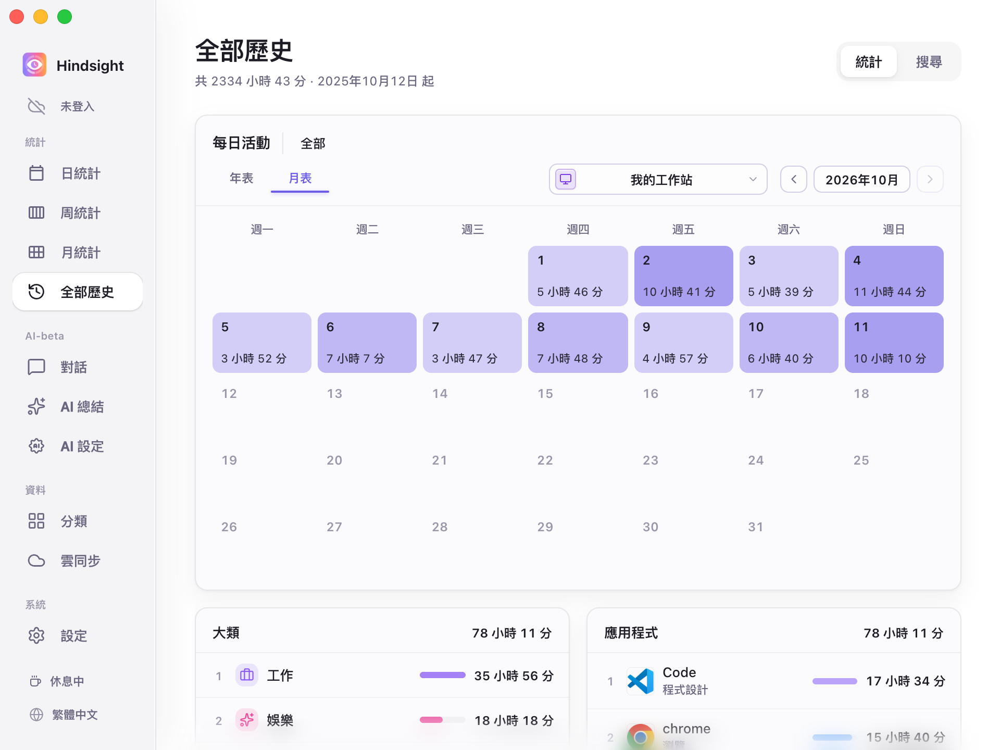

# 活動記錄與統計

- [功能概述](#功能概述)
- [統計](#統計)
  - [日統計](#日統計)
  - [周統計](#周統計)
  - [月統計](#月統計)
  - [全部歷史](#全部歷史)
- [活動採集](#活動採集)
- [預設行為](#預設行為)

## 功能概述

Hindsight 自動記錄前景活動與使用時間，提供日、週、月和歷史統計。基本使用時間統計不需要開啟截圖；截圖和 OCR 可自行選用。

## 統計

### 日統計

    
     
    日統計（時段檢視）

### 周統計

    
     
    周統計（時段檢視）

### 月統計

    
     
    月統計（時段檢視）

    
     
    月統計（各類別活動佔比及統計資料）

> 最外圈是大類活動的佔比（例如「工作」「娛樂」「瀏覽」「社交」），內圈是小類活動的佔比（例如「工作」下的「程式設計」「辦公」「工作溝通」）。

    
     
    月統計（佔比檢視-類別選取）

> 選取一個大類後，圓環和下方標籤只顯示該大類的組成。此處選取「工作」：程式設計佔 82%，辦公佔 11%，工作溝通佔 7%。
> 下方四張卡片由左至右分別為：本月工作時間較上月的變化（-60h 42m）、本月每日平均工作時間（2h 48m）、本月每日平均時間較上月的變化（-19m）、工作大類中佔比最大的小類活動（此處為程式設計，佔比 82%）

### 全部歷史

全年熱度圖呈現長期活動分布，月曆顯示每天的使用時間；支援指定日期範圍統計及單一應用程式的長期回顧。

    
     
    全部歷史（年表）

> 年表的顏色越深，表示當天使用時間越長。在熱度圖上拖曳選取一段範圍，可放大查看該時段；選取某一天，下方的大類和應用程式排行也會只統計當天。

    
     
    全部歷史（月表）

## 活動採集

- **活動記錄：** 記錄前景中取得焦點的應用程式及使用時間。
- **閒置處理：** 鍵盤與滑鼠超過 3 分鐘（預設）沒有操作後，停止計時。
- **工作時段：** 啟用後只在設定時段採集，其餘時間側欄顯示「休息中」，並關閉活動採集。
- **採集狀態：** 在側欄按一下 `停止採集` 按鈕即可停止活動採集，再按一下便會恢復。
- **網站網域：** 預設開啟，用來記錄及分類瀏覽的網站，例如可將 Youtube 的造訪記錄歸入「影片」類別。
- **多裝置：** 各裝置分別記錄；同步後可查看所有裝置的彙整資料，或單獨查看一台裝置。

## 預設行為

| 項目 | 預設狀態 | 說明 |
| --- | --- | --- |
| 活動採集 | 開啟 | - |
| 採集間隔 | 30 秒 | - |
| 閒置閾值 | 3 分鐘 | - |
| 工作時段 | 關閉 | 開啟後只在設定時段內記錄活動 |
| 記錄瀏覽器網站網域 | 開啟（受瀏覽器支援、權限及隱私設定影響） | - |
| 截圖 | 關閉 | - |
| 截圖保留時間 | 7 天 | 截圖會在此時間後自動刪除，以節省儲存空間 |
