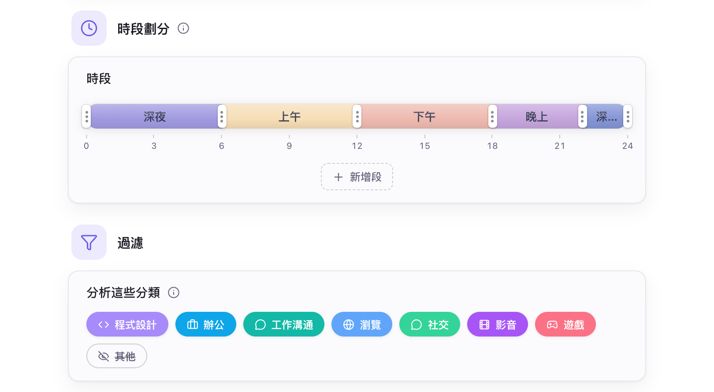

# AI 設定

- [功能概述](#功能概述)
- [本機模型](#本機模型)
- [雲端 API](#雲端-api)
- [總結報告相關設定](#總結報告相關設定)
- [預設行為](#預設行為)

## 功能概述

Hindsight 支援設定本機模型和雲端 API，在總結與對話中使用生成式大型語言模型。

## 本機模型

本機模型在你的電腦上執行。Hindsight 會依你的電腦協助完成設定：

1. **自動匹配引擎**：進入「AI 設定 → 引擎」，按一下下載即可。系統會自動辨識硬體（如 Mac Metal 或 NVIDIA CUDA），下載最適合的加速引擎，不需手動安裝驅動程式。
2. **一鍵下載推薦模型**：進入「AI 設定 → 模型」，依需求下載推薦模型即可。
3. **一鍵套用最佳參數**：系統會依電腦的視訊記憶體，自動計算最穩定的執行參數。

你可以從預設模型清單選擇，也可匯入自己的 GGUF 檔案，或填入 Hugging Face 儲存庫網址下載。引擎和模型預設從官方來源下載，無法連線時可切換至鏡像來源。

## 雲端 API

若裝置效能不足以執行本機模型，或需要更強大的模型，可改用雲端服務。

- **服務商**：支援 OpenAI 相容介面。內建 OpenAI、DeepSeek、Kimi（Moonshot）、OpenRouter、Together、Groq 預設，也可填入其他相容服務的網址。

使用雲端服務時，只會傳送文字內容，不會上傳截圖圖片。

> **請留意個人資訊外洩**：傳送的文字包含應用程式名稱、視窗標題、活動時間軸及個人簡介；使用對話時，也包含你的提問與 OCR 辨識的螢幕文字。這些內容可能含有敏感的個人資訊，建議使用前先設定：[隱私設定](./privacy-setting.md)，並只使用你信任的 API 服務商。

## 總結報告相關設定

Hindsight 會依這些設定產生總結報告。

    
     
    AI 設定 → 常規

- **時段劃分**：將一天分成幾段，AI 依時段彙整。
- **分析這些分類**：選擇哪些分類的應用程式納入報告。
- **個人簡介**：可選填，告訴模型你的工作內容，讓總結更貼近需求。
- **系統提示詞**：引導 AI 產生報告的風格與內容，可依需求自訂。

## 預設行為

| 項目 | 預設 | 說明 |
| --- | --- | --- |
| 本地 AI 引擎 | 未安裝 | 需在「AI 設定 → 引擎」下載，約 16–605 MB，依系統和顯示卡而定 |
| 下載來源 | 官方來源 | 從 Hugging Face 和 GitHub 下載，無法連線時可在「AI 設定 → 引擎」切換鏡像 |
| AI 記憶體使用 | 閒置 2 分鐘後釋放 | 任務結束並閒置約 2 分鐘後自動停止，釋放記憶體和視訊記憶體 |
| 總結時段 | 5 段 | 0–6、6–9、9–12、12–18、18–24 點，可修改 |
| 分析的應用程式類別 | 除「其他」外全部 | 報告只使用這些分類中的應用程式。歸入「其他」的應用程式（包括尚未歸類的）不會納入報告，可在「AI 設定 → 常規 → 過濾」調整 |
