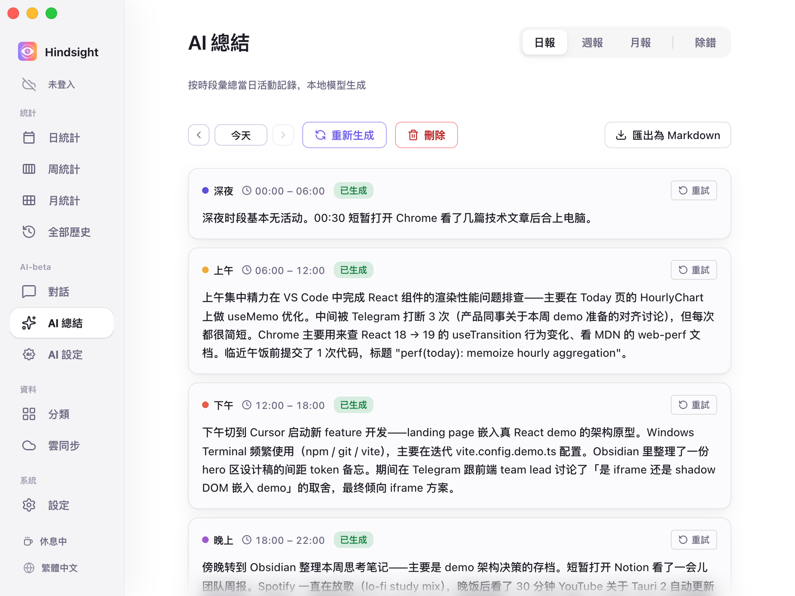
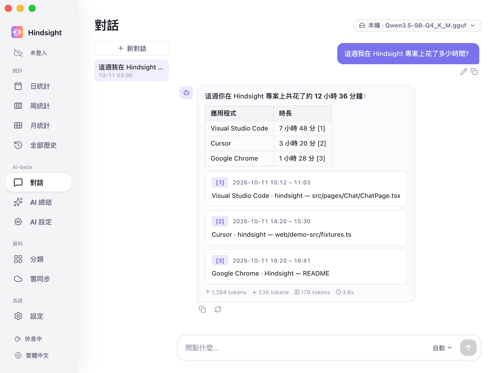

# AI 總結與對話

- [功能概述](#功能概述)
- [總結報告](#總結報告)
- [對話](#對話)
- [模型](#模型)
- [預設行為](#預設行為)

## 功能概述

Hindsight 可讓 AI 總結一段時間內的活動記錄，產生文字報告，或依活動記錄回答你的提問。

## 總結報告

「AI 總結」將活動記錄整理成文字報告。

    
     
    AI 總結 → 日報

目前支援：

- **日報**：依設定時段將一天的活動整理成報告，可匯出為 Markdown。
- **週報**：產生一週的活動總結報告。

> 「月報」仍在開發中，目前無法產生。

## 對話

在「對話」頁用自然語言查詢自己的記錄，例如「這週我在 Hindsight 專案上花了多少時間？」「我這週花了多少時間逛 Youtube？」。

    
     
    AI 對話

AI 會依活動記錄產生回答並提供連結，方便你核對依據。

## 模型

總結和對話可各自選擇模型，本機或雲端皆可：

- **本機模型**：在電腦上執行，所有內容都留在本機。
- **雲端 API**：支援 OpenAI 相容介面。內建 OpenAI、DeepSeek、Kimi（Moonshot）、OpenRouter、Together、Groq 預設，也可填入其他相容服務的網址。

設定方式見 [AI 設定](./ai-configuration.md)。

## 預設行為

| 項目 | 預設 | 說明 |
| --- | --- | --- |
| 自動總結 | 關閉 | 開啟後預設每天 23:00 產生當天日報，並補齊缺少的日報及上一週的週報 |
| 雲端 API | 關閉 | 預設只使用本機模型，使用雲端需自行設定 |
