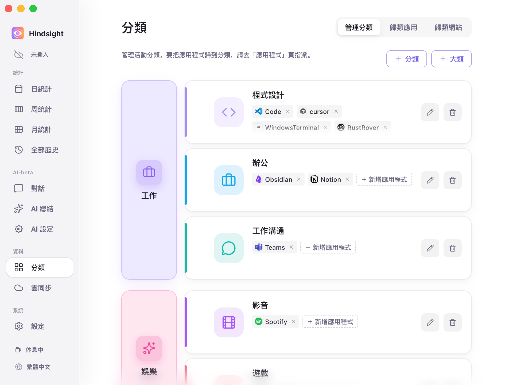
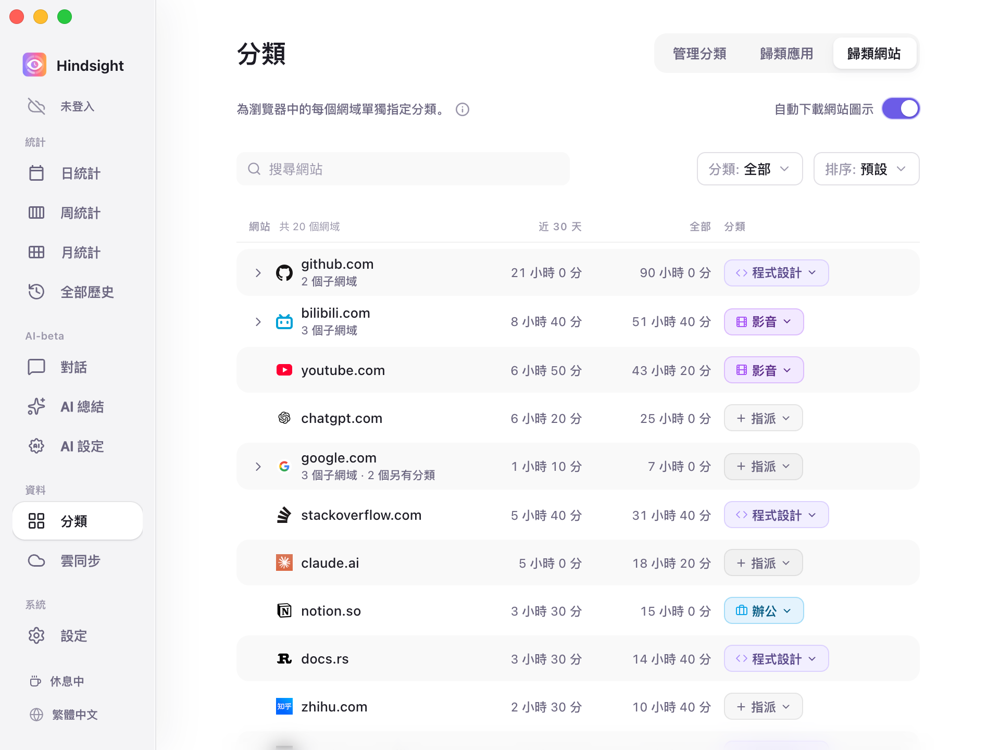
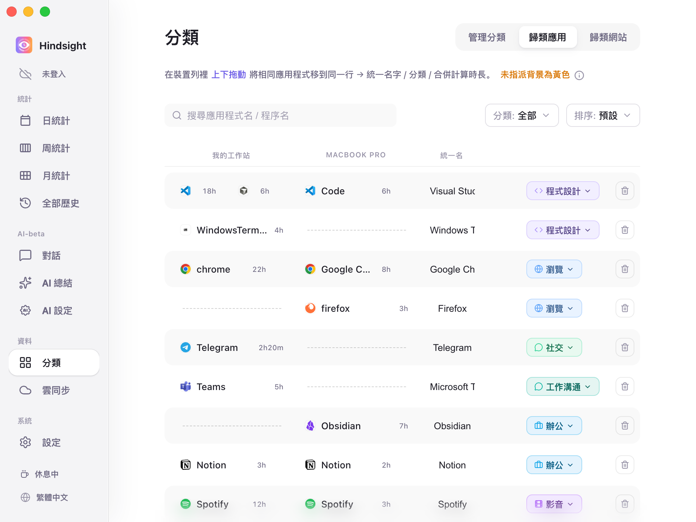

# 分類與應用程式管理

- [功能概述](#功能概述)
- [大類、小類與應用程式](#大類小類與應用程式)
- [歸類網站](#歸類網站)
- [歸類應用與跨裝置合併](#歸類應用與跨裝置合併)
- [預設行為](#預設行為)

## 功能概述

Hindsight 透過大類、小類和應用程式三層結構，管理及統計你的電腦使用情況。你可以為網站和應用程式指定分類，系統會依分類彙整使用時間。

## 大類、小類與應用程式

Hindsight 用三個層級整理、統計你的時間：

- **大類**：整體生活或工作領域（如「工作」「娛樂」）。
- **小類**：具體活動類型（如程式設計、辦公、社交、遊戲），每個分類隸屬一個大類，讓統計頁面彙整同類應用程式的使用情況。
- **應用程式**：你在電腦上使用的程式，例如 Wechat、Chrome、PowerPoint 等，各自歸入對應分類。

> **關係示意**：應用程式 ➡️ 歸入分類 ➡️ 彙整至大類（例如：PowerPoint 屬於「辦公」，再彙整至「工作」大類）。

    
     
    分類 → 管理分類

> 左欄是大類（例如「工作」「娛樂」），右邊每一列是該大類下的小類（例如「程式設計」「辦公」「工作溝通」），列中的標籤是該小類下的應用程式（例如程式設計下的 Code、Cursor）。

系統提供一套可直接使用的預設大類與小類。你可以自由新增、刪除、重新命名，或拖曳調整歸屬關係。部分常見應用程式也已預先分類，方便快速開始使用。

## 歸類網站

瀏覽器經常用於多種不同任務。若將整個瀏覽器歸入「瀏覽」，在 GitHub 查資料和在 B 站看影片的時間就會混在一起，無法區分。

「歸類網站」可分開處理瀏覽器中的網站，為各個網域指定分類。

    
     
    歸類網站

## 歸類應用與跨裝置合併

電腦上記錄到的所有軟體都會自動列在這裡。你可以為每個應用程式指定分類，也可以將不同裝置上的同款軟體合併統計。

    
     
    歸類應用

- **設定分類**：按一下右側的分類膠囊即可指定分類。未分類的應用程式以黃色背景提醒。
- **跨裝置拖曳合併**：同款軟體在不同系統上的名稱可能不同（例如 Windows 上叫 `chrome.exe`，macOS 上叫 `Google Chrome`）。在清單中**上下拖曳**即可配對至同一列，統一名稱並合併計算使用時間。
- **隱藏與清理**：不想統計的背景軟體可直接設為「隱藏」，不再計入報表。

## 預設行為

| 項目 | 預設 | 說明 |
| --- | --- | --- |
| 預設大類 | 工作、娛樂、社交、瀏覽 | - |
| 預設小類 | 程式設計、辦公、工作溝通（屬於工作）；遊戲、影音（屬於娛樂）；社交（屬於社交）；瀏覽（屬於瀏覽）；設計、其他（不屬於任何大類） | 另有特殊的「隱藏」，歸入其中的應用程式不計入統計 |
| 常見應用程式自動歸類 | 開啟 | 內建約 370 個常見軟體程序名稱的對照表，例如 Chrome → 瀏覽、VS Code → 程式設計、Steam → 遊戲、Spotify → 影音、Word → 辦公 |
| 尚未歸類的應用程式 | 計入「其他」 | 在「歸類應用」頁以黃色背景標示；該頁預設只列出尚未歸類的應用程式 |
| 跨裝置合併 | 常見軟體自動合併 | 內建 32 款常見軟體在不同系統上的名稱對照，例如 Windows 的 `chrome.exe` 和 macOS 的 `Google Chrome` 會自動排在同一列；其餘可手動拖曳配對 |
| 自動下載網站圖示 | 關閉 | 關閉時顯示預設地球圖示；開啟後才會下載各網站的實際圖示（如 GitHub、YouTube 的專屬 Logo） |
