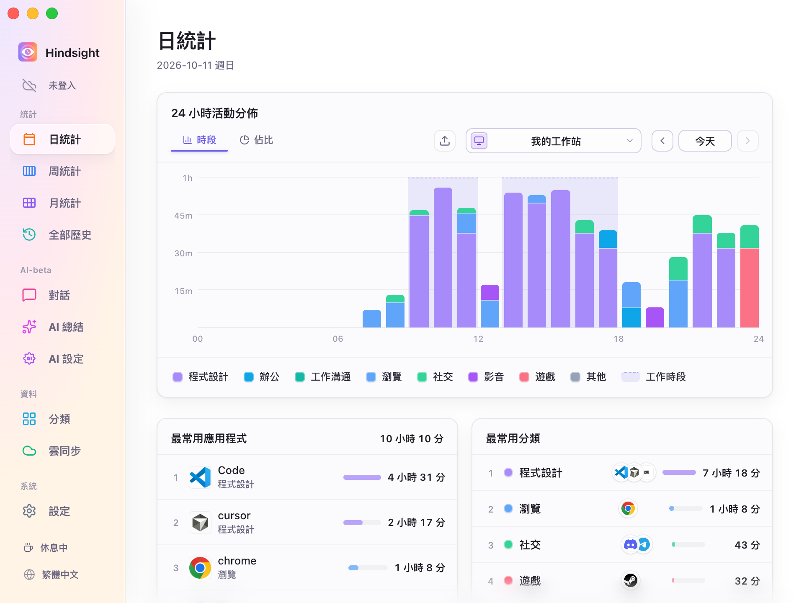
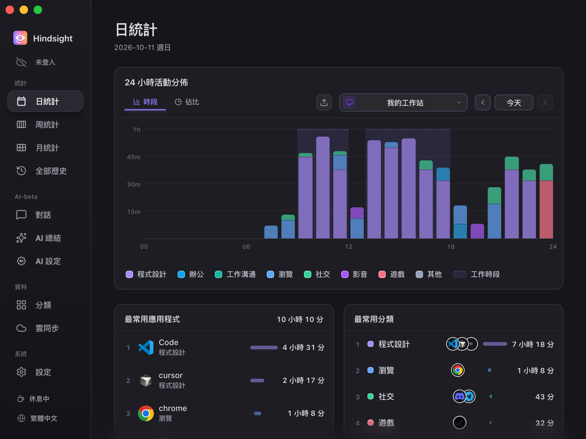

# 介面與外觀

- [功能概述](#功能概述)
- [介面語言](#介面語言)
- [外觀主題](#外觀主題)
- [啟動與關閉](#啟動與關閉)
- [預設行為](#預設行為)

## 功能概述

Hindsight 可切換介面語言與外觀主題，也可設定是否隨系統啟動，以及關閉視窗後是否繼續在背景執行。

## 介面語言

支援簡體中文、繁體中文、English、日本語、Português 和 Español。可在「設定 → 常規」切換，或按側欄底部的語言按鈕依序切換，立即生效。

切換介面語言時，AI 總結的提示詞語言也會一起切換。

## 外觀主題

Hindsight 提供明亮、簡約和暗色三種外觀主題：

<table align="center">
  <tr>
    <td align="center"> 明亮</td>
    <td align="center"> 簡約</td>
    <td align="center"> 暗色</td>
  </tr>
</table>

## 啟動與關閉

- **開機自動啟動**：登入系統後自動執行 Hindsight，開始記錄。
- **靜默啟動**：開啟後，Hindsight 會在系統啟動時於背景執行，不顯示主視窗。
- **關閉後最小化到右下角托盤**：開啟後，按關閉按鈕只會收起視窗，Hindsight 繼續在背景記錄，可從托盤圖示重新開啟或退出。

## 預設行為

| 項目 | 預設 | 說明 |
| --- | --- | --- |
| 介面語言 | 跟隨系統 | 中文、日文、葡萄牙文、西班牙文使用對應語言，其他系統語言顯示英文 |
| 外觀 | 簡約 | - |
| 開機自動啟動 | 關閉 | - |
| 關閉視窗 | 最小化到托盤 | 在背景繼續記錄 |
| 自動檢查更新 | 開啟 | 每週檢查一次，可在「設定 → 關於」修改 |
