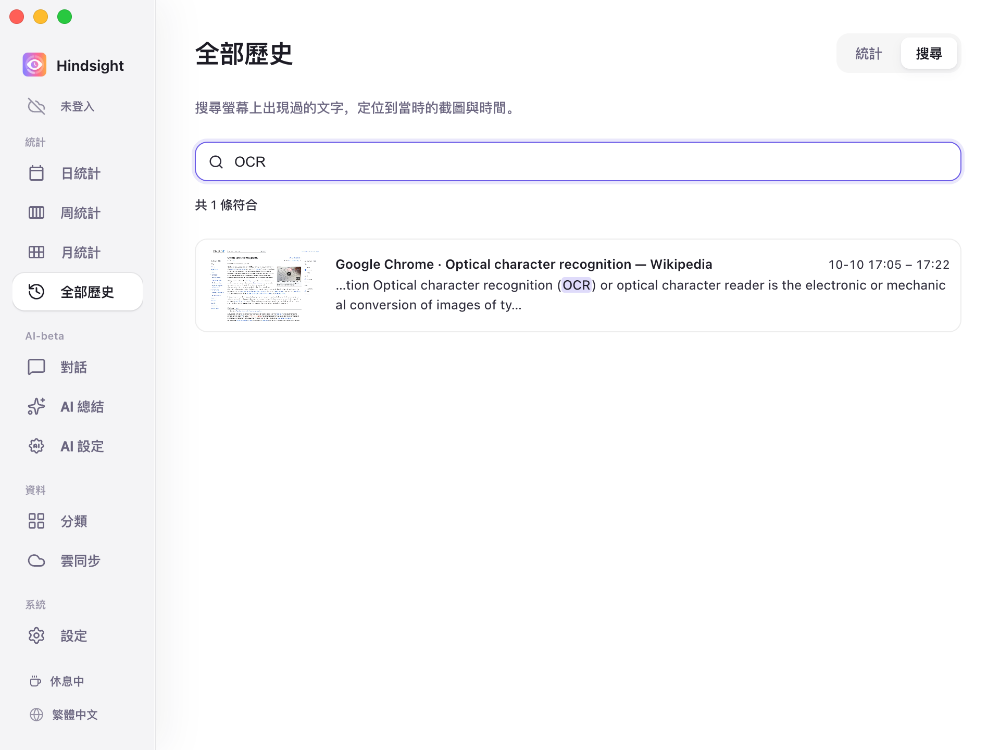
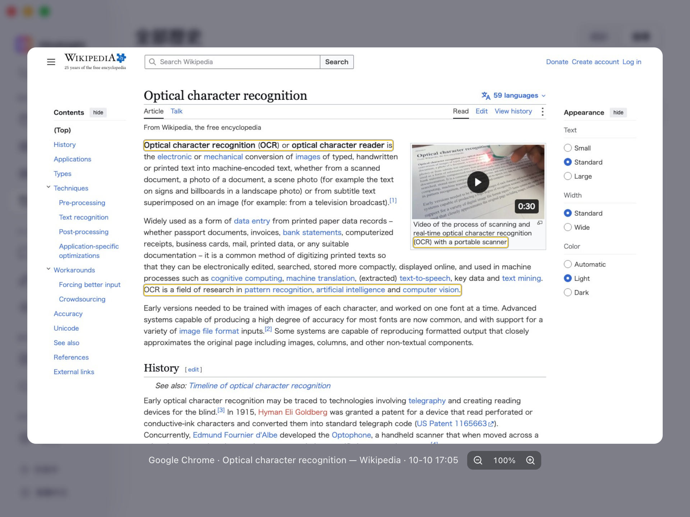

# 螢幕記憶與搜尋

- [功能概述](#功能概述)
- [搜尋與回看](#搜尋與回看)
- [預設行為](#預設行為)

## 功能概述

Hindsight 可透過關鍵字找回看過的網頁文字、文件片段，或忘記出處的一句話。

## 搜尋與回看

符合的文字會反白顯示，搜尋結果同時標示所在應用程式及出現時間。

    
     
    全部歷史 → 搜尋

    
     
    搜尋結果（截圖預覽）

> 截圖會框出符合文字的位置，支援縮放與拖曳查看。

## 預設行為

| 項目 | 預設 | 說明 |
| --- | --- | --- |
| 截圖 | 關閉 | 螢幕記憶的前提，需自行在設定中開啟 |
| 常駐 OCR | 關閉 | 開啟後在背景持續辨識新截圖的文字 |
| 截圖保留時間 | 7 天 | 超過此時間的截圖會被清理，但已辨識的文字仍可搜尋 |
