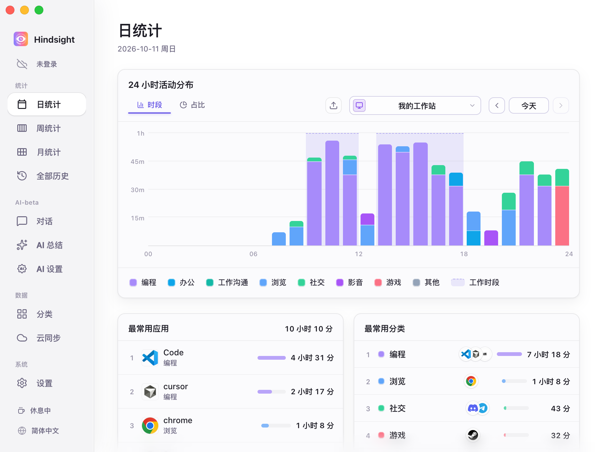
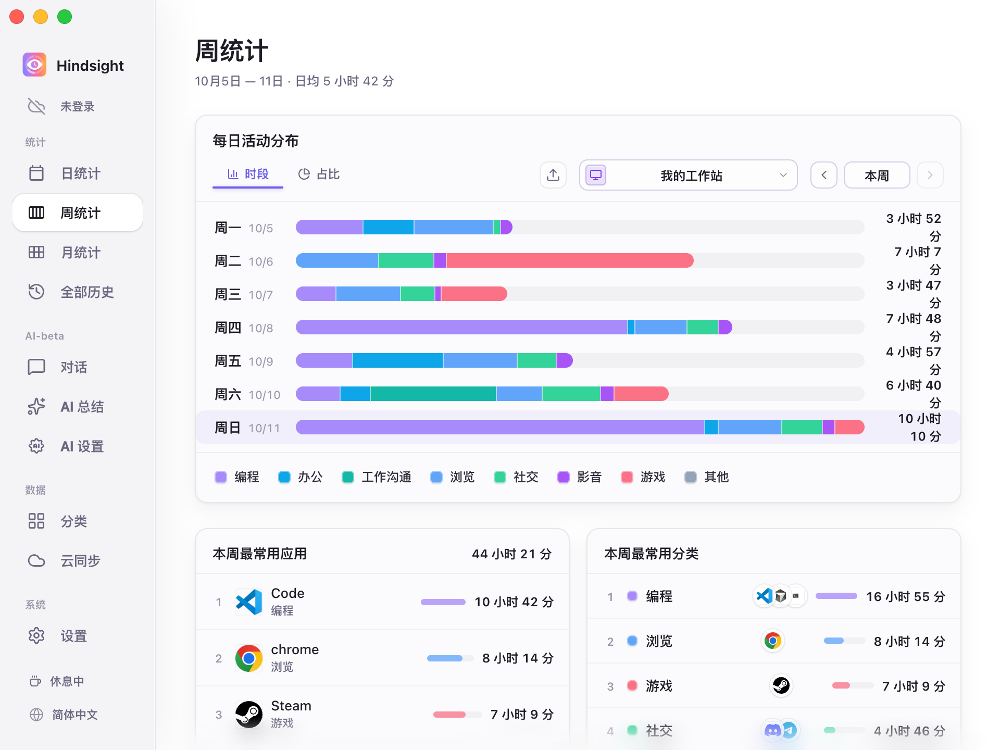
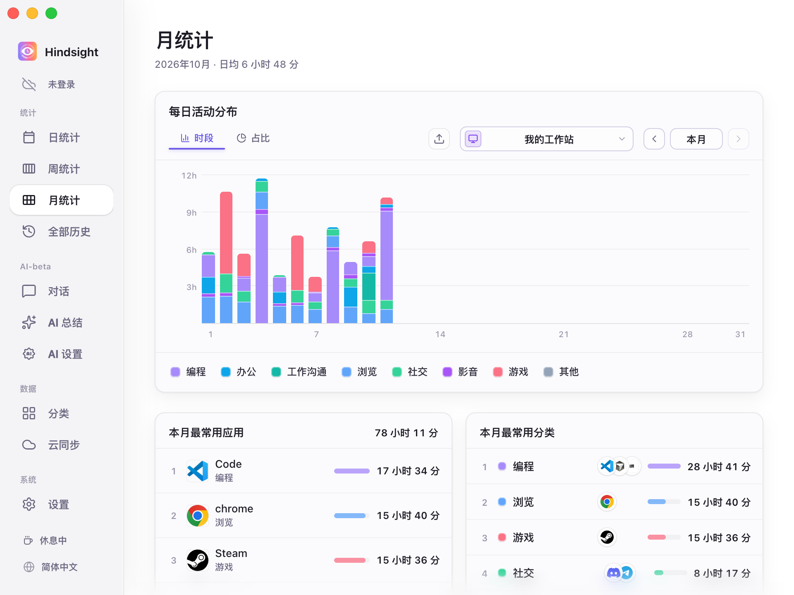
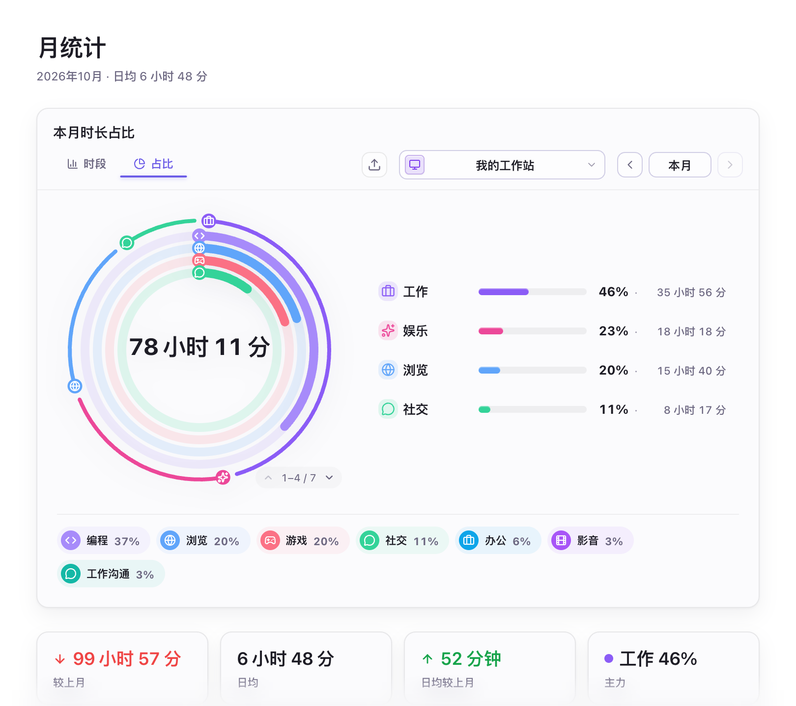
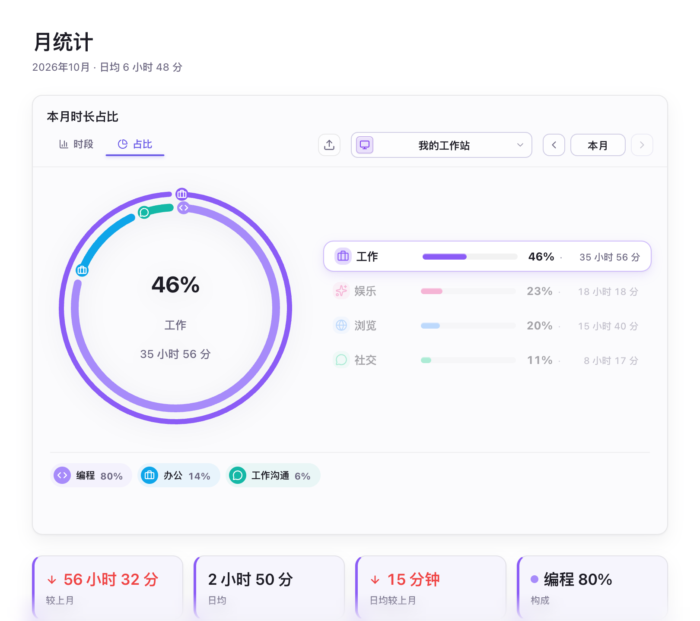
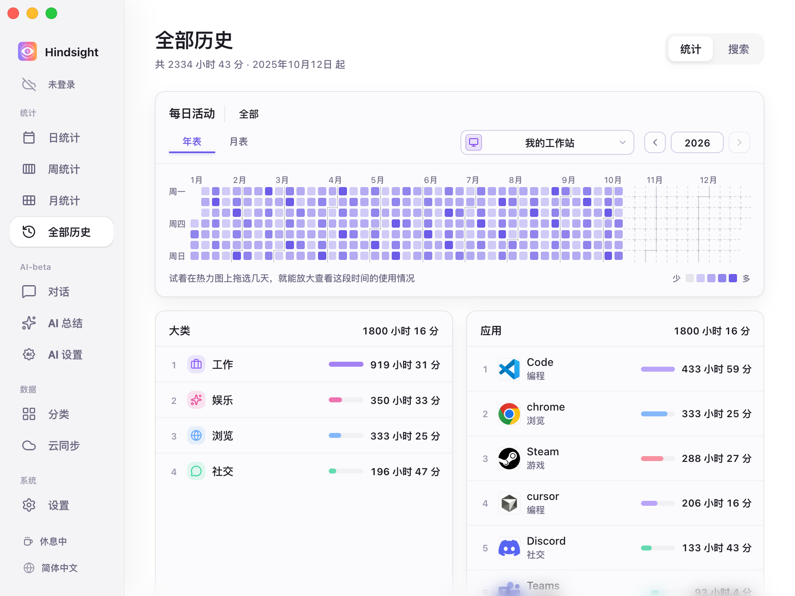
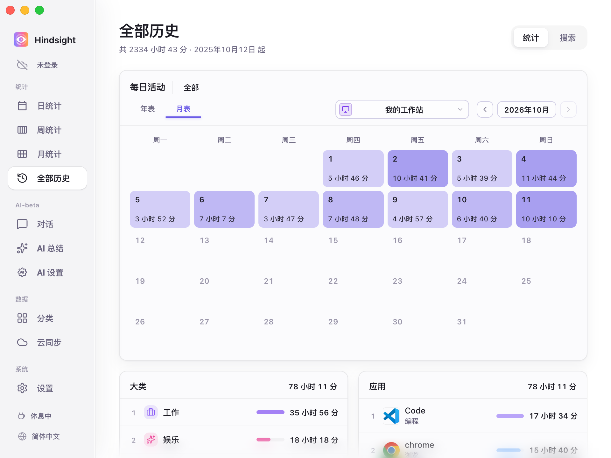

# 活动记录与统计

- [功能概述](#功能概述)
- [统计](#统计)
  - [日统计](#日统计)
  - [周统计](#周统计)
  - [月统计](#月统计)
  - [全部历史](#全部历史)
- [活动采集](#活动采集)
- [默认行为](#默认行为)

## 功能概述

Hindsight 自动记录前台活动与用时，并提供日、周、月和历史统计。基础用时统计无需开启截图；截图和 OCR 可选使用。

## 统计

### 日统计

    
     
    日统计（时段视图）

### 周统计

    
     
    周统计（时段视图）

### 月统计

    
     
    月统计（时段视图）

    
     
    月统计（各类别活动占比及其统计数据）

> 最外圈是大类活动的占比（例如「工作」「娱乐」「浏览」「社交」），内圈是小类活动的占比（例如「工作」下有的「编程」、「办公」、「工作沟通」）。

    
     
    月统计（占比视图-类别选中）

> 选中一个大类后，圆环和下面的标签只显示这个大类的构成。这里选中「工作」：编程占 82%，办公占 11%，工作沟通占 7%。
> 下方四个卡片从左到右分别为：本月工作时间较上月变化了多少（-60h 42m）、本月的日均工作时间（2h 48m）、本月的日均时间较上月变化了多少（-19m）、工作大类活动中占比最大的小类活动（此处为编程，占比 82%）

### 全部历史

全年热力图用于观察长期活动分布，月历呈现每天的用时；支持指定日期范围统计和单个应用的长期回顾。

    
     
    全部历史（年表）

> 年表里颜色越深表示当天用时越长。在热力图上拖选一段可以放大只看这段时间，点中某一天，下面的大类和应用排行会联动只统计这一天。

    
     
    全部历史（月表）

## 活动采集

- **活动记录：** 记录前台聚焦的应用，并记录其用时。
- **挂机闲置处理：** 键鼠无操作超过 3 分钟（默认）后停止计时。
- **工作时段：** 启用后仅在设定时段采集，其余时间侧栏显示「休息中」，并关闭活动采集。
- **采集状态：** 可以在侧边栏中点击 `停止采集按钮` 来停止活动采集，重新点击将恢复活动采集。
- **网站域名：** 默认开启，用于对浏览的网站进行记录和分类，例如可以将 Youtube 的访问记录归类到「视频」类别。
- **多设备：** 各设备分别记录；同步后可查看所有设备汇总，或单独查看一台设备。

## 默认行为

| 项目 | 默认状态 | 说明 |
| --- | --- | --- |
| 活动采集 | 开启 | - |
| 采集间隔 | 30 秒 | - |
| 闲置阈值 | 3 分钟 | - |
| 工作时段 | 关闭 | 开启后仅在设定时段内记录活动 |
| 浏览器网站域名记录 | 开启（受浏览器支持、权限及隐私设置影响） | - |
| 截图 | 关闭 | - |
| 截图保留时间 | 7 天 | 截图将在此时间后被自动删除，以节省存储空间 |
