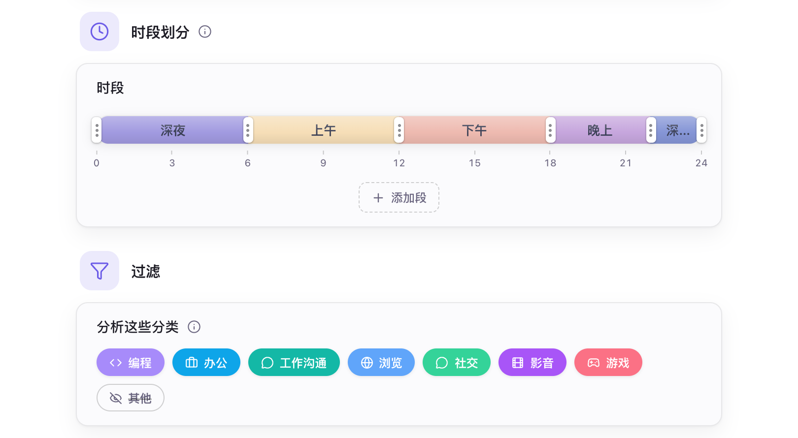

# AI 配置

- [功能概述](#功能概述)
- [本地模型](#本地模型)
- [云端 API](#云端-api)
- [总结报告相关设置](#总结报告相关设置)
- [默认行为](#默认行为)

## 功能概述

Hindsight 支持配置本地模型和云端 API，以便在总结和对话中使用生成式大语言模型。

## 本地模型

本地模型在你的电脑上运行。Hindsight 会根据你的电脑帮你配置好：

1. **自动匹配引擎**：进入「AI 设置 → 引擎」，点击下载即可。系统会自动识别你的硬件（如 Mac Metal 或 NVIDIA CUDA），自动下载最匹配的加速引擎，无需手动装驱动。
2. **一键下载推荐模型**：进入「AI 设置 → 模型」，根据你的需求下载推荐模型即可。
3. **一键应用最佳参数**：系统会根据你的电脑显存，自动计算出最稳定的运行参数。

模型可以从预设的模型列表里选择，也可以导入自己的 GGUF 文件，或填入 Hugging Face 仓库地址下载。引擎和模型默认从官方源下载，访问困难时可以切换到镜像源。

## 云端 API

如果本地设备性能不足，无法运行本地模型，或者需要更强大的模型时，可以切换到云端服务。

- **服务商**：支持 OpenAI 兼容接口。内置 OpenAI、DeepSeek、Kimi（Moonshot）、OpenRouter、Together、Groq 的预设，也可以填写其他兼容服务的地址。

使用云端服务时，仅会发送文本内容，不会上传截图图片。

> **请注意个人信息泄露**：发送的文本包含应用名、窗口标题、活动时间线和你的个人简介；使用对话时，还包含你的提问和 OCR 出来的屏幕文字。这些内容可能含有敏感的个人信息，推荐在使用前先配置：[隐私设置](./privacy-setting.md)，并请只使用你信任的 API 提供商。

## 总结报告相关设置

Hindsight 会根据这些设置生成总结报告。

    
     
    AI 设置 → 常规

- **时段划分**：把一天分成几段，AI 按段汇总。
- **分析的分类**：选择哪些分类的应用进入报告。
- **个人简介**：可选，告诉模型你做什么工作，让总结更贴合。
- **系统提示词**：用于指导 AI 生成报告的风格和内容，可以根据需要进行自定义。

## 默认行为

| 项目 | 默认 | 说明 |
| --- | --- | --- |
| 本地 AI 引擎 | 未安装 | 需要在「AI 设置 → 引擎」下载，约 16–605 MB，随系统和显卡而定 |
| 下载源 | 官方源 | 从 Hugging Face 和 GitHub 下载，访问困难时可在「AI 设置 → 引擎」切换镜像 |
| AI 内存占用 | 空闲 2 分钟释放 | 任务结束、空闲约 2 分钟后自动停止，释放内存和显存 |
| 总结时段 | 5 段 | 0–6、6–9、9–12、12–18、18–24 点，可以修改 |
| 分析的应用类别 | 除「其他」外全部 | 报告只用这些分类里的应用。归在「其他」的应用（包括还没归类的）不会写进报告，可在「AI 设置 → 常规 → 过滤」里调整 |
