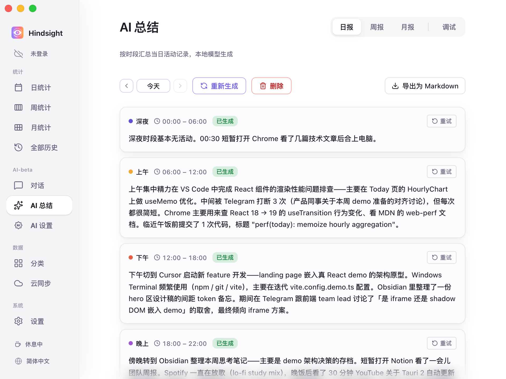
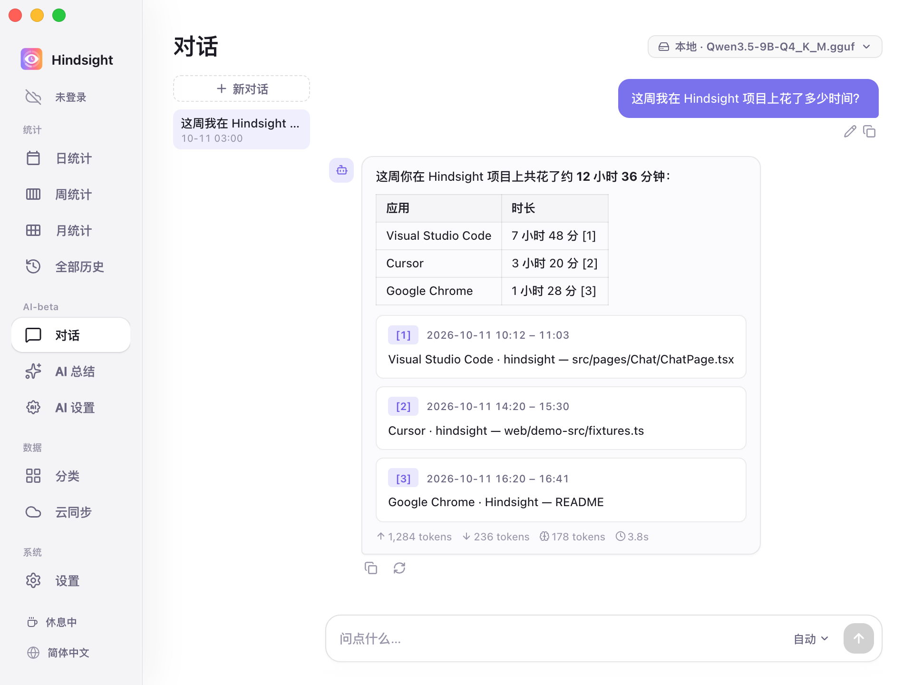

# AI 总结与对话

- [功能概述](#功能概述)
- [总结报告](#总结报告)
- [对话](#对话)
- [模型](#模型)
- [默认行为](#默认行为)

## 功能概述

Hindsight 支持让 AI 帮你总结一段时间内的活动记录，帮你生成文字报告，或基于活动记录回答你的提问。

## 总结报告

「AI 总结」把活动记录整理成文字报告。

    
     
    AI 总结 → 日报

目前支持：

- **日报**：把一天的活动按设置的时段整理成报告，可导出为 Markdown。
- **周报**：生成一周的活动总结报告。

> 「月报」目前还在开发中，暂时不能生成。

## 对话

在「对话」页用自然语言查询自己的记录，例如「这周我在 Hindsight 项目上花了多少时间？」「我本周花了多少时间逛 Youtube？」。

    
     
    AI 对话

AI 会依据你的活动记录生成回答，并提供链接，方便你核对依据。

## 模型

总结和对话各自选择使用的模型，本地或云端都可以：

- **本地模型**：在电脑上运行，所有内容不离开本机。
- **云端 API**：支持 OpenAI 兼容接口。内置 OpenAI、DeepSeek、Kimi（Moonshot）、OpenRouter、Together、Groq 的预设，也可以填写其他兼容服务的地址。

具体配置见 [AI 配置](./ai-configuration.md)。

## 默认行为

| 项目 | 默认 | 说明 |
| --- | --- | --- |
| 自动总结 | 关闭 | 开启后默认每天 23:00 生成当天日报，并补上缺失的日报和上一周的周报 |
| 云端 API | 关闭 | 默认只使用本地模型，使用云端需要主动配置 |
