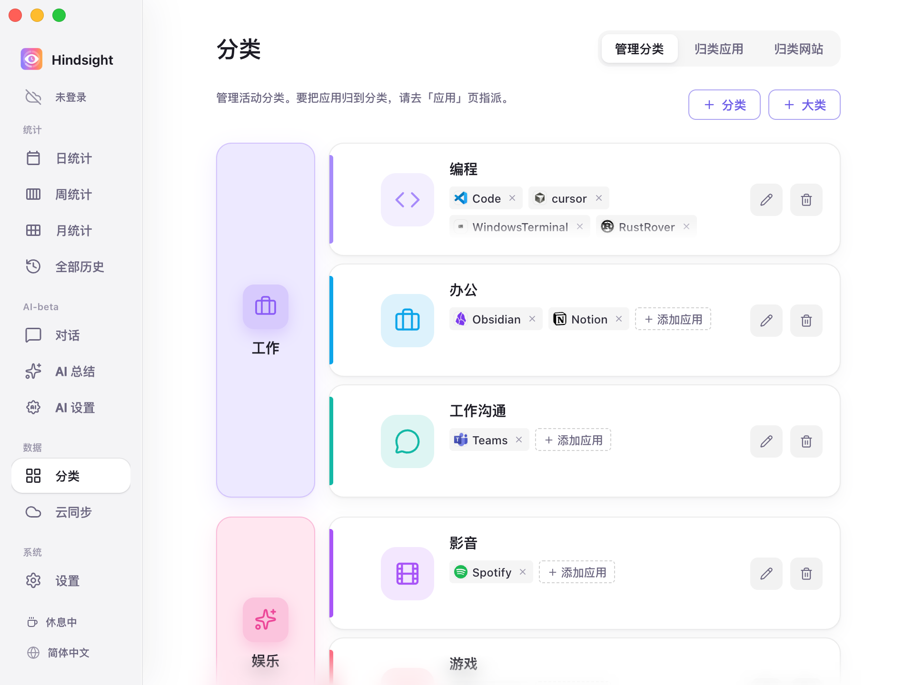
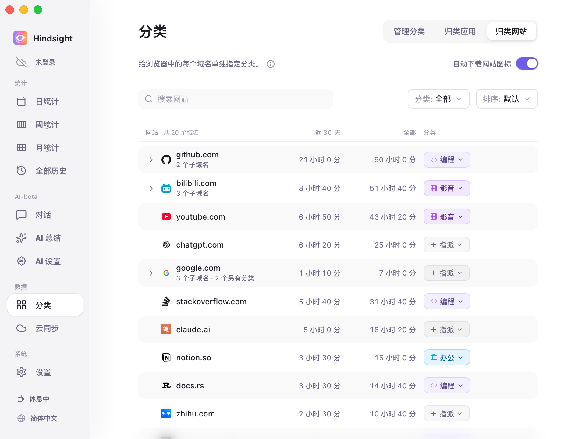
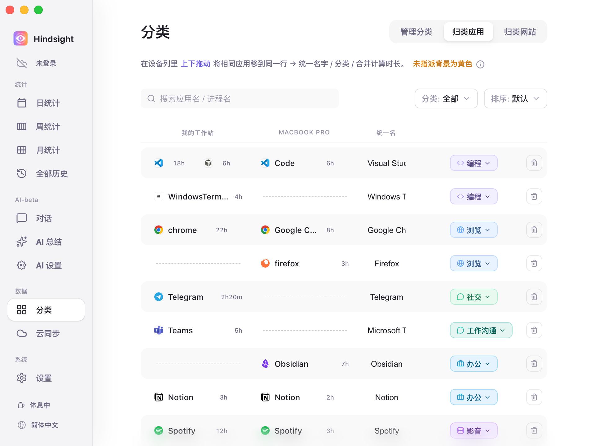

# 分类与应用管理

- [功能概述](#功能概述)
- [大类、小类与应用](#大类小类与应用)
- [归类网站](#归类网站)
- [归类应用与跨设备合并](#归类应用与跨设备合并)
- [默认行为](#默认行为)

## 功能概述

Hindsight 支持通过大类、小类和应用三层结构来管理和统计你的电脑使用情况。你可以为网站和应用指定分类，系统会根据分类汇总你的使用时长。

## 大类、小类与应用

Hindsight 用三层来整理，统计你的时间：

- **大类**：宏观的生活或工作领域（如「工作」、「娱乐」）。
- **小类**：具体的活动类型（如编程、办公、社交、游戏），每个分类从属于一个大类、用来统计页面汇总一类应用的使用情况。
- **应用**：你在电脑上用的程序，比如 Wechat、Chrome、PowerPoint 等，每个应用归入对应的分类。

> **示意关系**：应用 ➡️ 归入 分类 ➡️ 汇总进 大类（例如：PowerPoint 属于「办公」，进而汇总进「工作」大类）。

    
     
    分类 → 管理分类

> 左边一列是大类（例如「工作」「娱乐」），右边每一行是归在这个大类下的一个小类（例如「编程」「办公」「工作沟通」），行里的标签是归在这个小类下的应用（例如编程下的 Code、Cursor）。

系统预设了一套开箱即用的大类与小类。你可以自由增删、重命名，或通过拖拽调整它们之间的归属关系。也给一些常见的应用进行了预分类，以方便你快速开始使用。

## 归类网站

浏览器往往承担了多种不同性质的任务。如果将整个浏览器统一归为「浏览」，在 GitHub 查阅资料与在 B 站看视频的时间就会混在一起，无法区分。

「归类网站」允许你穿透浏览器外壳，为具体域名单独指派分类。

    
     
    归类网站

## 归类应用与跨设备合并

电脑上记录到的所有软件都会自动列在这里。你可以为每个应用指定分类，也可以把不同设备上的同款软件合并统计。

    
     
    归类应用

- **设置分类**：点击右侧的分类胶囊即可指派分类。未分类的应用会显示黄色背景提醒。
- **跨设备拖拽合并**：同一个软件在不同系统上的名称可能不同（例如 Windows 叫 `chrome.exe`，macOS 叫 `Google Chrome`）。在列表中**上下拖动**即可将它们配对到同一行，统一命名并合并计算时长。
- **隐藏与清理**：不想统计的后台软件可以直接选为「隐藏」，不再计入报表。

## 默认行为

| 项目 | 默认 | 说明 |
| --- | --- | --- |
| 预设大类 | 工作、娱乐、社交、浏览 | - |
| 预设小类 | 编程、办公、工作沟通（属于工作）；游戏、影音（属于娱乐）；社交（属于社交）；浏览（属于浏览）；设计、其他（不属于任何大类） | 另有一个特殊的「隐藏」，归进去的应用不计入统计 |
| 常见应用自动归类 | 开启 | 内置了约 370 个常见软件进程名的对照表，例如 Chrome → 浏览、VS Code → 编程、Steam → 游戏、Spotify → 影音、Word → 办公 |
| 还没归类的应用 | 算进「其他」 | 在「归类应用」页以黄色背景标出；这一页默认只列还没归类的应用 |
| 跨设备合并 | 常见软件自动合并 | 内置了 32 款常见软件在不同系统上的名称对照，例如 Windows 的 `chrome.exe` 和 macOS 的 `Google Chrome` 会自动排进同一行；其余的手动拖动配对 |
| 自动下载网站图标 | 关闭 | 关闭时显示默认地球图标；开启后才会下载各网站的真实图标（如 GitHub、YouTube 的专属 Logo） |
