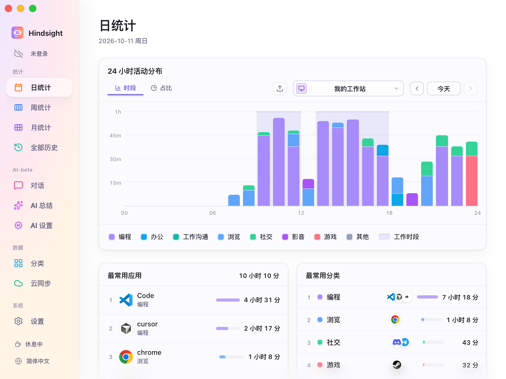
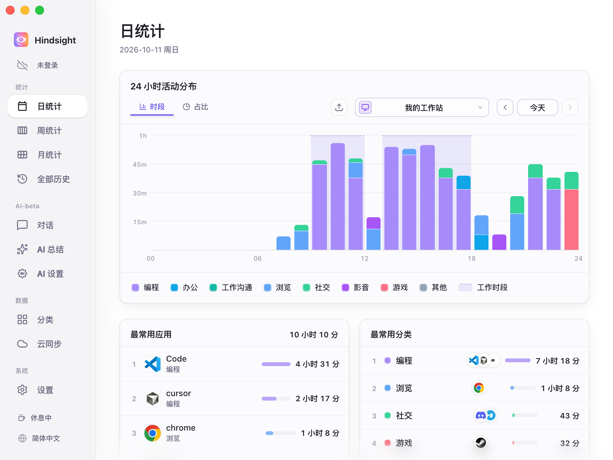
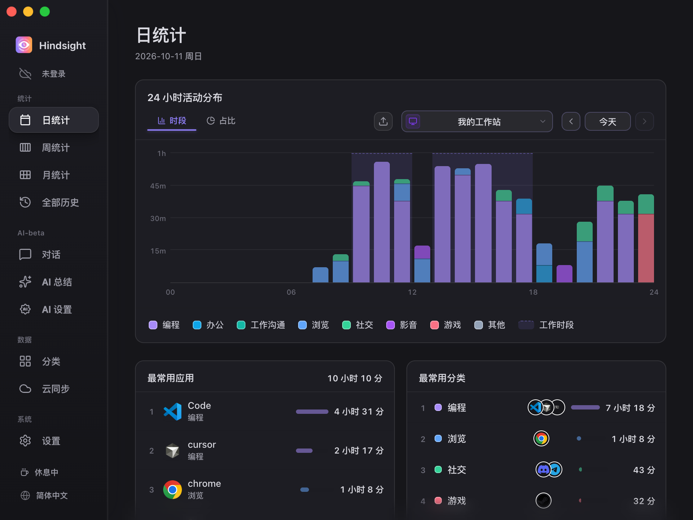

# 界面与外观

- [功能概述](#功能概述)
- [界面语言](#界面语言)
- [外观主题](#外观主题)
- [启动与关闭](#启动与关闭)
- [默认行为](#默认行为)

## 功能概述

Hindsight 可以切换界面语言和外观主题，也可以设置是否随系统启动，以及关闭窗口后是否继续在后台运行。

## 界面语言

支持简体中文、繁體中文、English、日本語、Português 和 Español。在「设置 → 常规」中切换，也可以点侧栏底部的语言按钮依次切换，立即生效。

切换界面语言时，AI 总结使用的提示词语言也会一起切换。

## 外观主题

Hindsight 提供了三种外观主题，分别为明亮、简约和暗色：

<table align="center">
  <tr>
    <td align="center"> 明亮</td>
    <td align="center"> 简约</td>
    <td align="center"> 暗色</td>
  </tr>
</table>

## 启动与关闭

- **开机自动启动**：登录系统后自动运行 Hindsight，开始记录。
- **静默启动**：开启后，Hindsight 在系统启动时会在后台运行，不会显示主窗口。
- **关闭后最小化到托盘**：开启后，点关闭按钮只会收起窗口，Hindsight 继续在后台记录，可以从托盘图标重新打开或退出。

## 默认行为

| 项目 | 默认 | 说明 |
| --- | --- | --- |
| 界面语言 | 跟随系统 | 中文、日语、葡萄牙语、西班牙语对应各自语言，其他系统语言显示英语 |
| 外观 | 简约 | - |
| 开机自动启动 | 关闭 | - |
| 关闭窗口 | 最小化到托盘 | 在后台继续记录 |
| 自动检查更新 | 开启 | 每周检查一次，可在「设置 → 关于」中修改 |
