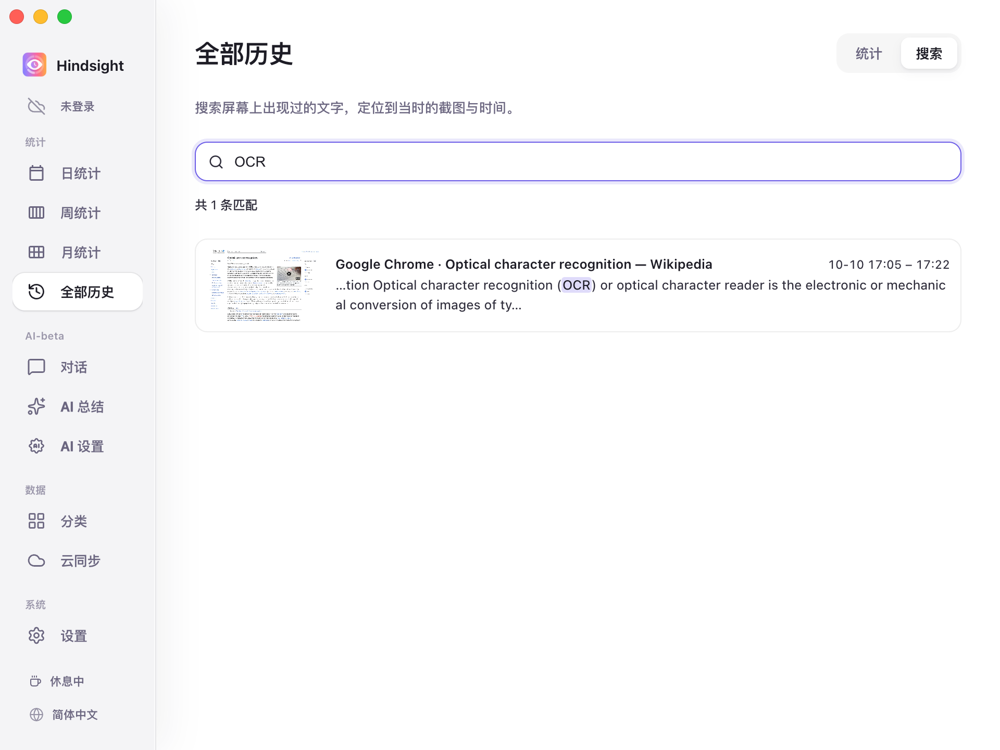
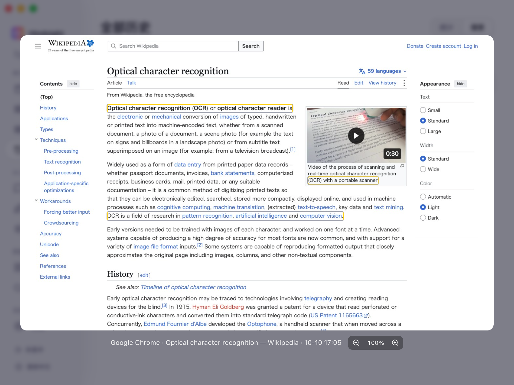

# 屏幕记忆与搜索

- [功能概述](#功能概述)
- [搜索与回看](#搜索与回看)
- [默认行为](#默认行为)

## 功能概述

Hindsight 支持通过关键词找回看过的网页文字、文档片段，或忘记出处的一句话。

## 搜索与回看

匹配文字高亮显示，搜索结果同时标明所在应用和出现时间。

    
     
    全部历史 → 搜索

    
     
    搜索结果（截图预览）

> 截图中框出匹配文字的位置，支持缩放与拖动查看。

## 默认行为

| 项目 | 默认 | 说明 |
| --- | --- | --- |
| 截图 | 关闭 | 屏幕记忆的前提，需要主动在设置中开启 |
| 常驻 OCR | 关闭 | 开启后在后台持续识别新截图的文字 |
| 截图保留时间 | 7 天 | 超过该时间的截图会被清理，但已识别的文字仍可搜索 |