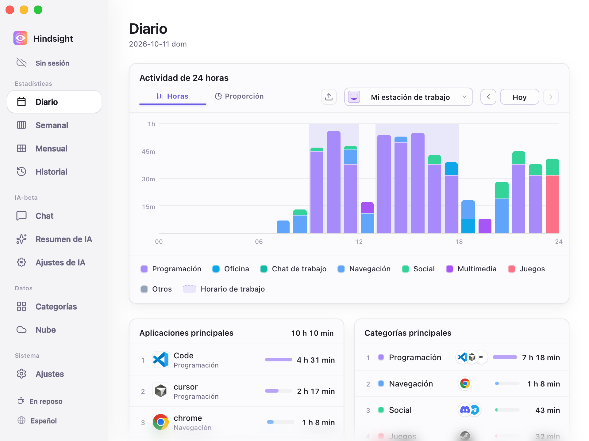
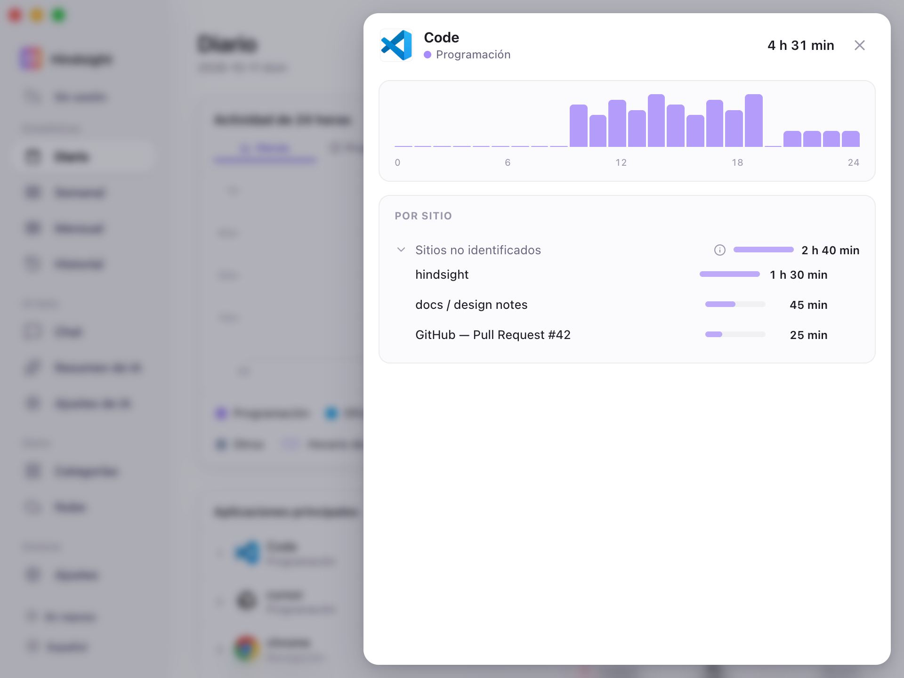
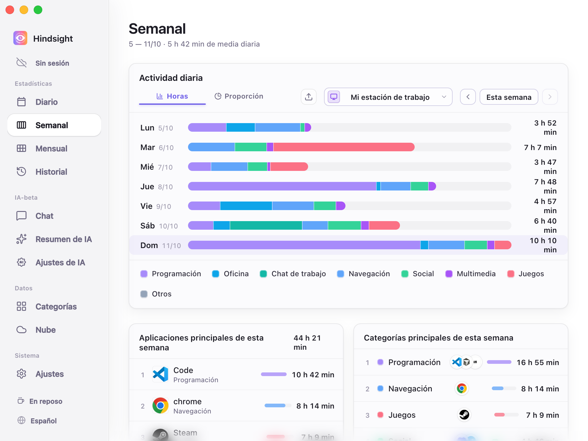
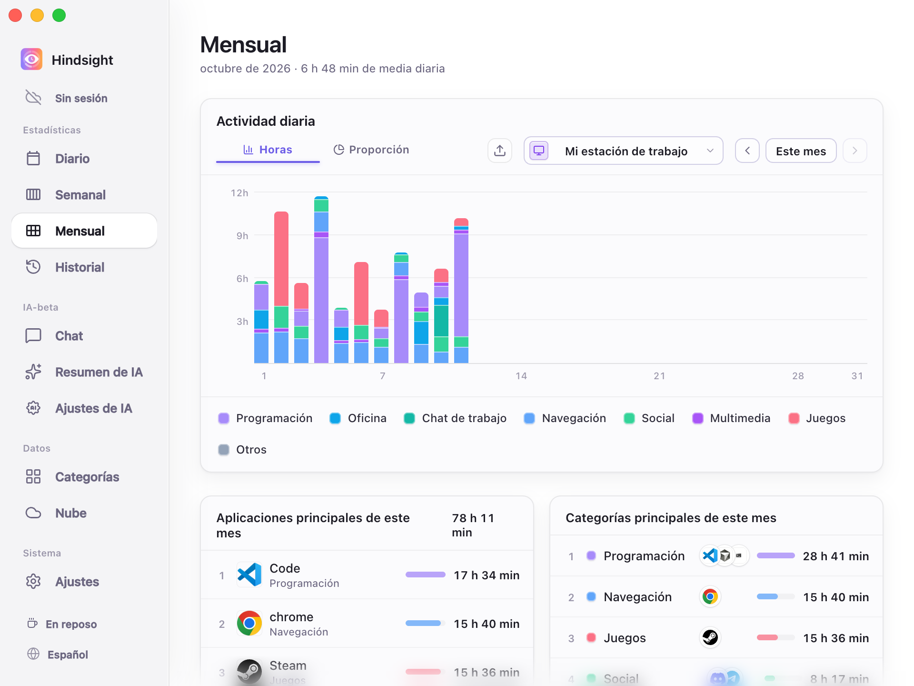
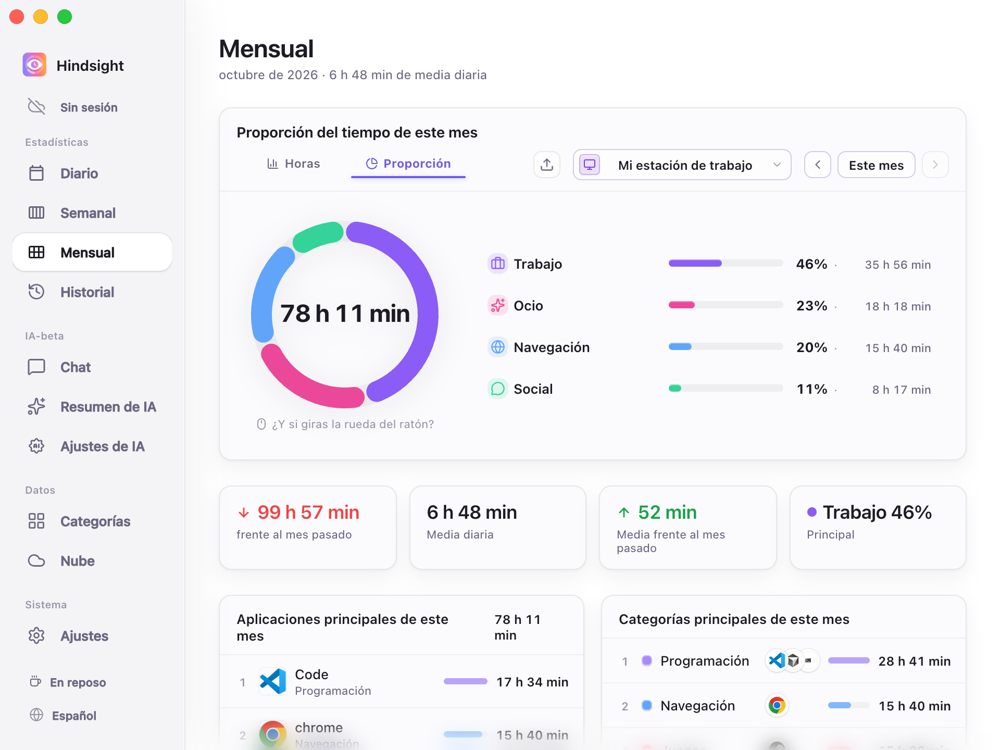
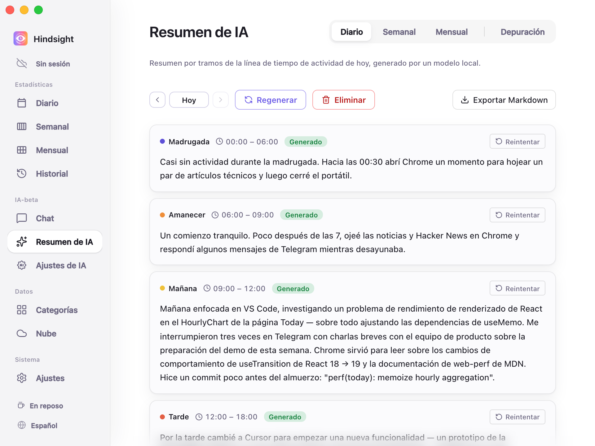
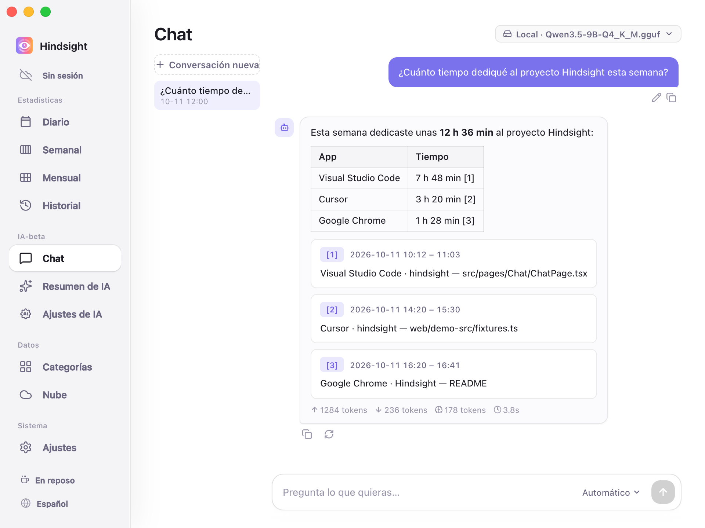
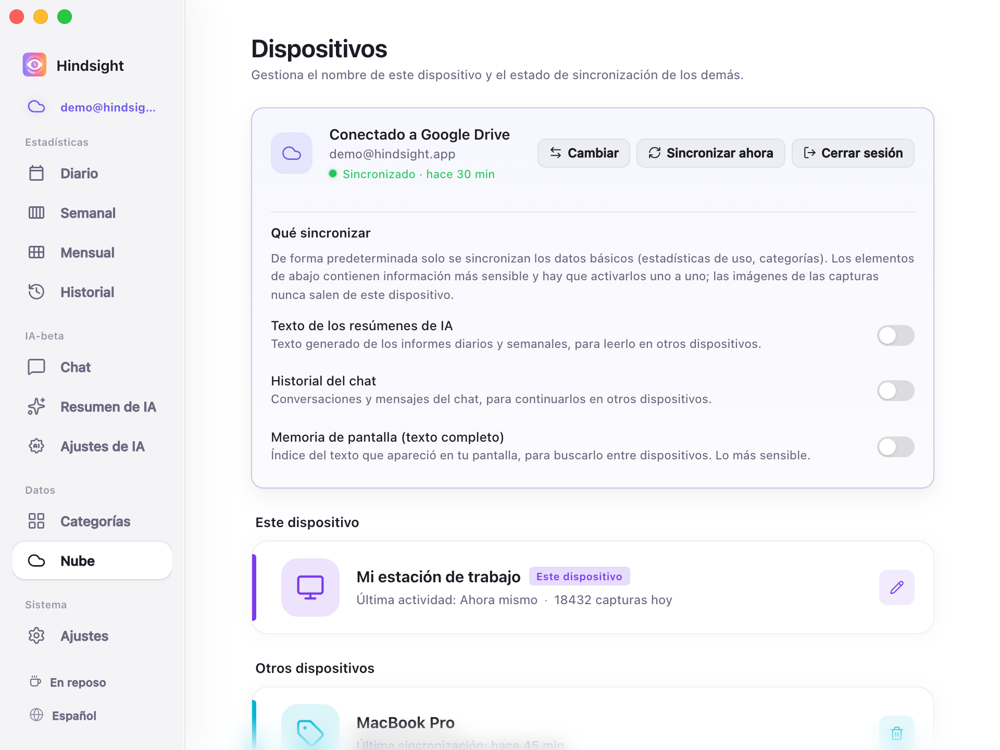

  <picture>
    <source media="(prefers-color-scheme: dark)" srcset="../readme-banner-dark.png">
    
  </picture>

   
  Registra automáticamente la actividad de aplicaciones y ventanas y muestra cómo has distribuido tu tiempo por día, semana y mes, sin temporizadores manuales ni etiquetas de proyecto que mantener.

  <a href="../zh/README.md">简体中文</a> · <a href="../zh-TW/README.md">繁體中文</a> · <a href="../../../README.md">English</a> · <a href="../ja/README.md">日本語</a> · <a href="../pt/README.md">Português</a> · <a href="README.md">Español</a>

  
  
  
  
  

  
  
  

  <a href="https://github.com/Tomotsugu-dev/Hindsight/releases"><b>Descargar la última versión</b></a> ·
  <a href="#vista-previa-de-la-interfaz">Vista previa de la interfaz</a> ·
  <a href="#funciones-principales">Funciones principales</a> ·
  <a href="#inicio-rápido">Inicio rápido</a>

---

## Vista previa de la interfaz

  <video src="https://github.com/user-attachments/assets/52ae7b55-3fb3-439d-9a1d-ee590ac82e6c" controls muted autoplay loop playsinline width="800"></video>

  <b>Vista previa de la aplicación</b> · Las interacciones principales de Hindsight en 1 minuto

   
  <b>Estadísticas diarias</b> · Cronología apilada de 24 horas y clasificaciones por aplicación y categoría: descubre de un vistazo en qué has empleado el día

   
  <b>Detalle de la aplicación</b> · Haz clic en cualquier aplicación para ver qué estabas haciendo en ella

   
  <b>Estadísticas semanales</b> · Toda tu semana de un vistazo

   
  <b>Estadísticas mensuales</b> · Barras de actividad diaria con clasificaciones por aplicación y categoría: descubre en qué has empleado realmente el tiempo este mes

   
  <b>Desglose mensual</b> · Proporción de tiempo por categoría, con el total, la media diaria y la variación respecto al mes anterior

   
  <b>Informe diario con IA</b> · Un modelo local o en la nube resume cada franja del día en un informe escrito

   
  <b>Chat con IA</b> · Solo tienes que preguntar, por ejemplo: «¿Cuánto tiempo he dedicado a X este mes?»

   
  <b>Sincronización entre dispositivos</b> · Para quienes usan más de un ordenador

## Funciones principales

- **Descubre en qué empleas tu tiempo** — Registra automáticamente la actividad del ordenador en segundo plano, la visualiza con distintos gráficos y permite consultar estadísticas por categoría de actividad (trabajo, entretenimiento, etc.)
- **Informe diario con IA** — Un modelo local resume las actividades del día por franjas horarias y las convierte en un informe diario
- **Chat con IA** — Pregunta «¿Qué he hecho hoy?» o «¿Cuánto tiempo he dedicado al proyecto X este mes?» y recibe respuestas basadas en tus propios registros
- **Búsqueda en el historial de pantalla** — Encuentra cualquier texto que haya aparecido en tu pantalla y accede a la captura y al momento correspondiente (las capturas de pantalla y el OCR están desactivados por defecto; actívalos según lo necesites)
- **Vista conjunta de varios dispositivos** — Sincroniza opcionalmente los datos de actividad mediante Google Drive o WebDAV y combina datos de varios dispositivos para analizarlos
- **Almacenamiento local y privacidad ante todo** — Tus datos permanecen en tu equipo por defecto
- **Mercado de plugins** — Usuarios y desarrolladores pueden crear sus propias herramientas de plugins para aumentar la productividad. Más información en el [Mercado de plugins](https://github.com/Tomotsugu-dev/hindsight-plugins)
- **Temas personalizados** — Importa un archivo de tema desde Ajustes → Apariencia → Temas personalizados para personalizar los colores, el modo claro u oscuro y la distribución de la página.

## Inicio rápido

Descarga el instalador para tu plataforma desde [Versiones](https://github.com/Tomotsugu-dev/Hindsight/releases) e instálalo.

### Windows

Descarga `hindsight_x.y.z_x64-setup.exe` y haz doble clic para instalarlo.

> ⚠️ **Al ejecutarlo por primera vez aparecerá el aviso «Windows protegió su PC»** — El instalador todavía no está firmado con un certificado de firma de código EV, por lo que SmartScreen lo bloqueará. Haz clic en «Más información» → «Ejecutar de todas formas» para continuar.

### macOS

Descarga `hindsight_x.y.z_universal.dmg`, haz doble clic para montar la imagen y arrastra Hindsight a la carpeta Aplicaciones.

### Linux

Descarga `hindsight_x.y.z_amd64.deb` (Ubuntu 22.04 o posterior, Debian 12 o posterior) o `hindsight-x.y.z-1.x86_64.rpm` (Fedora) e instálalo. En una sesión Wayland, solo es compatible GNOME 46 a 51.

## Licencia

  Este proyecto se distribuye bajo la <a href="../../../LICENSE"><b>GPL 3.0</b></a>. Se permite su uso, modificación y redistribución según sus términos. 
  Consulta la <a href="../../../CONTRIBUTING.md#license">guía de contribución</a> sobre permisos MIT anteriores y licencias de terceros. 
  © 2026 colaboradores de Hindsight

