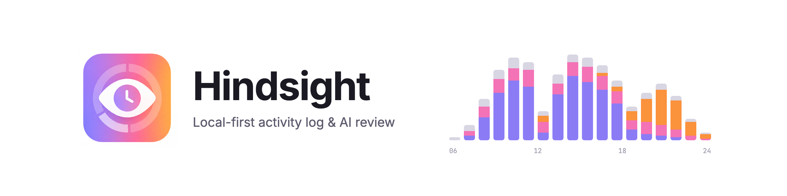
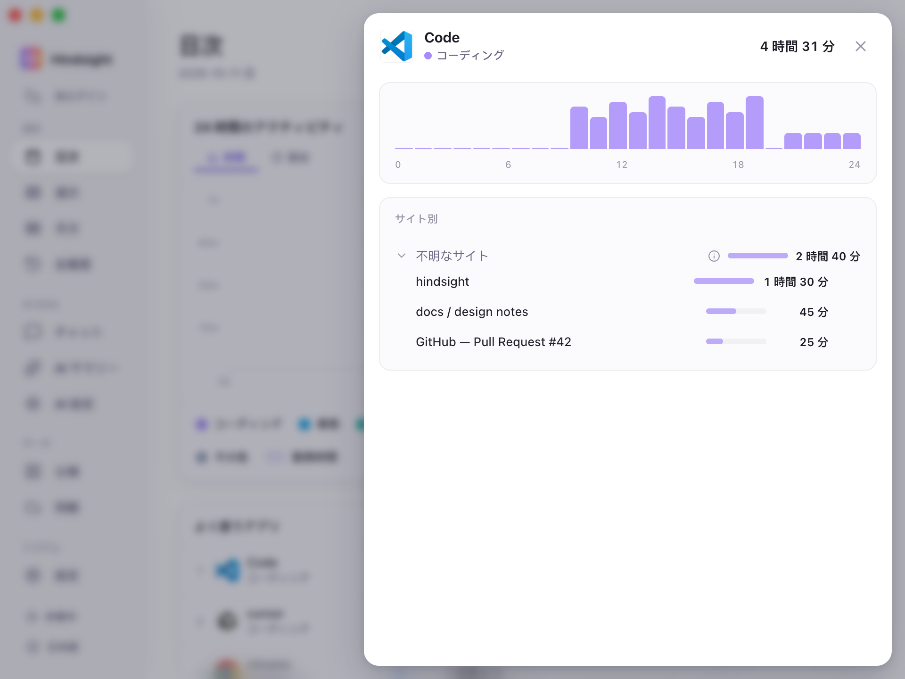
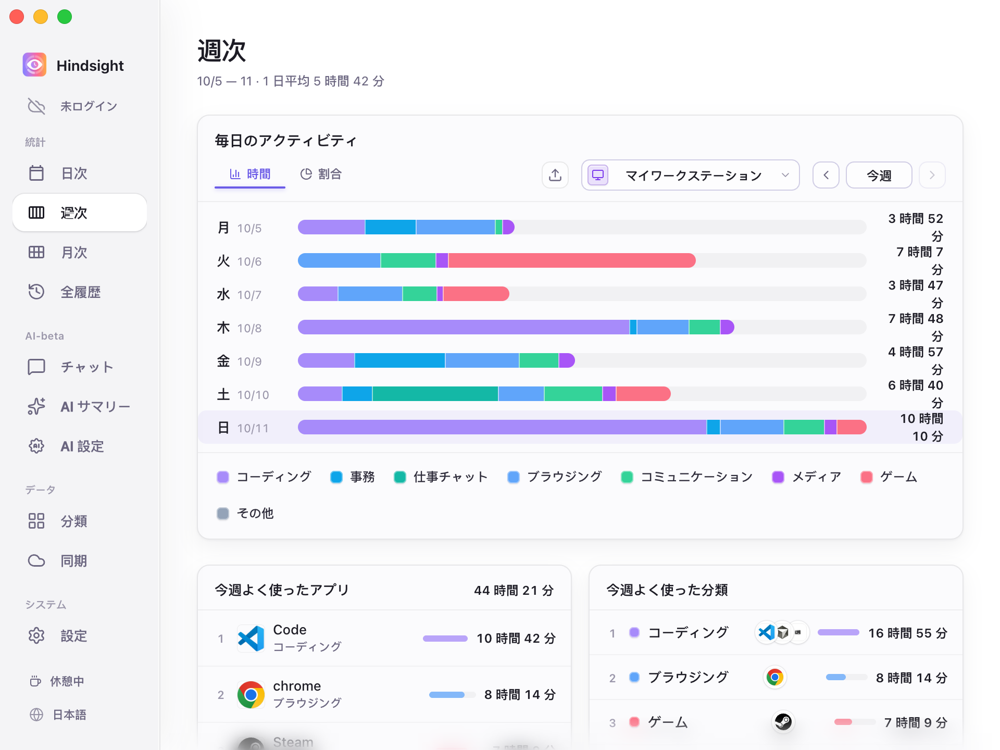
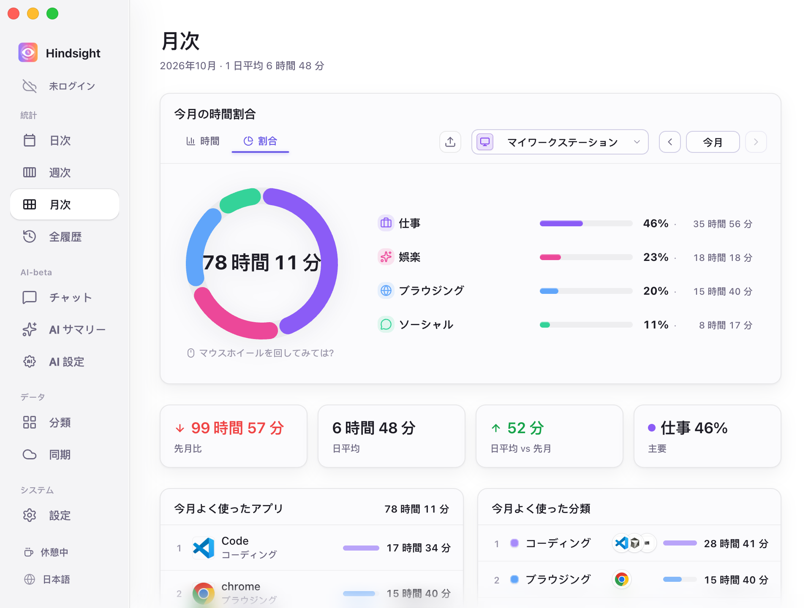
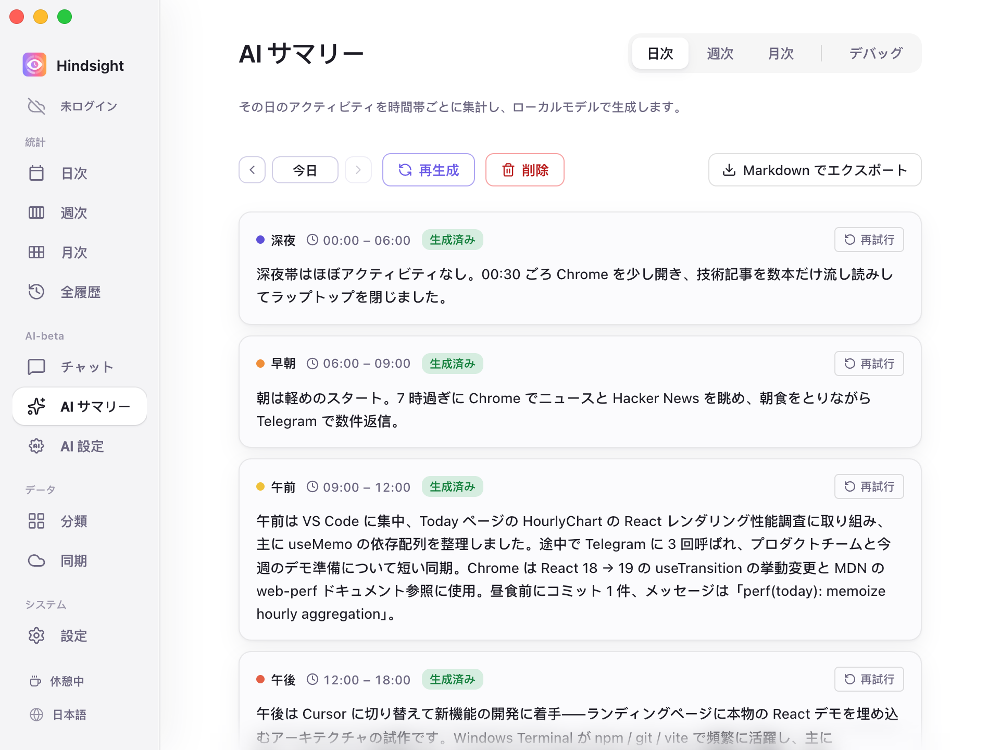
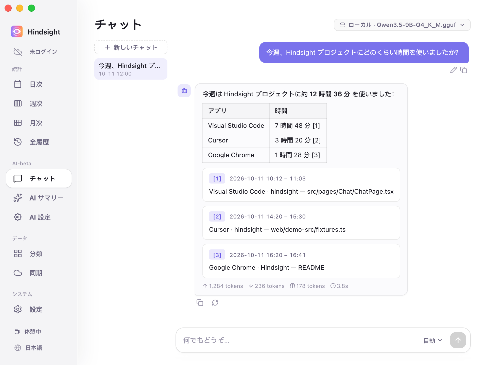
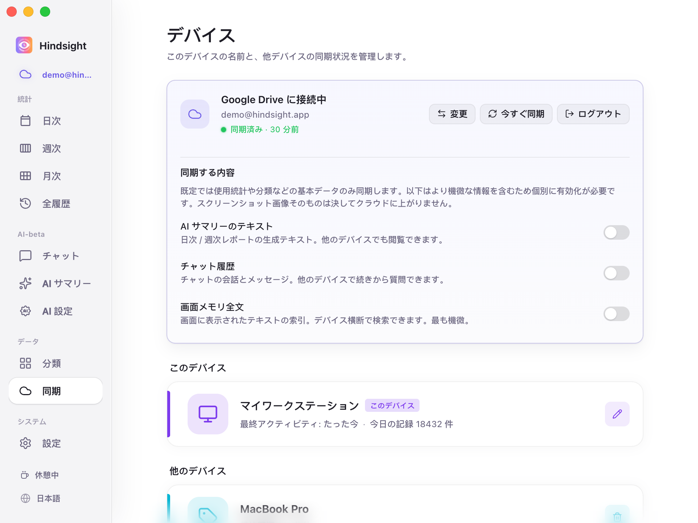

<p align="center">
  <picture>
    <source media="(prefers-color-scheme: dark)" srcset="../readme-banner-dark.png">
    
  </picture>
</p>
<p align="center">
<br/>
  パソコンのスクリーンタイム、集中を助けるポモドーロタイマー、仕事のリズムをまとめる AI。
</p>

<p align="center">
  <a href="../zh/README.md">简体中文</a> · <a href="../zh-TW/README.md">繁體中文</a> · <a href="../../../README.md">English</a> · <a href="../ja/README.md">日本語</a> · <a href="../pt/README.md">Português</a> · <a href="../es/README.md">Español</a>
</p>

<p align="center">
  <a href="https://github.com/Tomotsugu-dev/Hindsight/releases">
    
  </a>
  <a href="https://github.com/Tomotsugu-dev/Hindsight/releases">
    
  </a>
  <a href="https://github.com/Tomotsugu-dev/Hindsight/stargazers">
    
  </a>
  <a href="https://github.com/Tomotsugu-dev/Hindsight/actions/workflows/ci.yml">
    
  </a>
  <a href="../../../LICENSE">
    
  </a>
</p>
<p align="center">
  
  
  
</p>

<p align="center">
  <a href="https://github.com/Tomotsugu-dev/Hindsight/releases"><b>最新版をダウンロード</b></a> ·
  <a href="#インターフェースプレビュー">インターフェースプレビュー</a> ·
  <a href="#主な機能">主な機能</a> ·
  <a href="#クイックスタート">クイックスタート</a>
</p>

---

## インターフェースプレビュー

<p align="center">
  <video src="https://github.com/user-attachments/assets/d6036e77-ddfc-4896-b409-48f7fbab67ea" controls muted autoplay loop playsinline width="800"></video>
</p>
<p align="center">
  <sub><b>アプリプレビュー</b> · Hindsight の主要な操作を 1 分で</sub>
</p>

<p align="center">
  <br/>
  <sub><b>日次統計</b> · 24 時間の時間帯別積み上げグラフ × アプリ / カテゴリのダブルランキング。今日の時間の行き先が一目で</sub>
</p>

<p align="center">
  <br/>
  <sub><b>アプリ詳細</b> · アプリをクリックすると、その中で何をしていたかまで見える</sub>
</p>

<p align="center">
  <br/>
  <sub><b>週次統計</b> · 一週間の作業状況をひと目で</sub>
</p>

<p align="center">
  <br/>
  <sub><b>月次統計</b> · 日別の活動時間とアプリ / カテゴリランキングで、今月の時間の使い道を把握</sub>
</p>

<p align="center">
  <br/>
  <sub><b>今月の時間構成</b> · カテゴリ別の時間と割合に加え、合計・日平均・先月比をまとめて表示</sub>
</p>

<p align="center">
  <br/>
  <sub><b>AI 自動日報</b> · ローカル / クラウドモデルが時間帯ごとに当日の活動をまとめ、日報として出力</sub>
</p>

<p align="center">
  <br/>
  <sub><b>AI チャット</b> · 「今月 XX にどれくらい時間を使った？」と直接聞ける</sub>
</p>

<p align="center">
  <br/>
  <sub><b>マルチデバイス同期</b> · 複数台のパソコンを使う人に</sub>
</p>

## 主な機能

- **時間の使い道を把握** — パソコンの活動をバックグラウンドで自動記録し、さまざまなグラフで可視化。エンタメ、仕事など活動カテゴリ別に集計できます
- **AI 自動日報** — ローカルモデルが時間帯ごとに当日の活動をまとめ、日報を作成します
- **AI チャット** — 「今日何をした？」「今月 XX プロジェクトにどれくらい使った？」と直接質問。自分の記録に基づいて回答します
- **画面メモリ検索** — 画面に表示された文字を後から検索し、当時のスクリーンショットと時刻へ移動（スクリーンショットと文字認識はデフォルトでオフ、必要に応じて有効化）
- **マルチデバイス集約** — Google Drive または WebDAV で活動データを任意で同期し、複数のデバイスのデータをまとめて分析できます
- **ローカル・プライバシー優先** — データはデフォルトで本機のみに保存
- **プラグインマーケットに対応** — ユーザーや開発者がプラグインツールを自由に作成し、生産性をさらに高められます。詳しくは[プラグインマーケット](https://github.com/Tomotsugu-dev/hindsight-plugins)をご覧ください
- **カスタムテーマに対応** — 「設定 → 外観 → カスタムテーマ」からテーマファイルをインポートして、色、ライト / ダークモード、ページレイアウトをカスタマイズできます。

## クイックスタート

[Releases](https://github.com/Tomotsugu-dev/Hindsight/releases) からお使いのプラットフォーム用のインストーラーをダウンロードしてインストールしてください。

### Windows

`hindsight_x.y.z_x64-setup.exe` をダウンロードしてダブルクリックでインストールできます。

> ⚠️ インストーラーはまだコード署名されていないため、「WindowsによってPCが保護されました」と表示されることがあります。「詳細情報」→「実行」をクリックしてください。

### macOS

`hindsight_x.y.z_universal.dmg` をダウンロードし、ダブルクリックでマウントしてから Hindsight を「アプリケーション」フォルダにドラッグします。

### Linux

`hindsight_x.y.z_amd64.deb`（Ubuntu 22.04 以降、Debian 12 以降）または `hindsight-x.y.z-1.x86_64.rpm`（Fedora）をダウンロードしてインストールします。Wayland セッションでは GNOME 46 – 51 のみ対応しています。

#### Arch Linux

`yay` などの AUR ヘルパーで、AUR から [`hindsight-desktop`](https://aur.archlinux.org/packages/hindsight-desktop) をインストールします：

```bash
yay -S hindsight-desktop
```

パッケージはお使いのマシンでソースからビルドされ（数分かかります）、pacman でインストールされます。システムのほかのパッケージと一緒に更新できます（`yay -Syu`）。

## 謝辞

- [LINUX DO](https://linux.do/) コミュニティに感謝します。

## ライセンス

<p align="center">
  本プロジェクトは<a href="../../../LICENSE"><b>GPL 3.0</b></a>で公開されており、その条件に従って使用、改変、再配布できます。<br/>
  以前の MIT ライセンスと第三者のライセンスについては、<a href="../../../CONTRIBUTING.md#license">貢献ガイド</a>をご覧ください。<br/>
  <sub>© 2026 Hindsight contributors</sub>
</p>
