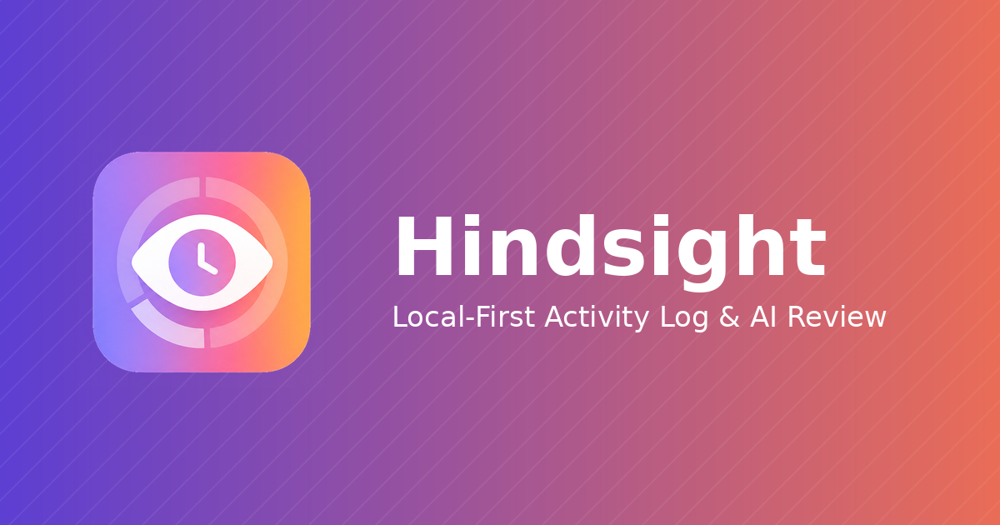
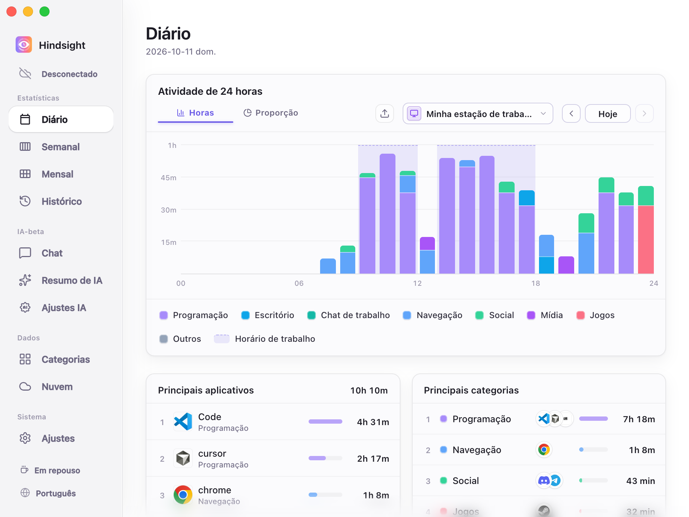
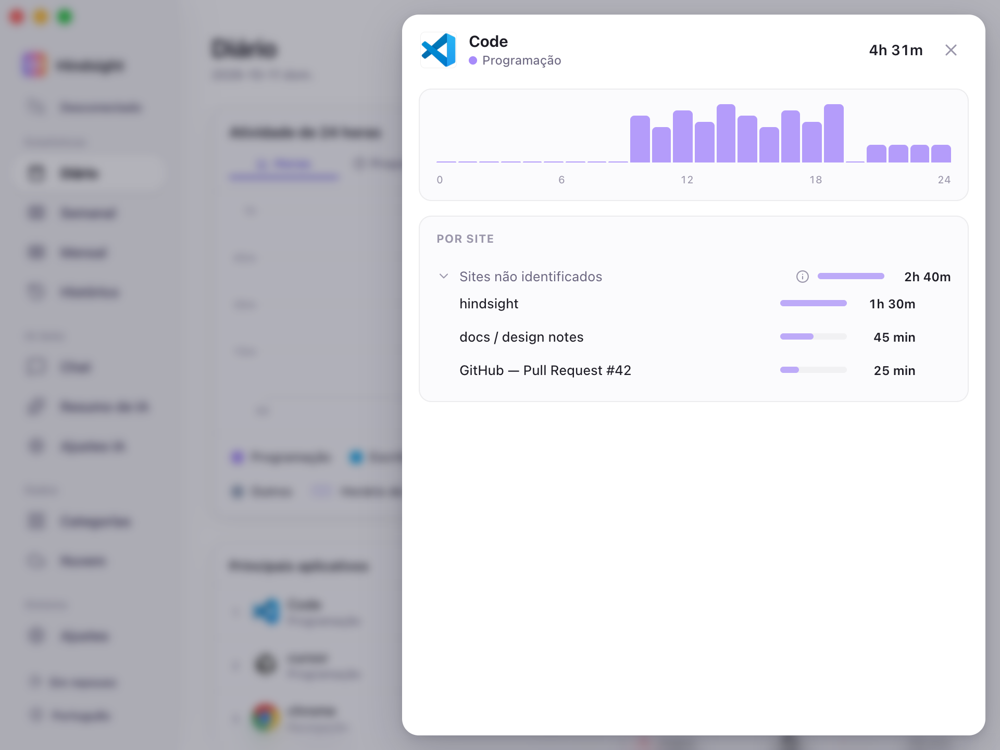
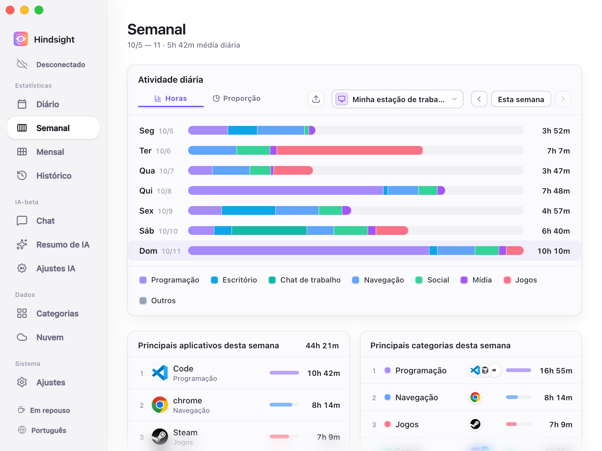
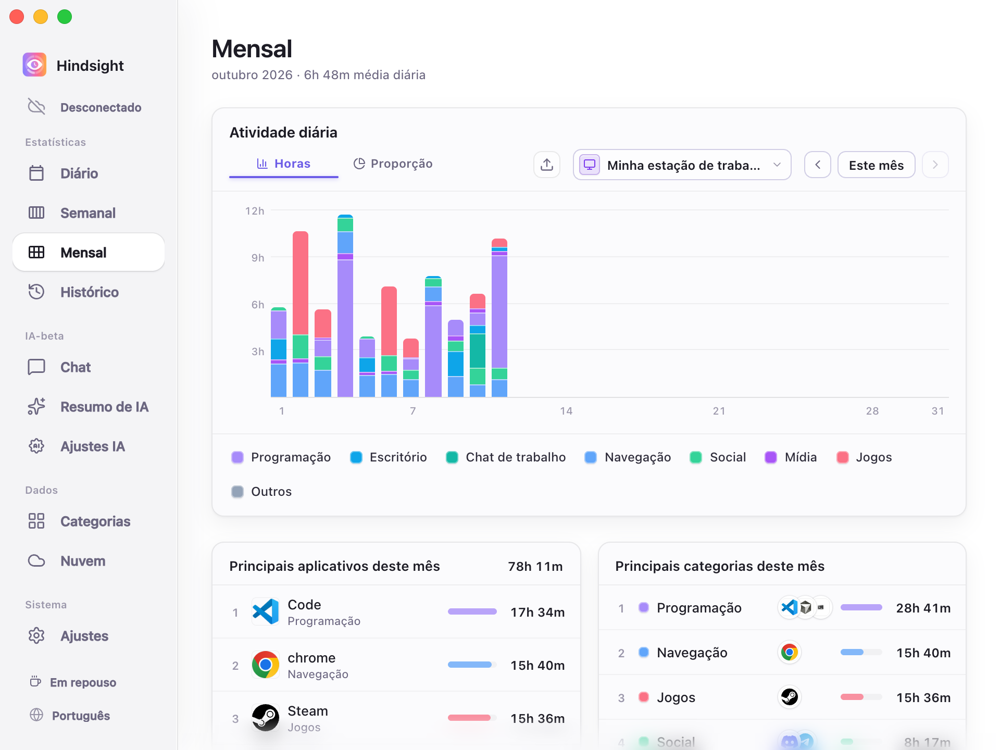
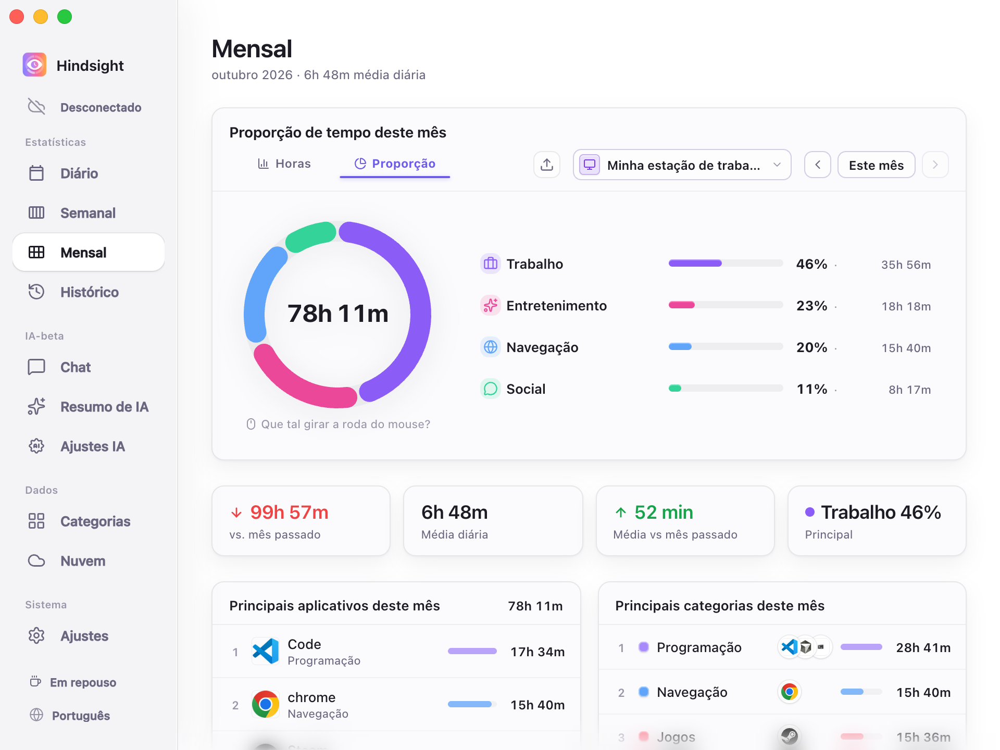
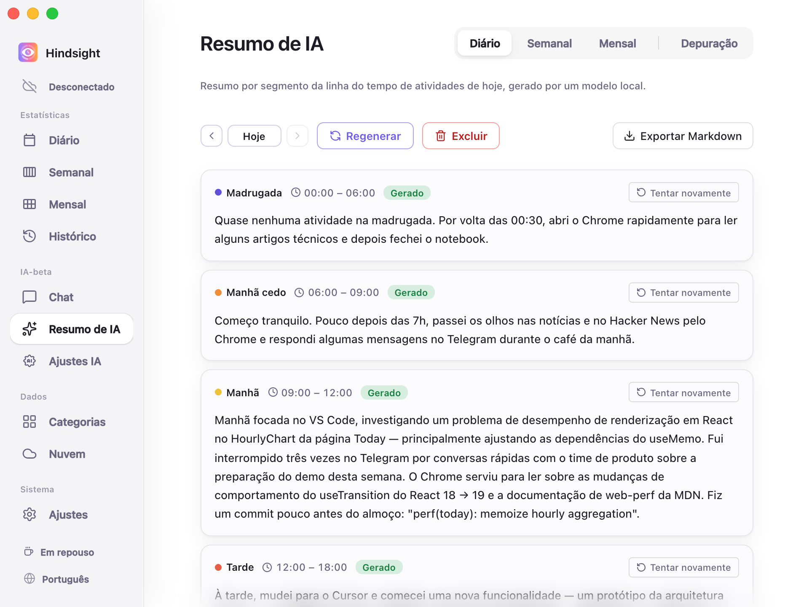
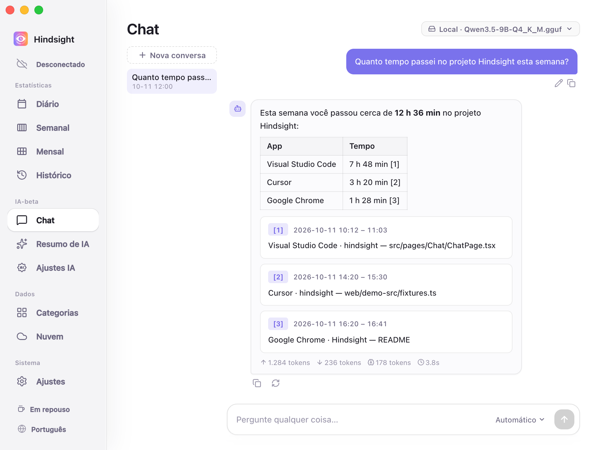
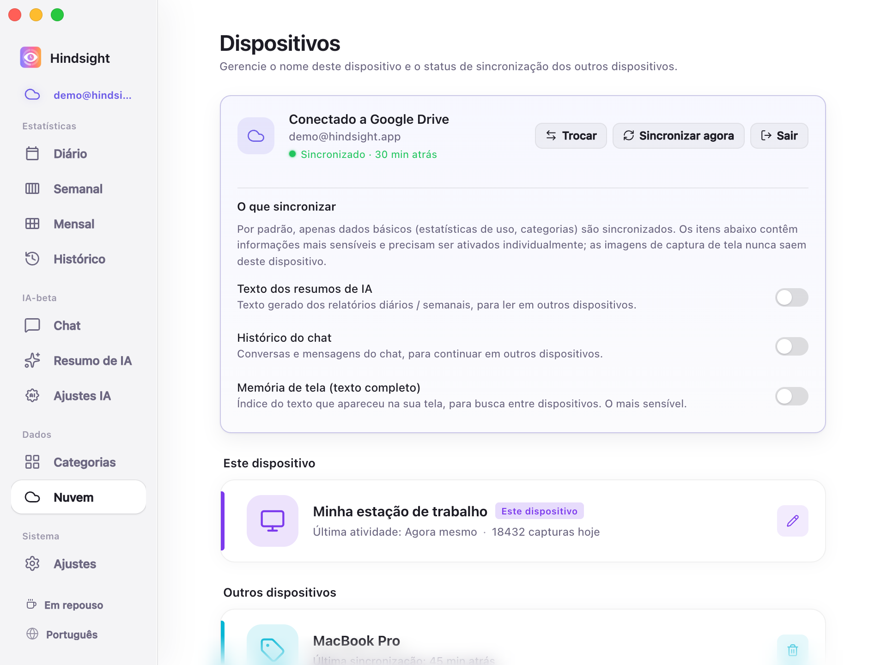

  

 
  Registra automaticamente apps e janelas e mostra para onde foi seu tempo por dia, semana e mês — sem cronômetro manual nem etiquetas de projeto para manter.

  <a href="../zh/README.md">简体中文</a> · <a href="../zh-TW/README.md">繁體中文</a> · <a href="../../../README.md">English</a> · <a href="../ja/README.md">日本語</a> · <a href="../pt/README.md">Português</a> · <a href="../es/README.md">Español</a>

  
  
  
  
  

  
  

  <a href="https://github.com/Tomotsugu-dev/Hindsight/releases"><b>Baixar a versão mais recente</b></a> ·
  <a href="#prévia-da-interface">Prévia da interface</a> ·
  <a href="#principais-recursos">Principais recursos</a> ·
  <a href="#começo-rápido">Começo rápido</a>

---

## Prévia da interface

  <video src="https://github.com/user-attachments/assets/5103236c-09ca-4f02-8fdc-b250160abc85" controls muted autoplay loop playsinline width="800"></video>

  <b>Prévia do app</b> · As interações principais do Hindsight em 1 minuto

   
  <b>Estatísticas diárias</b> · Gráfico empilhado de 24 horas × rankings de apps / categorias — veja para onde foi o seu dia num relance

   
  <b>Detalhe do app</b> · Clique em qualquer app para ver o que você estava fazendo dentro dele

   
  <b>Estatísticas semanais</b> · Sua semana inteira num relance

   
  <b>Estatísticas mensais</b> · Barras diárias com rankings de apps / categorias — veja para onde foi o tempo do mês

   
  <b>Estrutura do mês</b> · Tempo e proporção por categoria, com total, média diária e variação em relação ao mês anterior

   
  <b>Relatório diário por IA</b> · Um modelo local ou na nuvem resume as atividades do dia por período e gera um relatório

   
  <b>Chat com IA</b> · Pergunte direto, por exemplo: "quanto tempo passei em XX este mês?"

   
  <b>Sincronização multi-dispositivo</b> · Para quem usa mais de um computador

## Principais recursos

- **Veja para onde vai o seu tempo** — Registra automaticamente a atividade do computador em segundo plano, exibe os dados em vários gráficos e permite consultar estatísticas por categoria (trabalho, entretenimento etc.)
- **Relatório diário por IA** — Um modelo local resume as atividades do dia por período e as transforma em um relatório diário
- **Chat com IA** — Pergunte "o que eu fiz hoje?" ou "quanto tempo passei no projeto X este mês?" — respondido com base nos seus próprios registros
- **Busca na memória de tela** — Encontre qualquer texto que já apareceu na sua tela e vá direto à captura e ao momento (capturas e OCR vêm desativados por padrão, ative se quiser)
- **Agregação multi-dispositivo** — Sincronize opcionalmente os dados de atividade pelo Google Drive ou WebDAV e combine dados de vários dispositivos para análise
- **Local e privado por padrão** — Por padrão, os dados ficam na sua máquina
- **Mercado de plugins** — Usuários e desenvolvedores podem criar suas próprias ferramentas de plugin para aumentar a produtividade. Saiba mais no [Mercado de plugins](https://github.com/Tomotsugu-dev/hindsight-plugins)
- **Temas personalizados** — Importe um arquivo de tema em Configurações → Aparência → Temas personalizados para personalizar as cores, o modo claro ou escuro e o layout da página.

## Começo rápido

Baixe o instalador da sua plataforma em [Releases](https://github.com/Tomotsugu-dev/Hindsight/releases) e instale.

### Windows

Baixe `hindsight_x.y.z_x64-setup.exe` e clique duas vezes para instalar.

> ⚠️ **A primeira execução vai disparar o aviso "O Windows protegeu o seu PC"** — o instalador ainda não está assinado com um certificado de assinatura de código EV, então o SmartScreen vai bloqueá-lo. Clique em "Mais informações" → "Executar assim mesmo" para continuar.

### macOS

Baixe `hindsight_x.y.z_universal.dmg`, clique duas vezes para montar e arraste o Hindsight para a pasta Aplicativos.

## Licença

  Este projeto está disponível sob a <a href="../../../LICENSE"><b>GPL 3.0</b></a>. O uso, a modificação e a redistribuição são permitidos conforme seus termos. 
  Consulte o <a href="../../../CONTRIBUTING.md#license">guia de contribuição</a> sobre permissões MIT anteriores e licenças de terceiros. 
  © 2026 colaboradores do Hindsight

