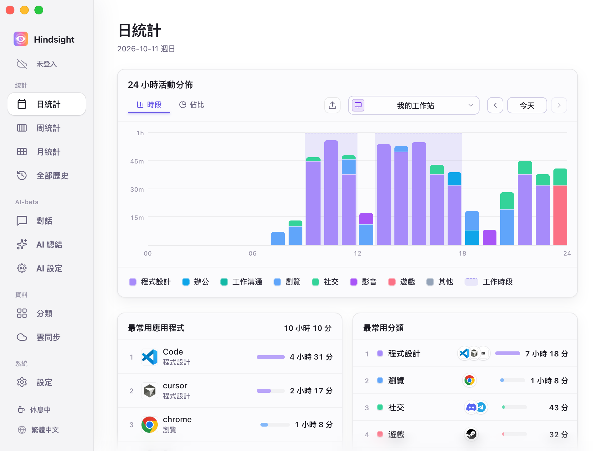
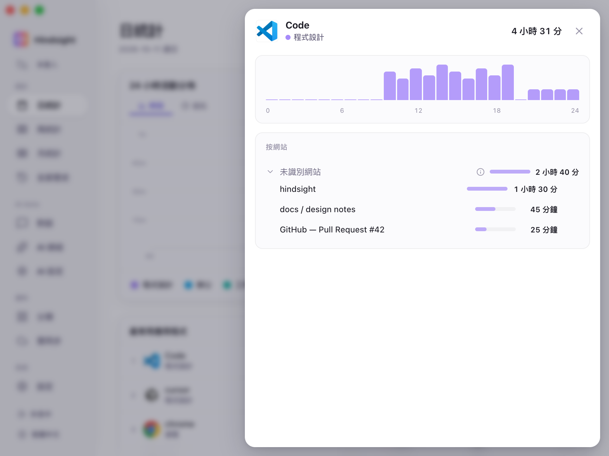
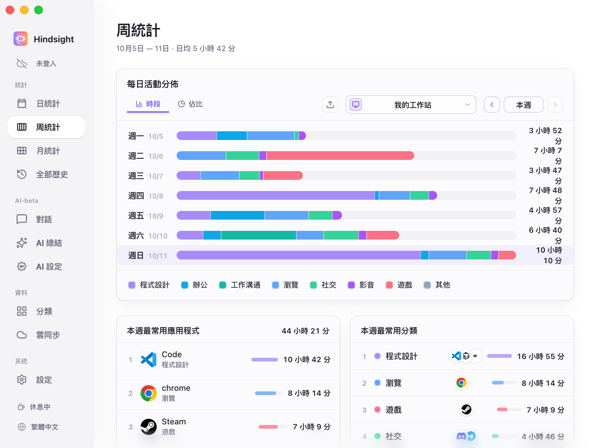
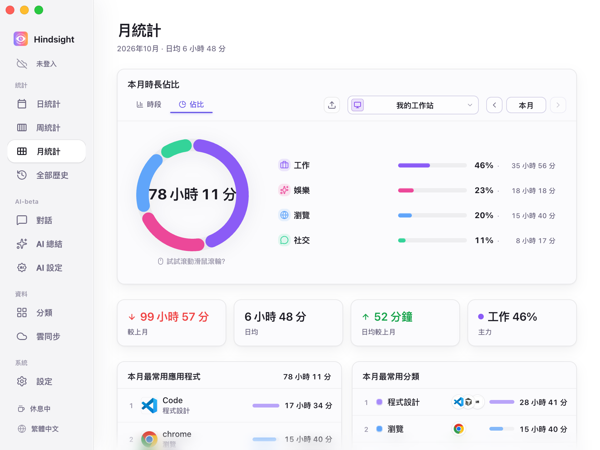
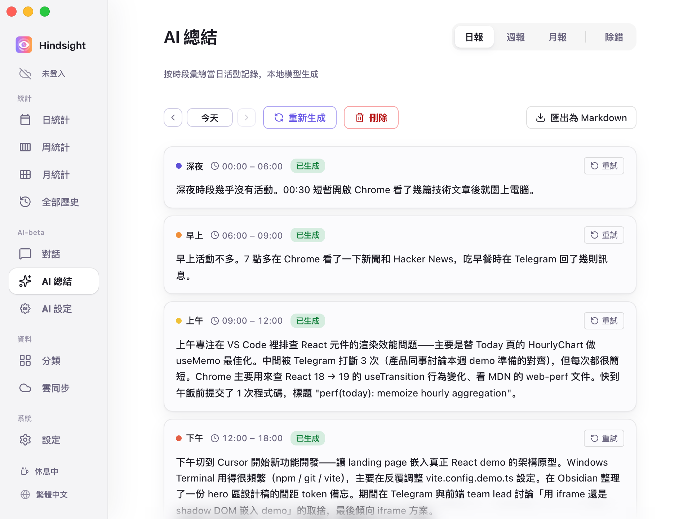
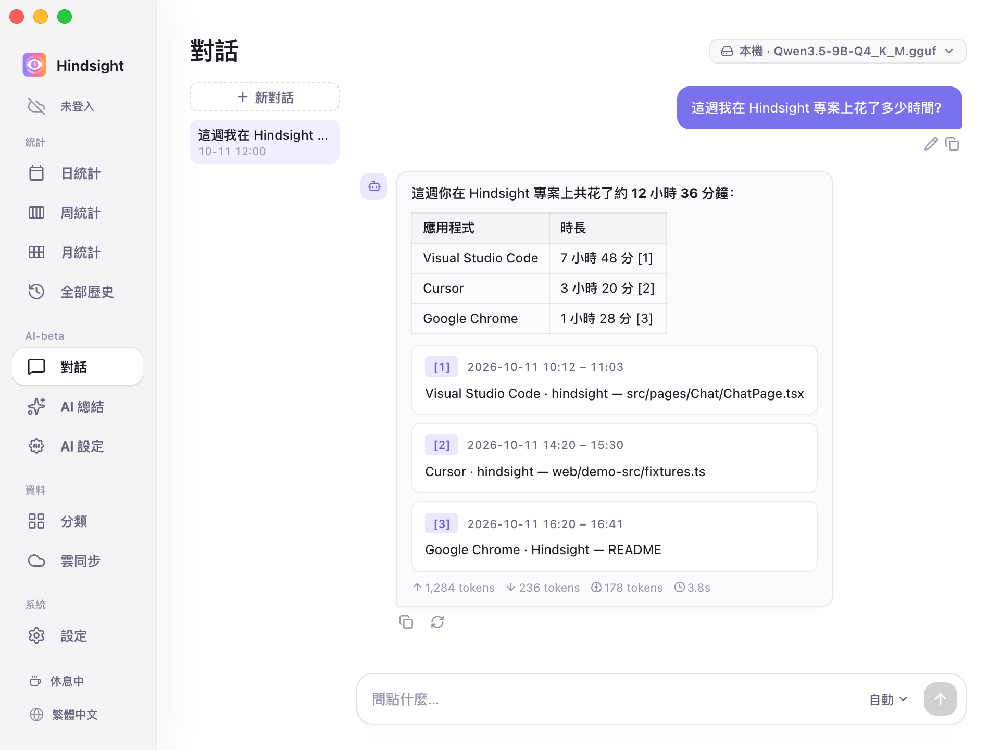
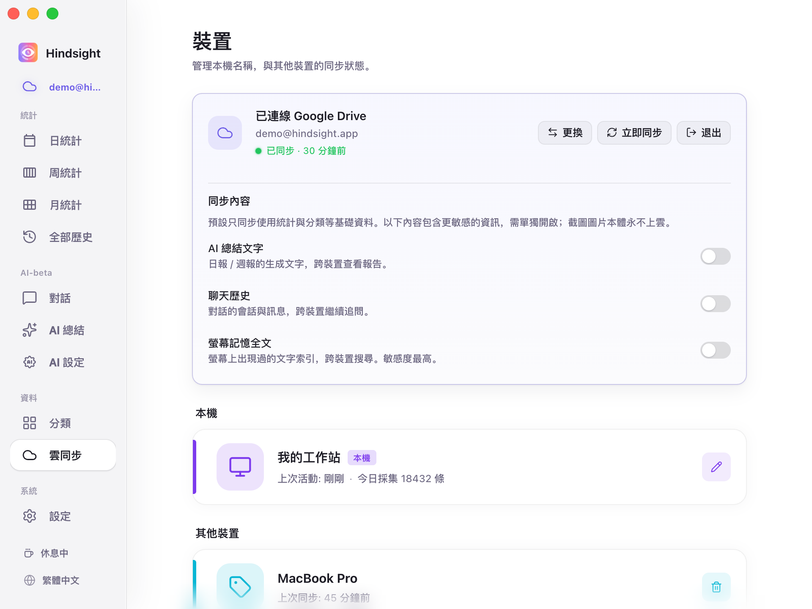

  

<h1 align="center">Hindsight</h1>

  <strong>本機優先的電腦活動日誌與 AI 復盤工具</strong> 
  自動記錄應用與視窗活動，按日、週、月還原時間去向；無需手動計時，也無需維護專案標籤。

  <a href="../zh/README.md">简体中文</a> · <a href="../zh-TW/README.md">繁體中文</a> · <a href="../../../README.md">English</a> · <a href="../ja/README.md">日本語</a> · <a href="../pt/README.md">Português</a> · <a href="../es/README.md">Español</a>

  
  
  
  
  

  
  

  <a href="https://github.com/Tomotsugu-dev/Hindsight/releases"><b>下載最新版</b></a> ·
  <a href="#介面預覽">介面預覽</a> ·
  <a href="#主要功能">主要功能</a> ·
  <a href="#快速開始">快速開始</a>

---

## 介面預覽

  <video src="https://github.com/user-attachments/assets/ce2ec848-a095-4c07-afac-c1b764f4862b" controls muted autoplay loop playsinline width="800"></video>

  <b>軟體預覽</b> · 1 分鐘看清 Hindsight 的核心互動

   
  <b>日統計</b> · 24 小時分時段堆疊圖 × 應用 / 分類雙排行，一眼看清今天的時間去向

   
  <b>應用明細</b> · 點開任意應用，看到都在應用中做什麼

   
  <b>週統計</b> · 一週七天的工作情況

   
  <b>月統計</b> · 按天展示各類活動時長，結合應用 / 分類排行，看清本月時間主要花在哪裡

   
  <b>本月時間結構</b> · 展示各類活動的時長與佔比，並彙總總時長、日均時長及較上月變化

   
  <b>AI 自動寫日報</b> · 本機 / 雲端模型按時段彙總當天的活動，寫成日報

   
  <b>AI 對話</b> · 直接問例如「這個月我在 XX 上花了多久」

   
  <b>多裝置同步</b> · 適合持有多台裝置的使用者

## 主要功能

- **看清時間花在哪** — 在背景自動記錄電腦活動，並以多種圖表呈現，也可依活動類別（娛樂、工作等）統計
- **AI 自動寫日報** — 本機模型按時段彙整當天的活動，寫成日報
- **AI 對話** — 直接問「我今天做了什麼」「這個月在 XX 專案上花了多久」，基於你自己的記錄回答
- **螢幕記憶搜尋** — 螢幕上出現過的文字都能搜回來，定位到當時的截圖與時刻（截圖與文字辨識預設關閉，按需開啟）
- **多裝置彙總** — 可選擇透過 Google Drive 或 WebDAV 同步活動資料，整合多台裝置的資料進行統計分析
- **本機·隱私優先** — 資料預設僅存本機
- **支援插件市集** — 使用者與開發者可自行打造插件工具，進一步提升生產力！詳情請見[插件市集](https://github.com/Tomotsugu-dev/hindsight-plugins)
- **支援自訂主題** — 使用者可在「設定 → 外觀 → 自訂主題」匯入主題檔，自訂配色、明暗模式與頁面版面配置。

## 快速開始

從 [Releases](https://github.com/Tomotsugu-dev/Hindsight/releases) 下載對應平台的安裝檔並安裝。

### Windows

下載 `hindsight_x.y.z_x64-setup.exe`，按兩下安裝即可。

> ⚠️ **首次執行會跳出「Windows 已保護你的電腦」** — 安裝檔尚未購買 EV 程式碼簽章憑證，會被 SmartScreen 攔下。點選「其他資訊」→「仍要執行」即可繼續安裝。

### MacOS

下載 `hindsight_x.y.z_universal.dmg`，按兩下掛載後將 Hindsight 拖入「應用程式」即可。

## License

  本專案基於 <a href="../../../LICENSE"><b>GPL 3.0</b></a> 開源，可依協議條款使用、修改與散布。 
  舊版 MIT 授權與第三方授權的說明請見<a href="../../../CONTRIBUTING.md#license">貢獻指南</a>。 
  © 2026 Hindsight contributors

