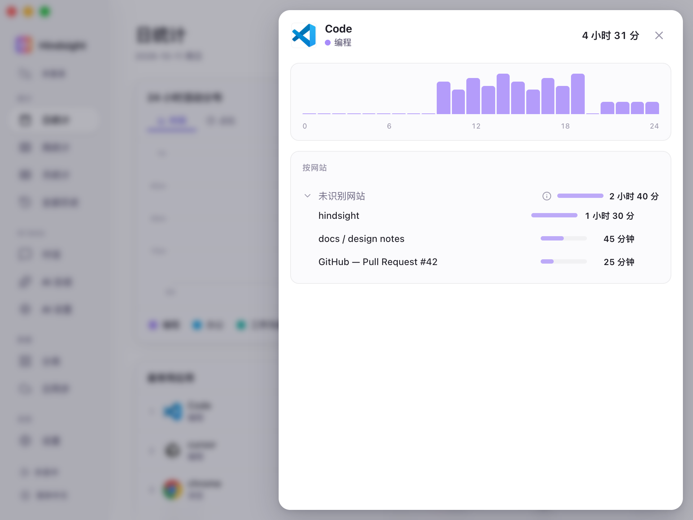
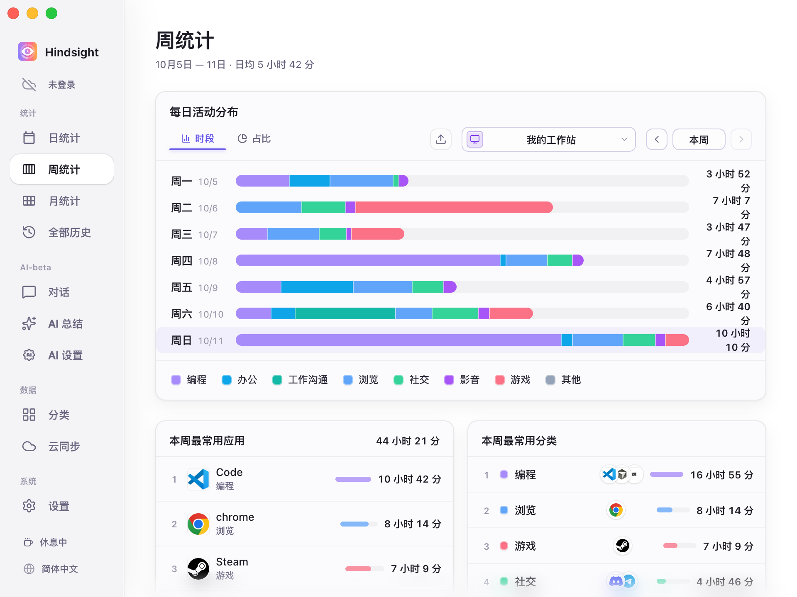
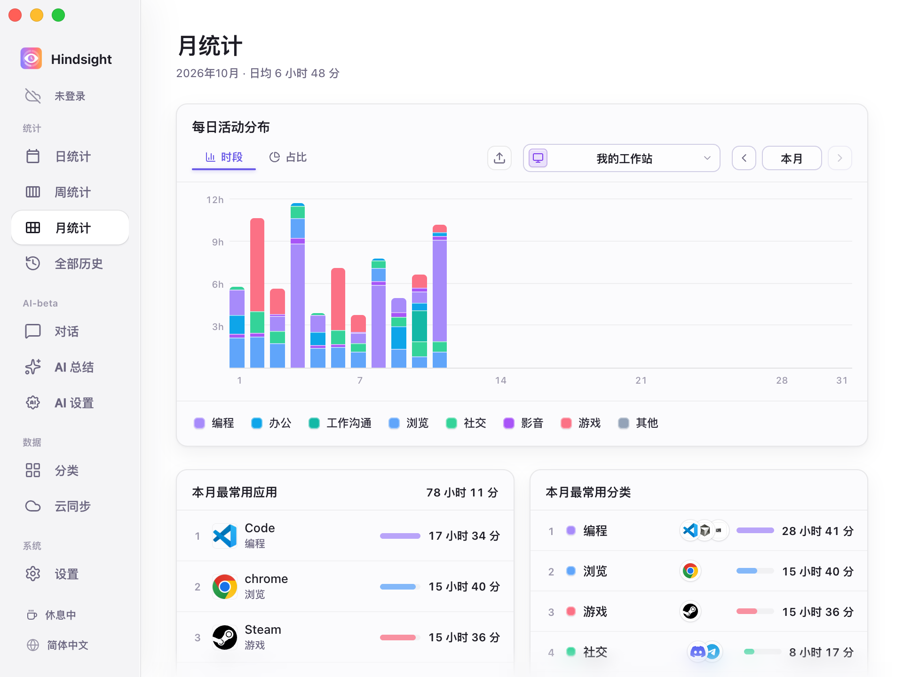
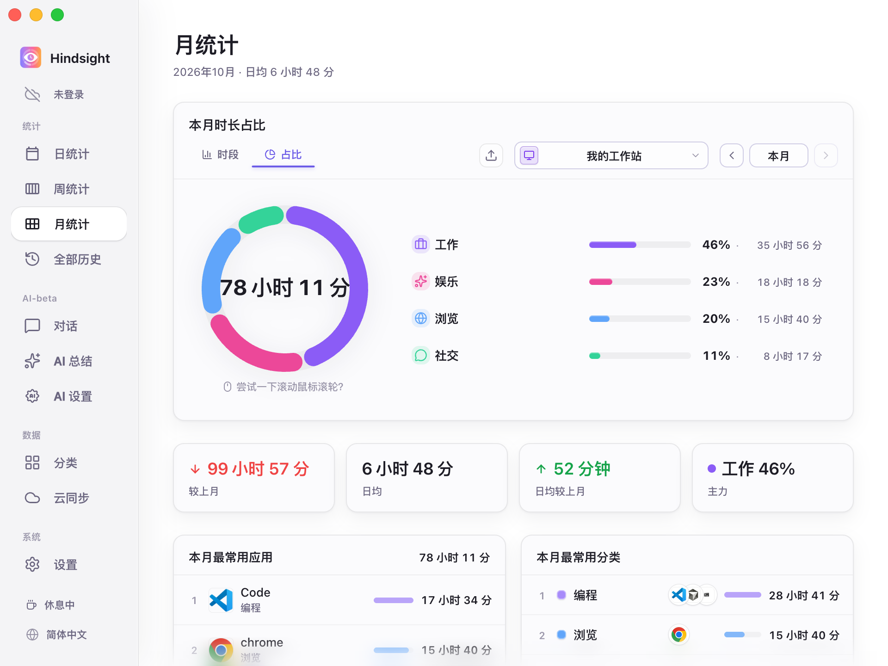
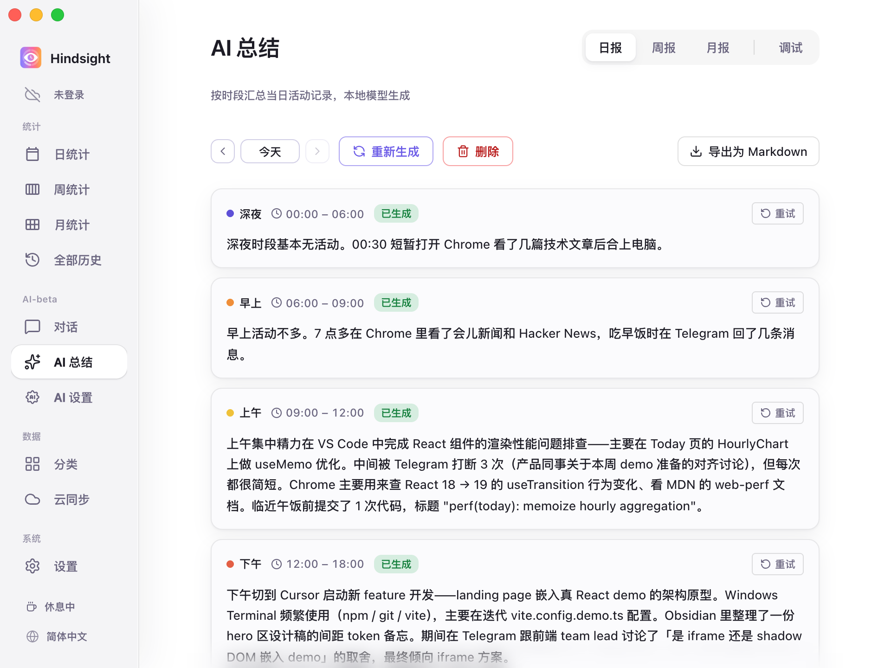
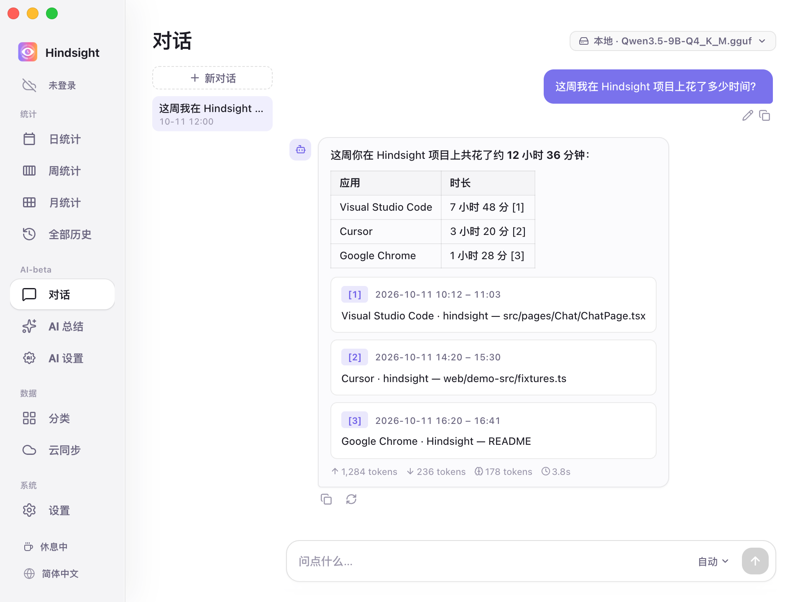
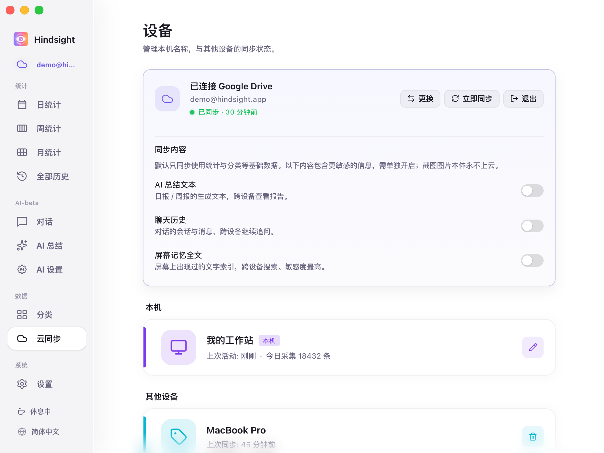

  <picture>
    <source media="(prefers-color-scheme: dark)" srcset="../readme-banner-dark.png">
    
  </picture>

 
  自动记录应用与窗口活动，按日、周、月还原时间去向；无需手动计时，也无需维护项目标签。

  <a href="../zh/README.md">简体中文</a> · <a href="../zh-TW/README.md">繁體中文</a> · <a href="../../../README.md">English</a> · <a href="../ja/README.md">日本語</a> · <a href="../pt/README.md">Português</a> · <a href="../es/README.md">Español</a>

  
  
  
  
  

  
  
  

  <a href="https://github.com/Tomotsugu-dev/Hindsight/releases"><b>下载最新版</b></a> ·
  <a href="#界面预览">界面预览</a> ·
  <a href="#主要功能">主要功能</a> ·
  <a href="#快速开始">快速开始</a>

---

## 界面预览

  <video src="https://github.com/user-attachments/assets/bff2c651-f3f6-4a8e-b930-b7547160144c" controls muted autoplay loop playsinline width="800"></video>

  <b>软件预览</b> · 1 分钟看清 Hindsight 的核心交互

   
  <b>日统计</b> · 24 小时分时段堆叠图 × 应用 / 分类双排行，一眼看清今天的时间去向

   
  <b>应用明细</b> · 点开任意应用，查看你在其中做了什么

   
  <b>周统计</b> · 一周的时间去向，一目了然

   
  <b>月统计</b> · 按天展示各类活动时长，结合应用 / 分类排行，看清本月时间主要花在哪里

   
  <b>本月时间结构</b> · 展示各类活动的时长与占比，并汇总总时长、日均时长及较上月变化

   
  <b>AI 自动写日报</b> · 本地 / 云端模型按时段汇总当天的活动，写成日报

   
  <b>AI 对话</b> · 直接问例如「这个月我在 XX 上花了多久」

   
  <b>多设备同步</b> · 适合使用多台电脑的用户

## 主要功能

- **看清时间花在哪** — 后台自动记录电脑活动，可视化出多种图表，并可按活动类别（娱乐、工作等）进行统计。
- **AI 自动写日报** — 本地模型按时段把当天的活动写成日报
- **AI 对话** — 直接问「我今天做了什么」或「这个月在 XX 项目上花了多久」，AI 会基于你自己的活动记录回答
- **屏幕记忆搜索** — 屏幕上出现过的文字都能搜回来，定位到当时的截图与时刻（截图与文字识别默认关闭，按需开启）
- **多设备汇总** — 可选 Google Drive 或者 WebDAV 同步活动数据，可整合多台设备的数据进行统计分析
- **本地·隐私优先** — 数据默认仅存本机
- **插件市场** — 用户和开发者可以创建自己的插件工具，提高生产效率。详情见 [插件市场](https://github.com/Tomotsugu-dev/hindsight-plugins)
- **支持自定义主题** — 用户可以在「设置 → 外观 → 自定义主题」导入主题文件，自定义配色、明暗模式和页面布局。

## 快速开始

从 [Releases](https://github.com/Tomotsugu-dev/Hindsight/releases) 下载对应平台的安装包并安装。

### Windows

下载 `hindsight_x.y.z_x64-setup.exe`，双击安装即可。

> ⚠️ 安装包还没有代码签名，Windows 可能会弹出「Windows 已保护你的电脑」。点击「更多信息」→「仍要运行」即可。

### macOS

下载 `hindsight_x.y.z_universal.dmg`，双击挂载后将 Hindsight 拖入「应用程序」文件夹。

### Linux

下载 `hindsight_x.y.z_amd64.deb`（Ubuntu 22.04 及以上、Debian 12 及以上）或 `hindsight-x.y.z-1.x86_64.rpm`（Fedora）并安装。Wayland 会话里只支持 GNOME 46 – 51。

## 致谢

- 感谢 [LINUX DO](https://linux.do/) 社区。

## 许可证

  本项目基于 <a href="../../../LICENSE"><b>GPL 3.0</b></a> 开源，可按协议条款使用、修改与分发。 
  旧版 MIT 授权与第三方许可证的说明见<a href="../../../CONTRIBUTING.md#license">贡献指南</a>。 
  © 2026 Hindsight 贡献者

